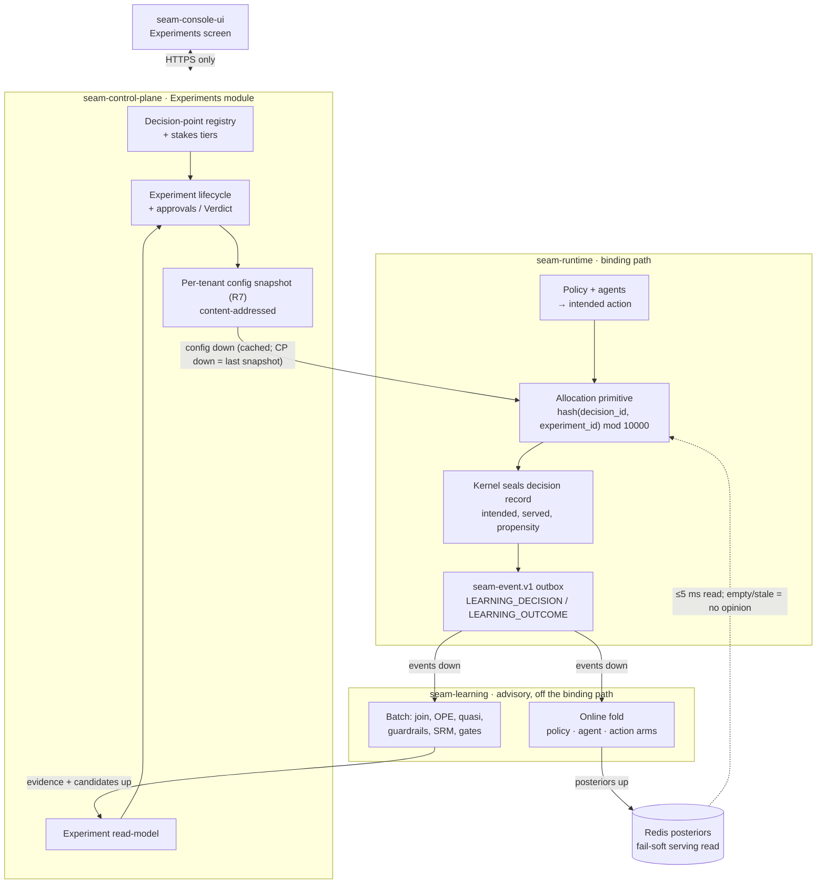
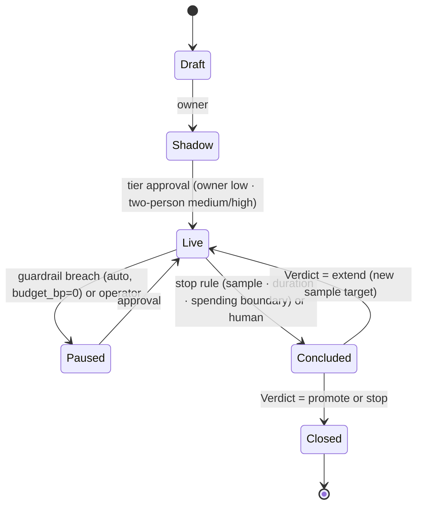

# Branchpoint — Design

Oct 30, 2026 · @Ajit Koti

## What Branchpoint is

Branchpoint is Seam's experimentation system for decisions: a product (the Experiments surface an AI or risk lead works in), a platform (the estimators, gates and evidence behind it) and a runtime capability (the allocation primitive that decides what a given decision tries). It answers one question: **which policy is better, and how do we know?**

The rule that splits it from seam-learning: **seam-learning learns and improves policy; Branchpoint experiments with decisions.** Branchpoint spends a budget of decisions to buy evidence; seam-learning spends evidence to buy a better policy. Branchpoint never changes a policy. seam-learning never chooses what a single decision tries.

It is not a new plane. It is one new mechanism in the runtime, additive work in seam-learning, and an Experiments module in the control plane and console. It reuses every estimator, gate and ledger seam-learning already has (see branchpoint-boundary.md for the inventory).

Buyer: the AI or data-science lead who already runs Seam and has traffic to experiment over. Pairing line: Branchpoint finds the better policy by trying it forward and testing it backward; Changeset ships every action it produces safely.

## Principles

1. **Decisions are the unit, not sessions or users.** Every allocation is made at a sealed decision point and recorded on that decision. Outcomes land weeks later and join back by `decision_id`.
2. **The propensity is sealed at decision time.** No allocation happens without logging the probability it happened with. An experiment whose propensities cannot be logged is refused, not approximated.
3. **Nothing on the binding path depends on anything new.** The allocation primitive is a pure, deterministic function of the decision id and a locally cached config snapshot (R7). Learning state is read through the existing serving read; empty or stale means no opinion.
4. **One learner.** Posteriors live in seam-learning. Branchpoint configures allocations over arms; it never computes or stores a posterior of its own.
5. **Evidence is produced as a by-product, never reconstructed.** Every number on a report traces to sealed records and the actuation ledger.
6. **A human promotes, and the record says who.** Auto-promote exists only behind seam-learning's existing gates. Quasi-experimental estimates never feed it.
7. **Known vocabulary only.** Experiment, variant, holdout, allocation, guardrail metric, promotion. Never self-learning, self-improving, or guardrails alone.
8. **Enablement, never fear.** Branchpoint's question is improvement, not permission. Permission is Changeset's story.

## Objects

Ten objects. Four exist today in seam-learning or the runtime; six are new, and all six live in the control plane's Experiments module except the allocation itself, which is sealed by the runtime.

| Object | What it is | Owner | Status |
| --- | --- | --- | --- |
| Decision point | A named place a policy produces an action (`fraud.auth.decide`). Task type plus the action space (`approve / decline / review`). | Control plane registry | New |
| Policy variant | A versioned policy the experiment compares (threshold 75 vs 65, rules v12 vs v13, model B). Content-addressed. | Control plane config bundles | Exists as config snapshots |
| Action arm | One action from the decision point's space, keyed like a policy arm with `dimension: action`. | Runtime emits, learning folds | New dimension on an existing key |
| Experiment | The accountable object: question, decision point, variants or arms, allocation mode, budget, stakes tier, guardrails, stop rules, owner, approvals. | Control plane | New |
| Allocation | What one decision was told to try: mode, intended action, served action, propensity, budget epoch. Sealed on the decision record. | Runtime | New fields, schema-additive |
| Budget | Basis points of decisions per epoch an experiment may spend on non-default actions. Capped by stakes tier. | Control plane sets, runtime enforces | New |
| Stakes tier | Which allocation modes and budgets a decision point admits. Set once per decision point, changed only through approval. | Control plane | New |
| Outcome | What happened: `correct`, plus scalar `reward` and named `metrics` (loss, fee, false-decline cost). Joined by `decision_id` within the unit's horizon. | Runtime emits, learning joins | `correct` exists; scalar is new |
| Evidence | A report over one experiment: forward (live split) and backward (replay) estimates, guardrails, SRM, sample sizes, refusals. | Learning computes, control plane serves | Mostly exists |
| Verdict | The signed promotion, stop or extension: who, on what evidence, under which approval, over which content digest. | Control plane approval plus actuation ledger | Exists |

## Architecture

Three layers, each already a repo. The control plane owns the Experiment and publishes it as a config snapshot. The runtime enforces the allocation and seals the record. seam-learning folds the outcomes, computes the estimates, and hands candidates back to the control plane. The console presents; it talks to nothing but the control plane.

*Branchpoint across the three layers · config down, events down, posteriors and evidence up.*



Two loops. The fast loop is runtime to learning to runtime: sealed decisions and outcomes flow out through the outbox, posteriors flow back through Redis. The slow loop is learning to control plane to runtime: evidence becomes a candidate, a human approves, the snapshot changes. Neither loop adds a dependency to the binding path. Redis empty means no opinion; the control plane down means the last snapshot.

## Runtime layer: the allocation primitive

The one new mechanism. It sits after the policy and agents produce the intended action and before the kernel seals, inside seam-runtime. It is not in the orchestrator (that is policy selection, which is learning's) and not in a connector (too late; the action is sealed).

**What it does, per decision.**

1. Look up the decision point in the locally cached snapshot. No experiment, or budget zero: seal the intended action with `propensity = 1.0` and no experiment fields. This is the path every decision takes today.
2. Compute `bucket = hash(decision_id, experiment_id) mod 10000`. Pure, replayable, no clock, no RPC.
3. Apply the mode (see Allocation modes). Holdout: served differs from intended iff `bucket < budget_bp`. Fixed split: the bucket picks the variant. Adaptive or contextual: sample the action arm from posteriors read through the existing serving read; empty or stale posteriors mean no opinion, and the experiment's declared fallback applies (fixed allocation or no holdout).
4. Seal both actions and the propensity on the decision record. Emit `LEARNING_DECISION` with `dimension: action` beside the policy and agent dimensions.

**Binding-path rules it must keep (R7, one-way door).**

- Config arrives only as a content-addressed control-plane snapshot, cached locally. Control plane unreachable means the last snapshot, never a stall.
- Learning state is read only through the serving read that already exists, under the same 5 ms budget. Nothing new is awaited.
- The agent is never told it was held out. The served action does not leak back into the session context.
- A served action that differs from the intended one is still a staged write. Changeset ships it; Branchpoint only chose it.

**Refusals, fail-closed.** An experiment is refused at snapshot load, not at decision time, when its budget exceeds the stakes tier cap, its mode is not admitted by the tier, its decision point is unregistered, or its budget is below the identifiability floor (Decisions needed, item 4). A refused experiment allocates nothing; every decision seals the intended action.

## Learning layer: what folds, what evaluates

seam-learning gains an action dimension and a scalar reward; everything else is reuse. Its charter does not change: external, event-driven, advisory, never on the binding path, no operator surface of its own.

| Change | Where | Size |
| --- | --- | --- |
| Action arms: fold `dimension: action` rows into their own posteriors, keyed `(tenant, task_type, context_class, mode, served_action)` | `crates/online`, `batch/relearn.py`, `join.py` | additive; arm-key shape unchanged |
| Scalar reward: `reward: f64` and `metrics: map` beside `correct`; Beta fold stays for `correct`, a Gaussian or bucketed fold for `reward` | `types.rs`, `join.py`, new fold path | the one design choice (Decisions needed, item 2) |
| Per-unit outcome horizon: 48h default is wrong for disputes at day 90 to 120 | `SEAM_OUTCOME_HORIZON_MS` per unit | configuration, not code |
| New targets for replay: `RuleReplayTarget` (a deterministic rule over logged context), `FixedPolicyTarget` (a named variant) | `target.py` | small; same estimators |
| Policy-variant experiments: arms carry a variant, not an algorithm pair | `ExperimentConfig`, `experiment_analysis.py` | moderate; analysis reused |
| Quasi-experimental estimators: regression discontinuity at thresholds, interrupted time series, difference-in-differences | new `batch/quasi.py` | moderate; offline only |
| Experiment-scoped evidence: every estimate, refusal and SRM result keyed by `experiment_id` | `experiment_analysis.py`, `ope_status.py`, `shadow_report.py` | small |

What it already does, unchanged, and Branchpoint depends on: propensity-guarded OPE (`assert_ope_identifiable` refuses windows with any null or all-1.0 propensity), cross-fitted doubly-robust estimation, O'Brien–Fleming spending so daily looks do not inflate false positives, SRM checks, the safety gate (PASS / HOLD / REVIEW), the non-inferiority quality gate, trust-weighted `verified_by`, and the actuation ledger.

The two rules that keep the layers apart: learning never reads an experiment's stop rule or budget (those are control-plane facts it reports against, not enforces), and learning never chooses what a decision tries (the runtime does, from the snapshot).

## Control-plane layer: the Experiment and its lifecycle

The control plane owns everything a person is accountable for: the Experiment object, the registry of decision points and stakes tiers, the approvals, the read-model the console renders. This is where the boundary map already puts operator surfaces; Branchpoint adds an Experiments module, not a plane.

*Experiment lifecycle · 6 states, every forward transition gated.*



**Transitions and who makes them.** Draft to Shadow is the owner's. Shadow to Live needs the approval the stakes tier demands: owner for low, two-person for medium and high. Live to Paused is automatic on a guardrail breach (learning's evaluation flags it, the control plane publishes a snapshot with budget zero) or manual. Paused to Live is an approval. Live to Concluded is the experiment's stop rule (sample target, duration, or a significant result under the spending boundary) or a human. Concluded to Closed is the Verdict: promote (a candidate goes through the existing approval and lands in the actuation ledger), stop, or extend back to Live with a new sample target.

**What the control plane publishes.** One content-addressed snapshot per tenant containing every live experiment: decision point, mode, variants or arms, `budget_bp`, epoch, fallback, tier. The runtime caches it; a change takes effect at the next snapshot pull. There is no other channel to the runtime.

**What the read-model serves.** Per experiment: exposure and SRM, forward estimates (live split) and backward estimates (replay), guardrail metrics against their limits, refusals with reason codes, the shadow tally, and the Verdict trail. Quasi-experimental estimates carry a label the console cannot hide. The console presents; it computes nothing and talks to nothing else.

## Allocation modes

Five modes. Every one allocates at a decision point, logs a propensity, and uses `bandit-core` math where it samples. None adds an algorithm; the adaptive modes read posteriors seam-learning already maintains.

| Mode | What one decision does | Propensity logged | Computed by | Tiers admitted |
| --- | --- | --- | --- | --- |
| Shadow | Variant computes its action; the intended action is served; both recorded | 1.0 (nothing changed) | runtime | all |
| Holdout | A budgeted slice takes a non-default action (the control slice: approve a share of would-be declines) | `budget_bp / 10000` for the held-out action | runtime, deterministic bucket | all; budget capped per tier |
| Fixed split | Each decision gets a policy variant by bucket, sticky by session | the variant's weight | runtime | all |
| Adaptive | Thompson sample over action arms per context class | Monte-Carlo `P(action)`, as today for policy arms | learning posteriors, runtime samples | low, medium |
| Contextual | LinUCB over action arms with served features, ε per DECISION-002 | `(1 − ε) + ε/K` or `ε/K` | learning fits, runtime scores | low |

**Why bandits live here without breaking the rule.** Branchpoint declares the arms, the context class, the budget and the fallback. seam-learning learns the posteriors. The runtime samples from them exactly as it samples policy arms today. Two learners over one posterior would disagree; this design has one.

**Decentralized allocation is deferred.** Allocation by each agent or node without the runtime breaks SRM and propensity accounting unless every node logs and the join reconciles. The narrow forms that matter already exist: per-tenant independent allocation (`units.py`) and the aggregated prior network for cold start. Revisit when a design partner's agents must decide while partitioned from the runtime.

## Hindsight: testing backward

Hindsight answers "had variant B been live over this window, what would the outcomes have been?" It runs in seam-learning's batch over sealed decisions, and it has two families with different honesty.

**Off-policy evaluation (randomized evidence).** IPS, SNIPS and doubly-robust estimates over decisions that carry a real propensity. The target is a named object: `GreedyTarget` (exists), `RuleReplayTarget` (a deterministic rule over logged context, for threshold and rules changes), `FixedPolicyTarget` (a registered variant). Windows are restricted the way `ope_window.py` already does, and `assert_ope_identifiable` refuses any window with a null or all-1.0 propensity. This is the only family that can feed a promotion.

**Quasi-experimental estimates (observational evidence).** For decision points whose tier refuses randomization, or for history recorded before an experiment existed.

- Regression discontinuity at thresholds. A threshold policy is an RD design by construction: decisions just above and below the cutoff are near-identical and received different actions. First estimator to build; it needs no budget and the data already exists in every scored deployment.
- Interrupted time series for an ungated rule change at a known time.
- Difference-in-differences and synthetic control for a change rolled to some segments or tenants and not others.

Every quasi-experimental number carries a label the read-model and console cannot drop, states its identifying assumption in one line, and never enters `auto_promote.decide`. It can open an experiment; it cannot close one.

**Foresight and Hindsight are the same data.** The live split is read forward; the replay is read backward. One record, one join, one estimator set.

## Guardrails, budgets, stop

**Budget.** Basis points of decisions per epoch an experiment may allocate away from the intended action. Enforced in the runtime by the deterministic bucket, so the realized share converges to the budget without coordination and is auditable from the records alone. The stakes tier caps the maximum; the identifiability floor sets the minimum below which the experiment is refused as unevaluable.

**Stakes tiers.** Set per decision point, changed only by approval.

| Tier | Modes admitted | Max budget | Goes live by |
| --- | --- | --- | --- |
| Low | all five | 2000 bp | owner |
| Medium | shadow, holdout, fixed split, adaptive | 500 bp | two-person approval |
| High | shadow, holdout, fixed split | 100 bp | two-person approval; quasi-experimental evidence required first |

The numbers are placeholders for the first design partner to ratify, in the same way `DEFAULT_MARGIN` and `DEFAULT_MIN_N` were ratified from the first unit's evidence.

**Guardrail metrics.** Declared on the Experiment as metric, direction and limit (false-decline rate up by no more than 0.5 points; loss per thousand decisions up by no more than X). seam-learning evaluates them on every offline run against the same joined window as the primary estimate. A breach is a fact the control plane acts on, not something learning enforces.

**Stop.** A breach, an operator pause or a concluded experiment all take the same path: the control plane publishes a snapshot with `budget_bp = 0`; the runtime stops allocating at the next pull. There is no second actuator and no call into the runtime. The latency is one snapshot interval, which is a number to state to the buyer, not hide.

**Refusals are evidence.** Every refusal (tier, floor, identifiability, SRM, unregistered decision point) is recorded with a reason code and shown on the experiment, the way `shadow_report.py` already treats a refused auto-promote.

## Schemas

All changes are schema-additive. A decision outside any experiment serializes byte-identically to today.

**Decision record and `LEARNING_DECISION` (runtime emits).**

```csv
field,type,note
experiment_id,string?,absent outside an experiment
allocation_mode,enum?,"shadow | holdout | split | adaptive | contextual"
variant_id,string?,the policy variant served (split modes)
intended_action,string?,what the policy produced
served_action,string?,what was sealed (equals intended unless held out)
propensity,f64,"P(served | context, mode); 1.0 outside an experiment"
budget_bp,u16?,the budget in force at decision time
budget_epoch,string?,the epoch the budget was counted in
dimension,enum,"policy | agent | action (new value)"
```

**`LEARNING_OUTCOME` (runtime emits, learning joins).**

```csv
field,type,note
decision_id,string,join key (exists)
correct,bool,exists; Beta fold
reward,f64?,scalar outcome (new)
metrics,map<string f64>?,named guardrail metrics (new)
verified_by,string?,provenance (exists)
```

**Experiment (control plane, published in the snapshot).**

```csv
field,type,note
experiment_id,string,content-addressed with the rest of the snapshot
decision_point,string,registered name; carries the action space and tier
mode,enum,one of the five
variants | arms,list,policy variants (split) or actions (holdout, adaptive, contextual)
budget_bp,u16,capped by tier
epoch,duration,budget counting period
fallback,enum,"none | fixed when posteriors give no opinion"
guardrails,list,"metric, direction, limit"
stop_rule,struct,"sample target, max duration, spending boundary"
owner,principal,accountable person
approvals,list,approval references; the Verdict trail
```

The action arm key keeps the existing five-part shape with `served_action` in the candidate slot and `dimension: action` beside it, so `split_arm`, the goldens and the Redis layout do not change. Whether the action dimension needs its own key family instead is Decisions needed, item 1.

## Product surface

What the AI or risk lead sees and does. Three calls, one screen, one report.

**SDK (Python, TypeScript, Rust, through the existing seam-sdk).**

1. `register_decision_point(name, action_space, stakes_tier)` once, through the control plane; the runtime refuses allocations on an unregistered point.
2. Nothing at decision time. The policy returns its action as it does today; the runtime allocates and seals. An agent framework integrates by running its decisions through Seam, which it already does.
3. `report_outcome(decision_id, correct?, reward?, metrics?)` when the outcome lands, days or months later, through the existing outcome path.

**Console: the Experiments screen.** A list of experiments by decision point and state; one page per experiment with the question, the allocation, exposure and SRM, the forward estimate with its interval, the backward estimate with its target named, guardrails against limits, refusals, and the Verdict trail with who approved what on which evidence. Quasi-experimental results sit under their own label.

**The weekly report.** Per decision point: what was tried, what it cost in budget, what it showed, what was promoted and by whom. Generated from the read-model, exportable, and the artifact a model-risk reviewer or regulator would ask for.

**Vocabulary on every surface.** Experiment, variant, holdout, allocation, budget, guardrail metric, evidence, promotion. Never self-learning or self-improving; never guardrails alone; Seam internals (arm keys, posteriors, snapshots) only in documentation, never on a screen.

## Boundaries and non-goals

**Each layer may not:**

- Runtime: await anything new on the binding path; read an experiment from anywhere but the cached snapshot; compute or store a posterior; tell an agent it was held out.
- Learning: enforce a budget, stop rule or tier; choose what a decision tries; grow an operator route, role, rendering or approval semantics (ECOSYSTEM, the A5 amendments); feed a quasi-experimental estimate into `auto_promote.decide`.
- Control plane: sit on the binding path (R7); push anything to the runtime other than a snapshot; compute an estimate itself.
- Console: talk to any plane but the control plane.

**Non-goals.**

- No `seam-branchpoint` repo, service or plane.
- No second propensity logger, joiner, estimator, gate or ledger.
- No decentralized or per-agent allocation (deferred, with a trigger).
- No user- or session-level experimentation product; Statsig, LaunchDarkly and AgentCore do that and are not the comparison.
- No experiment on decisions that do not run through Seam. If a partner wants Branchpoint without the runtime, the answer is no (DECISION-001).

**DECISION-001, addressed.** Modelling the customer's action space moves toward generic decision learning. It stays coupled because the action dimension is a dimension of a sealed Seam decision record, not a second customer abstraction, and because every differentiated capability (sealed propensity, joined outcome, signed promotion) only exists for decisions the runtime sealed.

## Rollout phases

Four phases, each shippable on its own and each producing something a design partner can look at. Hindsight before Foresight: the backward estimators need no budget and no tier argument, so they are the first thing a partner sees.

1. **Hindsight on existing history.** Scalar reward and metrics on `LEARNING_OUTCOME`; per-unit horizon; `RuleReplayTarget` and `FixedPolicyTarget`; regression discontinuity at thresholds; experiment-scoped evidence in the read-model. No runtime change. Exit: one partner decision point replayed under a counterfactual threshold with a labelled estimate.
2. **Shadow and holdout.** The allocation primitive in seam-runtime with the shadow and holdout modes; the action dimension emitted and folded; the Experiment object, registry, tiers and snapshot in the control plane; the Experiments screen in the console. Exit: a holdout running on a low-tier decision point with SRM clean and a forward estimate that agrees with the Hindsight one within its interval.
3. **Fixed split and the full lifecycle.** Policy-variant experiments; stop rules and the spending boundary wired to the lifecycle; guardrail breach to budget zero; the Verdict trail; the weekly report. Exit: one experiment taken Draft to Closed with a promotion in the actuation ledger.
4. **Adaptive and contextual.** Thompson and LinUCB over action arms through the existing serving read and fallback. Exit: an adaptive allocation on a low-tier point whose realized propensities pass `assert_ope_identifiable`.

Quasi-experimental ITS and difference-in-differences land in phase 1 or 3 depending on which a partner's history supports first.

## Decisions needed

- [ ] **Action-arm key.** Ride the existing five-part arm key with `served_action` in the candidate slot and `dimension: action` beside it (no golden changes), or give the action dimension its own key family. The first is cheaper and keeps the three-repo arm-key contract untouched; the second is cleaner if action spaces grow past a handful of values. Recommend the first until a partner's action space exceeds ten values.
- [ ] **Scalar reward fold.** A Gaussian posterior family beside Beta, or bucketized Beta over reward quantiles. Gaussian is the honest one for money; bucketized reuses everything. Recommend Gaussian, offline-only at first, with the online fold staying Beta on `correct`.
- [ ] **`RuleReplayTarget` correctness.** A rule replay is only as good as the rule's determinism. Require policy variants to be versioned, content-addressed and pure over logged context, or accept a stated error bound. Recommend the requirement; it is what config bundles already give.
- [ ] **Identifiability floor.** The minimum `budget_bp` below which a holdout is refused, mirroring `assert_ope_identifiable` and `DEFAULT_MIN_N`. A number to derive from the partner's volume, not to guess.
- [ ] **Tier defaults.** The three tiers' mode lists, caps and approval levels above are placeholders to ratify on the first partner's evidence.
- [ ] **Snapshot interval.** The stop latency is one pull; state it (seconds to a few minutes) and decide whether high-tier points get a shorter interval.
- [ ] **Deck weight.** Branchpoint is feature-sized against this code, not module-sized. Decide whether the September module framing stands or the holdout primitive and RD-at-thresholds become two slides in the Seam story.

## Appendix — code-grounded corrections (2026-10-31, updated 2026-11-01)

The design above is unchanged as authored. Verifying it against the code found the following. The engineering
truth and the phased execution plan are in [`plans/branchpoint.md`](../plans/branchpoint.md). The decisions are in
[`DECISIONS.md`](../DECISIONS.md).

- An Experiment channel already exists in Redis (`routing:experiment`, seam-learning `ExperimentConfig`) and the runtime reads it without going through the control plane. It will be migrated into the snapshot (D2).
- Action rows need their own algorithm namespace (`bp~{exp12}`, the first 12 hex of sha256(experiment_id); `#` would start a URL fragment). The fold filters deny only `agent` today, so a `dimension` field alone separates nothing, and the `bp~` fold is batch-only (D3, D9).
- The per-unit outcome horizon is code, not configuration, and only the batch path can apply it.
- Guardrails are not wired today (`guards_ok` has no caller passing it).
- `reward` / `metrics` exist nowhere yet. They need proto, digest, Iceberg and SDK work (D4).
- The allocation is sealed in a versioned Commitment trailer (marker `0x02`), not as new record columns. The TCT signs the **intended** action, because MACP refuses a rewritten commitment; the served action lives only in the trailer (D1).
- `register_decision_point` lives in the control plane, not in the SDK (D5). seam-sdk has no Rust client; the Rust client is `seam-runtime/crates/seam-client`.
- `branchpoint-boundary.md` does not exist. The verified reuse inventory is in [`plans/PROGRESS.md`](../plans/PROGRESS.md).
- The default stop latency is one control-plane fetch interval (300 s).
- The default randomisation unit is the admitted AITP subject, not the decision; analysis is cluster-aware and the floor is ~50 distinct units per arm (D8, A-10). The bucket salt is derived in the runtime from the tenant commitment key and never leaves it (D6).
- **2026-11-07 (D15):** the non-goal "No experiment on decisions that do not run through Seam" is reversed. Branchpoint also runs through an attested SDK + OpenFeature provider, with graded evidence (`sealed` > `bound` > `attested` > `observational`). See [`plans/attested-sdk.md`](../plans/attested-sdk.md).
