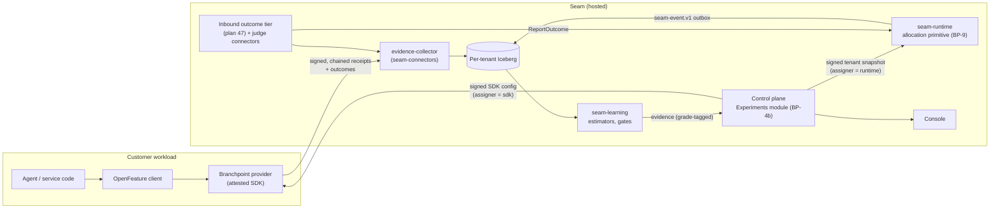

# Attested SDK + OpenFeature provider: Branchpoint without the runtime

**Status:** APPROVED (2026-11-08). Direction ACCEPTED by owner (D15, "add these now"); sub-decisions D15.1–D15.6
reconciled 2026-11-08 (D15.1/D15.2/D15.4 owner, D15.3/D15.5 Opus, D15.6 owner 2026-11-07). D15.1/D15.2/D15.4 amended
by the owner the same day after a Fable pass (DECISIONS § 2026-11-08 W1). Master plan: [`branchpoint.md`](branchpoint.md). Decision: [`../DECISIONS.md`](../DECISIONS.md) D15.

**Positioning:** Branchpoint is *the experiment and evidence layer for AI decisions*. It runs experiments over any
decision policy (a rule set, threshold, prompt, model, tool set or agent configuration), whether or not the decision
runs through the Seam runtime. Judge-score tools (Braintrust, Langfuse, LangSmith, AgentCore Evaluations) are
**integrations that feed metrics**. Branchpoint does not compete with them.

## Why

The market analysis (2026-11-07 session) found that product A/B tools test users and clicks, LLM eval tools grade
traces with judges, and decisioning vendors lock champion/challenger into their own rule engines. Nobody offers
decision-unit experiments with a logged propensity, delayed outcomes, off-policy replay and signed promotion, across
tools and vendors. Branchpoint already specifies all of that, but only for decisions the runtime seals
(DECISION-001: "Branchpoint without the runtime: no"). D15 reverses that. Seam stays the **top evidence grade**,
not a prerequisite.

## The core idea: one product, several assignment sources, graded evidence

**One author, one backend.** Every experiment is authored in the CP Experiments module. Evidence is computed by
seam-learning over the per-tenant lake and shown in the console. Only the **assigner** differs:

| Grade | Assigner | What the grade guarantees | May feed `auto_promote` |
|---|---|---|---|
| `sealed` | seam-runtime (BP-9) | The allocation is in the sealed Commitment trailer (D1). The unit is the admitted AITP subject (D8). The salt never leaves the runtime (D6). | Yes, behind the existing gates |
| `bound` *(AS-7, later)* | The SDK assigns. Receipt digests are sealed into the Seam decision record that ran under them. | Tamper-evident link from the variant to a sealed decision. The assignment itself is still self-reported. | No (human promotes) |
| `attested` | The SDK on its own | Receipts are signed under a key the CP certified for SDK key K of tenant T (D15.4) and hash-chained per (cert, experiment). Replays, reorders and gaps within a chain's observed range are detectable. A chain tail lost before upload is invisible unless the workload closes the chain with `chain_close`. The propensity is in every receipt. It does **not** prove which workload ran. `unit_tag` is pseudonymous under a salt the tenant's workloads hold (D15.2), so the tenant can always re-link its own tags. Sealed and attested tags of one unit are unrelated, so rows of different grades never join by unit. Rows signed under a since-revoked SDK key are tagged and never promote. | No (human promotes) |
| `observational` | Nobody (history, ungated rollouts) | None. Quasi-experimental estimates only (BP-3-Q), carried under a label the UI cannot drop. | Never |

**The rule that keeps propensity accounting honest:** an experiment has exactly **one** assigner, fixed at Draft.
A decision point with a live runtime-assigned experiment refuses an SDK-assigned one and vice versa (extends A-3,
`overlapping_experiment`). The provider never assigns a runtime-assigned experiment; it returns the default with
reason `ASSIGNED_BY_RUNTIME`. So there is never double assignment.

## How it fits Seam (the integration answer)

1. **Control plane: authoring, keys and config.** The Experiment object (BP-4b) gains
   `assigner: runtime | sdk` and `variant_kind: policy | prompt | model | toolset | agent`. A variant's payload is a
   content-addressed JSON bundle (a prompt template id + params, a model id + settings, a tool allowlist, an agent
   graph ref, a threshold). Runtime-assigned experiments publish in the signed tenant snapshot exactly as BP-7 does
   today. SDK-assigned experiments publish in a new **signed SDK config document**. It is signed by a **dedicated**,
   tenant-bound key (seed stem `BRANCHPOINT_SDK_DOC`, domain `seam.branchpoint.sdk-doc.v1\n`, RFC 7638 `kid`; CP
   D-AS1-1), not the runtime's tenant-document signer, so it rotates apart from that trust root. The SDK pins it by
   `kid` with a previous-keys list. It is served on a tenant-scoped route authenticated by SDK-key proof of possession
   (D15.4), never the shared `x-seam-fetch-token` gate. Kill switch: stop or
   pause publishes `budget_bp = 0` in the next document, which is the same stop path as the runtime. The latency is
   the SDK poll interval (default 60 s, A-12).
2. **Runtime: unchanged for `attested`.** The binding path gains nothing, and D1/D6/D8 are untouched. The runtime
   salt never goes to the SDK. SDK experiments use their own bucket version `bpa1` with a per-experiment salt the
   CP derives from a per-tenant key (D15.2). The SDK grade does not claim the runtime's resistance to unit guessing, and it says so. Only
   `bound` (AS-7) touches the runtime: one optional trailer field carrying receipt digests, decided then.
3. **Ingest: an evidence-collector in seam-connectors** (D15.3). It verifies receipt signatures and chains, then
   writes per-tenant Iceberg tables `bp_assignments` and `bp_outcomes` with the same CP-vended, tenant-scoped tokens
   `ingest-history-iceberg` uses. Plan 47's rule "outcomes go through the runtime, never around it" still holds for
   **sealed** decisions. Attested assignments have no runtime record to join to, so their outcomes go to the
   collector. The inbound tier (warehouse reader, signed webhook) routes by the point's assigner.
4. **Learning: two lanes, never a union (D-W7-1).** The sealed join (`LearningDecision`/`LearningOutcome` rows)
   stays sealed-only, with every row stamped `evidence_grade = "sealed"`. The `bp_*` tables (attested) are read by a
   separate attested lane with its own join and refusals. Cluster-aware SRM and CIs (BP-10a) and guardrails apply in
   both lanes. DR/IPS (`assert_ope_identifiable`) runs on the sealed lane only, since attested rows carry no
   propensity or features. New refusal `receipt_chain_incomplete` applies in the attested lane when chain
   completeness for the window falls below A-11. The promotion fence refuses `auto_promote` for any grade other than
   `sealed`, and an experiment that mixes grades is refused `mixed_grade`.
5. **Outcomes and judge scores.** `report_outcome(assignment_id, reward?, metrics?, observed_at?)` from the SDK, or
   from the inbound tier. Judge integrations are **inbound connectors**: they pull scores by trace id or assignment
   id from Braintrust, Langfuse, LangSmith and AgentCore and write them as named `metrics` with
   `reporter_class = outcome_connector` (the closed set from D4 is unchanged). By default a judge metric is a
   **guardrail metric**. It may feed the `reward` only on a `low`-tier point. It is labelled `verified_by = judge:<source>`
   in evidence (D15.5).
6. **Console.** The grade appears on every estimate, beside SDK keys (enrol, rotate, revoke) and the receipt-chain
   health per experiment. Vocabulary is unchanged.

## The SDK and provider

**Repo: new open-source `zer07labs/seam-branchpoint`** (D15.1, owner 2026-11-08). Apache-2.0, with its own semver.
Packages: PyPI `seam-branchpoint` (import `seam_branchpoint`), npm `@zer07labs/seam-branchpoint` (the npm org and 0.0.0
placeholders are claimed at AS-0, D15.1 as amended; the repo stays private until AS-2). The OpenFeature providers ship as subpackages (`seam_branchpoint.openfeature`,
`@zer07labs/seam-branchpoint/openfeature`), server SDK first. Wire names stay neutral. It is not inside
`seam-sdk`, which is generated from `seam.api.v1` and version-locked to the runtime. It holds the neutral contract
(`branchpoint.v1` proto, buf module `buf.build/zer07labs/branchpoint`), the SDK cores (Python and TypeScript first,
Go and Java later) and the OpenFeature providers.

- **OpenFeature provider.** Flag key = experiment key (or decision point name). `targetingKey` = the allocation
  unit. The flag value is the variant bundle (an object flag), and `flagMetadata` carries
  `{experiment_id, variant_id, propensity, receipt_id, evidence_grade}`. An `after` hook writes the receipt. Flag
  evaluations are emitted as OTel `feature_flag.evaluation` span events, with the receipt id, so judge tools can key
  scores to the trace.
- **Local evaluation only.** Assignment = `bpa1` bucket over the cached, signature-verified SDK config (D15.2):
  `bucket = u64be(HMAC-SHA256(salt_e, "bpa1\n" ‖ experiment_id ‖ "\n" ‖ unit)[..8]) mod 10000`, the bp2 shape, so
  `allocation_propensity = weight_bp / 10000` (D12) reads the same for sealed and attested rows. `salt_e` is 32 bytes
  and is **derived, never stored** (D15.2 as amended):
  `salt_e = HKDF-SHA256(IKM = K_bp,t, salt = empty, info = "seam.branchpoint.sdk-salt.v1" ‖ experiment_id, L = 32)`.
  `K_bp,t` is a per-tenant key, KMS-wrapped like the CP's other seeds.
  - `salt_e` is carried in the signed SDK document. It is immutable after Draft and byte-identical in every document
    version, because an experiment keeps the `K_bp,t` version it was created under. That follows D6's rule: never
    rotate inside an experiment.
  - At Concluded the document drops it.
  - Tenant deletion destroys `K_bp,t`, so the CP can no longer recompute that tenant's tags.
  - The derivation stays inside the CP. The golden vectors start from `salt_e`. Arms take half-open intervals of cumulative `weight_bp` in `arms[]` order. Holdout is
  `bucket < budget_bp`. The unit is its UTF-8 bytes as given, with no normalisation, and an empty unit gets the default
  with no receipt. Each experiment carries `bucket_version`. An unknown value fails soft (`unsupported_bucket_version`:
  default, no receipt). No network call happens on the evaluation path. A stale or unverifiable config, or none at all, means
  the default variant, propensity 1.0 and no receipt (fail-soft, mirrors R7).
- **Receipts.** `{receipt_id, experiment_id, config_digest, bucket_version, salt_kid, variant_id, propensity, unit_tag,
  cert_digest, seq, prev_hash, evaluated_at}`. Each receipt is attributable to the `sdk_key_id` named in the certificate
  its `cert_digest` identifies. `bucket_version` is `"bpa1"` in every receipt, and
  `salt_kid = hex(sha256(salt_e)[..4])` appears in both the document and the receipt.
- **The SDK key (D15.4 as amended):** a tenant-bound Ed25519 machine credential, registered with proof of possession
  (the D-384 pattern, CP `src/machine-credentials.ts`, `src/machine-auth.ts`).
  - It carries a new closed role `BranchpointSdk`, added to `MACHINE_ROLES`. The role grants only the SDK document
    route and the certificate route. Receipts are uploaded to the AS-3 collector, which authenticates a batch by its
    CP-signed certificate. Whether uploads also need SDK-key PoP is AS-3's call, and it is reversible.
  - Its id is `sdk_key_id` = `bk_` + 26 lowercase Crockford base32, distinct from `mc_`.
  - It is never a bearer secret, so a leaked id or token cannot enrol receipt keys.
- **Key custody (D15.4, owner 2026-11-08):** each workload generates an in-process Ed25519 key. One call at boot, off
  the evaluate path and authenticated by the SDK key with proof of possession, returns a short-lived CP-signed certificate
  `(domain ‖ pk ‖ not_before ‖ not_after ‖ sdk_key_id ‖ tenant)`, the runtime's KMS-intermediate pattern. The private key
  never leaves the workload, and no workload key is a governance event. The signed message is
  `seam.branchpoint.receipt.v1` ‖ JCS bytes. `key_id` is the RFC 7638 thumbprint, and `sdk_key_id` is `bk_` + 26 lowercase
  Crockford base32. The certificate travels in the batch header. Chains are scoped `(cert_digest, experiment_id)`, `seq` starts at
  0, and genesis `prev_hash = sha256(domain ‖ cert_digest ‖ experiment_id)`. The collector verifies the cert, then the
  signature, then the chain, using only the CP public key. With no certificate there are no receipts, which is honestly
  unattested. Cert TTL, PoP lifetime, `chain_close` and the cert-fetch retry policy stay reversible. Batches upload asynchronously from a bounded buffer. Overflow drops are counted
  in the chain, so they show up as incompleteness and are never hidden.
- **Replay.** A receipt replayed from another workload fails three checks: the leaf certificate does not match, the
  per-(cert, experiment) `seq`/`prev_hash` chain breaks, and `receipt_id` is deduped.
- **Unit privacy.** Only `unit_tag = hex(HMAC-SHA256(salt_e, "bpa1-tag\n" ‖ unit)[..16])` leaves the process. Its domain
  is distinct from the bucket's `"bpa1\n"`. The raw unit never does
  (mirrors the BP-9 tag). Unlike bp2, the salt is held by the tenant's workloads and the CP, so the tag is
  **pseudonymous, not unlinkable after shred**, and the tenant can always re-link its own units. For BP-17 erasure the CP
  recomputes tags on an audited route (AS-1), so no runtime route is needed.

## Phases

Each phase is executed by the named repo's own `/implement`. The cross-repo plans are written by `/plan` from this
file.

### AS-0: `branchpoint.v1` contract and grade mapping
- **Status:** TODO. **Repo:** new `seam-branchpoint` (contract only). **Depends on:** D15 sub-decisions reconciled (done 2026-11-08, amended W1).
- **Names first (D15.1 as amended).** Fix the package namespace here, not at AS-2, because import paths, the README and
  the vectors freeze it.
  - Claim the npm org `@zer07labs`.
  - Publish 0.0.0 placeholders, with no code, for PyPI `seam-branchpoint` and npm `@zer07labs/seam-branchpoint`.
  - Reserve `buf.build/zer07labs/branchpoint`.
  - The repo stays private until AS-2.
- The README and the release notes state which `branchpoint-sdk` document `v` each SDK semver reads (J1-R3).
- The neutral proto covers ExperimentDef (SDK view), Variant bundle, Receipt, ReceiptBatch, Outcome and EvidenceGrade.
  A mapping table, kept in the repo, ties each field to its `seam.event.v1` / `AllocationView` counterpart (no Seam
  tags change). Golden vectors cover `bpa1` (salt `0x00..1f`, three units, two arm layouts), `unit_tag`, the
  workload certificate, receipt signing and chain genesis, shared by every SDK and the collector. Fixtures:
  - The bucket and tag use the two domains `"bpa1\n"` and `"bpa1-tag\n"`.
  - `bucket_version = "bpa1"` and `salt_kid` appear in every receipt fixture.
  - The vectors start from `salt_e`. The HKDF derivation is CP-internal and not part of the golden.
- **Hub pin.** seam-connectors (AS-3) consumes the vectors too, so they are pinned as a new group in
  `seam/contract/golden-manifest.json`. The hub is canonical; seam-branchpoint and seam-connectors vendor
  byte-identical copies. The hub edit is made by a separate seam unit, not by the AS-0 unit (owner, 2026-11-08). It
  runs in wave 3 alongside the J1 hub work, after AS-0 has produced the vectors, and AS-0 is DONE once it merges.
- **AC:** buf lint/breaking green; golden vectors byte-identical across Python and TS reference implementations;
  the hub golden group lists the vectors and passes the gate; the names are claimed.

### AS-1: CP: assigner, variant kinds, SDK keys, SDK config document
- **Status:** DONE (seam-control-plane #635, 91549a8, 2026-11-09), default off, armed per env by the CP handoff
  `scripts/handoff/2026-11-09-branchpoint-sdk-seeds.sh`. It does not pull BP-11 forward (D-AS1-7): until BP-11 ships, a
  real tenant's SDK document lists zero experiments. **Repo:** seam-control-plane (`src/products/branchpoint`). **Depends on:** AS-0, BP-4b (shipped), seam `plans/platform-products.md` PP-1 (entitlement) and PP-4 (document kind).
- Experiment gains `assigner` (immutable after Draft) and `variant_kind`. Variant bundles are content-addressed.
  One-assigner-per-point refusal. Draft→Live for an SDK experiment is gated by the same tier approvals.
- **D15.5 enforcement.** The CP refuses, at draft, a judge metric (`verified_by` prefix `judge:`) as the `reward` on a
  medium or high point. It also refuses a tier raise from `low` while a judge-primary experiment is open, the same
  way it refuses `tier_cap_exceeded`.
- **SDK keys (D15.4 as amended).** An SDK key is a tenant-bound Ed25519 machine credential with PoP registration and
  the new closed role `BranchpointSdk`. `MACHINE_ROLES` gains it, and the invariant test is updated in the same change.
  Its id is `bk_` + 26 lowercase Crockford base32.
  - Enrolment, rotation and revocation are governance events. Append only `BRANCHPOINT_SDK_KEY_ENROLLED/ROTATED/REVOKED`
    to `GOV_KINDS` (template `CHANGESET_SIGNER_*`), with no per-workload kinds.
  - **One ordering PR:** these appends, PP-1's `ENTITLEMENT_*` (both after `CHANGESET_POLICY_REJECTED`) and the
    `MACHINE_ROLES` change land in one CP ordering PR, with the console pin landing first (`cp-drift.test.ts`). If PP-1
    has already shipped its appends, this PR appends after them in the same way.
  - The CP may fold these events through the machine-credential projection or a sibling one. That choice is reversible.
- **Workload certificates.** A route authenticated by SDK-key PoP (`POST /v1/branchpoint/sdk/certificates`) issues
  short-lived certificates.
- **Seeds: three new CP stems, one key per purpose** (as shipped): `BRANCHPOINT_SDK_DOC` (document signer, D-AS1-1),
  `BRANCHPOINT_CERT` (workload-certificate issuer, D-AS1-2) and `BRANCHPOINT_SALT_KEK` (wraps each tenant's `K_bp,t`
  keyring, D-AS1-4). Each is `SEAM_<STEM>_SEED_HEX`, or `SEAM_KMS_WRAPPED_<STEM>_SEED` under aws-kms; all three or none,
  and a partial set refuses the CP boot (D-AS1-9). Wrapping under aws-kms needs the custody account; the CP never
  Encrypts.
- **Salt.** A per-tenant `K_bp,t`, KMS-wrapped, derives `salt_e` per experiment (D15.2 as amended), and nothing is stored
  per experiment.
  - The experiment records the `K_bp,t` version it was created under, and that version is kept until every experiment
    under it is Closed.
  - At Concluded the document drops `salt_e`.
  - Tenant deletion destroys `K_bp,t`.
- **The signed SDK config route** (`GET /v1/branchpoint/sdk/document`) is tenant-scoped and authenticated by SDK-key
  PoP, never `x-seam-fetch-token`. The document is signed by the dedicated `BRANCHPOINT_SDK_DOC` key, and the SDK pins
  it by `kid` with a previous-keys list. The CP serves two of the three spec §10 routes (document, certificates); the
  receipts route belongs to the collector (AS-3).
- **BP-17 recompute route.** An audited CP route (`POST /api/control-plane/branchpoint/unit-tags/recompute`) takes a raw unit and returns that tenant's attested tags for each
  experiment, for AS-3's purge. Every call is audit-logged, but it is not a governance event (D15.4 allows only SDK-key kinds). The raw unit is never
  persisted. The audit sink is AS-1's call, and it is reversible.
- **AC:**
  - An SDK experiment never appears in the tenant snapshot, and a runtime experiment never appears in the SDK document.
  - Pause → `budget_bp = 0` in the next document.
  - A bearer token without PoP is refused on every SDK route.
  - `salt_e` is byte-identical across document versions and K rotations for one experiment, and is absent after
    Concluded.
  - The recompute route's output matches the AS-0 tag vectors.
- **BP-11 precondition (A21, from AS-1).** SDK experiments never shadow, so BP-11's Live transition must enforce one
  occupying (live|paused) SDK experiment per decision point. Until then, the CP's publish-time R8.10 check refuses such a
  document and keeps the previous head.

### AS-2: SDK cores + OpenFeature providers (Python, TypeScript)
- **Status:** TODO. **Repo:** seam-branchpoint. **Depends on:** AS-0; AS-1 for the end-to-end test.
- Config fetch/verify/cache, local `bpa1` evaluation, receipts, chain, buffered uploader, `report_outcome`, the
  OpenFeature provider + hook, and OTel events. Published to PyPI and npm.
- **AC:** zero network calls on evaluate (asserted in tests); fail-soft on missing/stale config; p99 evaluate < 50 µs
  in-process; realized split converges to weights (SRM test over 10⁶ synthetic units).

### AS-3: evidence-collector
- **Status:** TODO. **Repo:** seam-connectors. **Depends on:** AS-0, AS-1 (the CP cert-signing public key and SDK-key revocation state).
- Verify the workload certificate, then the signature, then the chain (D15.4), dedupe by `receipt_id`, record gaps, tag rows signed under a since-revoked SDK key (`sdk_key_revoked`, from AS-1's
  revocation state), write `bp_assignments` / `bp_outcomes` per tenant with
  CP-vended tokens, and expose completeness metrics. The inbound tier routes outcomes for `assigner = sdk` points
  here.
- **D15.3 conditions:**
  1. The collector is a separate inbound service like `outcomes-webhook`, not a connector-host connector (the host has no inbound port), with a new `contract/service-roster.json` entry.
  2. It writes to `t_<tenant>.raw` only. Assignment rows carry propensity and never reach `published`.
  3. Each `bp_*` table declares its own retention (D-109) and carries a schema golden like `history_table_schema`.
  4. The carve-out from plan 47 principle 2 is recorded as a seam-connectors decision.
  5. BP-17 for attested rows: purge `bp_*` rows by the `unit_tag`s that AS-1's audited recompute route returns
     (D-LH-8 path, like BP-17's connectors half).
  6. The AS-0 vectors are vendored byte-identical from the hub golden group.
- **AC:** a forged, replayed (including a cross-workload replay) or reordered receipt is refused with a reason code. A
  gap is counted, not filled. A revoked-key row is tagged, not dropped. Every row carries the `sdk_key_id` its certificate names. A purge by tag leaves no readable row.

### AS-4: Learning: grade-aware join, refusals, fence
- **Status:** TODO. **Repo:** seam-learning. **Depends on:** AS-3, BP-10a.
- **A separate attested lane, not a union (D-W7-1, owner 2026-11-10).** Spec: seam-learning
  `plans/cross-repo/seam-experiments-as4-lane.md` (source plan `plans/branchpoint-w7.md` P6–P7).
  - `joined_history` stays sealed-only. Every row is stamped `evidence_grade = "sealed"`, and the posterior, OPE and
    auto-promote producers raise `ForeignGradeRows` on any other grade.
  - A separate fleet-only `attested_evidence` asset reads `raw.bp_*` per tenant and runs the attested join:
    register-verdict revocation, chain completeness at the A-11 floor (`receipt_chain_incomplete`), and the
    outcome-time envelope. It runs the forward evaluation only against `assigner: "sdk"` designs.
  - Promotion fence: `auto_promote.decide` refuses any promotion whose evidence grades are not a subset of
    {`sealed`} (gate `grade`). An experiment that mixes grades is refused `mixed_grade`. Evidence that includes rows
    tagged `sdk_key_revoked` is refused for any promotion, human included (D15.4 as amended).
  - Evidence keyed by `experiment_id` with the grade carried to the CP intake (BP-5).
  - Unchanged: the attested grade stays non-promotable until this spec says otherwise.
- **AC:** an attested split over synthetic traffic recovers a planted effect within its CI. Incomplete chains are
  refused, not estimated. A window with revoked-key rows is refused `sdk_key_revoked`. No attested row reaches
  `joined_history`, the posterior fit or the promotion gates; a mixed-grade experiment is refused `mixed_grade`.

### AS-5: Judge-score integrations
- **Status:** TODO. **Repo:** seam-connectors (inbound tier). **Depends on:** AS-3; plan 47 inbound manifest.
- Connectors for Braintrust, Langfuse, LangSmith and AgentCore Evaluations pull scores by trace or receipt id and
  map them to named metrics per the manifest. They are guardrail-by-default and labelled
  `verified_by = judge:<source>`, with `reporter_class = outcome_connector` (D15.5).
- **AC:** a judge score lands as a metric on the right assignment, or is counted as unmatched (plan 47 principle 3).

### AS-6: Console
- **Status:** shipped - seam-console-ui #235 (0b5bf61), prd smoke ok; attested e2e still open on seam-branchpoint#9 (enrol-bundle tool) and CP #639 (evidence grade). **Repo:** seam-console-ui (`@seam/product-branchpoint`, PP-5). **Depends on:** AS-1, AS-4, PP-5.
- Grade badge on every estimate, SDK keys page, receipt-chain health, and variant-kind display.

### AS-7: `bound` grade: receipt digests in the sealed record (LATER)
- **Status:** DEFERRED. **Trigger:** a design partner running SDK experiments on prompts or models *inside*
  Seam-governed agents. Until BP-16 (interactive path) lands, those are `attested`.
- One optional Allocation-trailer (or new trailer) field carrying the receipt digests in force, passed on
  `RunDecisionRequest`. It is a one-way door (proto tag + trailer layout), decided by `/reconcile` when triggered.

## Sub-decisions (reconciled 2026-11-08)

| # | Question | Recommendation | Door |
|---|---|---|---|
| D15.1 | Where the SDK lives | **CONFIRMED, amended (owner, 2026-11-08):** names claimed at AS-0 (placeholders), vectors pinned in the hub. Originally: new open-source `zer07labs/seam-branchpoint` repo (contract + SDKs + providers), Apache-2.0, own semver; PyPI `seam-branchpoint`, npm `@zer07labs/seam-branchpoint`; proto `branchpoint.v1` at `buf.build/zer07labs/branchpoint`. Not `seam-sdk`. | One-way-ish (public package names) |
| D15.2 | SDK bucket + salt | **CONFIRMED, amended (owner, 2026-11-08):** `bpa1` = the bp2 shape with a 32-byte per-experiment salt the CP derives (HKDF from a KMS-wrapped per-tenant key, nothing stored), immutable after Draft, in the signed SDK document; same salt for bucket and `unit_tag`, under distinct domains; receipts carry `bucket_version` + `salt_kid`. D6 unchanged for the runtime. See _Local evaluation only_. | One-way (golden) |
| D15.3 | Where attested evidence lands | **CONFIRMED (Opus, 2026-11-08):** evidence-collector in seam-connectors → per-tenant Iceberg `bp_*`. Not the runtime: high-volume, non-binding traffic must not touch the decision boundary. Conditions are in AS-3. | Reversible |
| D15.4 | Receipt signing key custody | **CONFIRMED, amended (owner, 2026-11-08):** per-workload in-process Ed25519 key + short-lived CP-signed certificate obtained with the SDK key, which is a PoP machine credential with role `BranchpointSdk`; only SDK-key enrol/rotate/revoke are governance events; revoked-key receipts never promote. See _Receipts_. | One-way (wire) |
| D15.5 | Judge metrics as primary | **CONFIRMED with precision (Opus, 2026-11-08):** guardrail by default. A judge metric may be the primary (it feeds the experiment's `reward`) only on a `low`-tier point. The label is `verified_by = judge:<source>`, with `reporter_class` staying `outcome_connector`. The CP enforces this (AS-1). | Reversible |
| D15.6 | Name | **Decided (owner, 2026-11-07):** Seam is the platform brand; the product is "Seam Branchpoint", running with or without **Seam Runtime**. See seam `plans/platform-products.md`. | Reversible |

## New assumptions

Appended to [`../ASSUMPTIONS.md`](../ASSUMPTIONS.md): A-11 (chain completeness floor), A-12 (SDK poll interval).

## Non-goals

- No hosted assignment service on the evaluation path (local evaluation only).
- No user-or-session product analytics, funnels, session replay or web visual editor: the product A/B market is not
  the target.
- No LLM judge of our own; judges are integrations.
- No change to the runtime binding path, D1, D6, D8 or the `reporter_class` closed set.
