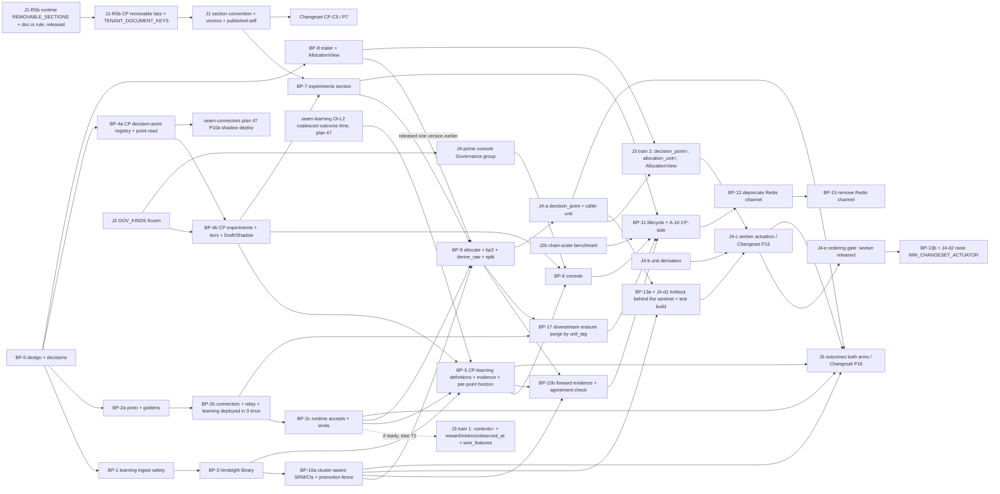

# Branchpoint — execution plan

Repo: `seam-experiments` (coordination home; all code lands in sibling repos via `plans/cross-repo/*`)
Design: [`../plan/Branchpoint — Design.md`](../plan/Branchpoint%20—%20Design.md) · Repo map: [`PROGRESS.md`](PROGRESS.md)
Joint plans with Changeset: [`joint/shared-substrate.md`](joint/shared-substrate.md) (J1, J2, J2b, J3, J4') · [`joint/holdout-via-changeset.md`](joint/holdout-via-changeset.md) (J4-a..e, J5)
Planner: Opus · Critical decisions: Fable · Owner: @Ajit Koti · Consolidated 2026-11-01 (see _Revision history_)

**How to read this file.** Each phase below is self-sufficient: `/implement` reads the phase text, the linked
cross-repo section and the joint phase it names, and nothing else. There are no override banners. Where a
phase touches a shared surface (tenant-document sections, `GOV_KINDS`, the SDK train), the joint plan holds
the exact text and this file points to it by ID.

## Context

Branchpoint is Seam's experimentation system for decisions. It has three parts: a runtime **allocation
primitive** that decides what a sealed decision tries, additive **estimators and evidence** in seam-learning,
and an **Experiments module** in the control plane and operations console. One learner, propensity sealed at
decision time, nothing new on the binding path, and a human promotes.

**What the code says today (verified file:line in `PROGRESS.md`). Where the design is wrong or stale:**

1. **An Experiment channel already exists and goes around the control plane.** seam-learning's
   `ExperimentConfig` lives in Redis `routing:experiment:{task}:{ns}`, and the runtime reads it on each decision
   (`seam-serving-router/src/lib.rs:1085`, `experiment.rs:93-99`, session-FNV `%100` bucket, `{base}@{arm}`
   keyspace). Goldens pin it as `experiment_config` / `experiment_assignment`. Zero production configs;
   tenant-less by design. → **D2** (migrate, BP-12/BP-15).
2. **Action rows would contaminate policy posteriors.** Both fold paths deny only `dimension == "agent"`
   (`seam-learning/crates/core/src/units.rs:67-70`, `batch/.../join.py:262`). The Redis posterior key carries
   no dimension. → **D3** (`bp~{exp12}` namespace, BP-1).
3. **The outcome horizon is global code.** `SEAM_OUTCOME_HORIZON_MS` is read online (`crates/online/src/main.rs:329`)
   and in batch (`dagster/assets.py:90-95`, the shared `_horizon_ms` parse). Online, the joiner **evicts** the
   decision after 48 h (`utils/join.rs:37`), so a later outcome becomes an orphan (`:117-123`). Batch drops outcomes
   past 48 h (`join.py:60` `DEFAULT_HORIZON_MS = 172_800_000`, inclusive filter `0 ≤ occurred_at − decided_at ≤
   horizon` at `:184-191`, inclusive at `:190`), measured on report time. → per-point **batch** horizon (BP-5) on the event time
   (`observed_at`, D4 amendment).
4. **Guardrails are not wired.** `promotion.evaluate_promotion(guards_ok=True)` has no caller that passes it.
5. **No `reward` / `metrics` anywhere** (`seam.proto:1302-1314`, `seam_event.proto:272-283`, Iceberg, `join.py:229`
   `reward = 1.0 if correct`). `outcome_digest(correct, verified_by)` (`facade.rs:779`) governs replay. → **D4**.
6. **The sealed record cannot gain columns.** `DecisionRecord` digest v4, `MAX_KNOWN_SCHEMA_VERSION = 4`. The
   non-breaking carrier is the Commitment ciphertext trailer (precedent #1361 `SealAttestation`). → **D1**.
7. **MACP refuses a rewritten commitment.** `validate_outcome_positive` (`macp-modes =0.11.0`) and the consistency
   check (`seamd/src/lib.rs:6295-6317`, the seal-time vote-tally / `text_stated_outcome` code, #713). → the TCT signs what the panel decided (intended), always.
8. **The control plane has no DB or decision-point registry.** JSON files (`src/file-store.ts`). Learning
   read-models are fleet-global (409 elsewhere, `src/http/routes.ts:1168-1174`), so Branchpoint needs new
   tenant-scoped reads.
9. **The SDK claims are off.** No Rust SDK in seam-sdk (`seam-runtime/crates/seam-client`), no CP client.
   `report_outcome` requires `idempotency_key`. → **D5**.
10. **`branchpoint-boundary.md` does not exist.** The verified inventory lives in `PROGRESS.md`.
11. **Smaller corrections.** `units.py` is a tenant↔algo registry. No aggregated-prior network. `ope_status.py` /
    `shadow_report.py` are per unit. Default stop latency is one CP fetch, `SEAM_CP_FETCH_INTERVAL` = 300 s.
12. **In prd `task_type == mode` for every RunDecision** (`lib.rs:5765-5768`; the `(namespace, mode)` map has no
    production config source). So a "decision point" has no runtime reality until J4-a's `decision_point` field;
    before it, a point is selected by namespace (BP-7 `selector`).
13. **The admitted subject is in scope before routing.** `caller_subject = trust.subject.clone()` at
    `lib.rs:5911`, proven at admission (`grpc.rs:1491`), before `routed_policy_with_route` at `:6013`. That is
    what lets BP-9 bucket on the subject (D8) with no extra plumbing.

Reused unchanged: `assert_ope_identifiable` (`ope.py:95-154`), cross-fitted DR, PASS/HOLD/REVIEW,
`DEFAULT_MARGIN=0.02` / `DEFAULT_MIN_N=200`, trust-weighted `verified_by`, the actuation ledger (for `bp~` action experiments only, BP-11), `ApprovalMachine`,
the domain-separated signed tenant snapshot with a tolerant runtime reader, the 5 ms fail-soft serving read,
and the per-tenant commitment key (`seamd/src/commitment.rs`).

### Decisions (full text in `../DECISIONS.md`)

| # | Decision | Call |
|---|---|---|
| D1 | Where the allocation is sealed | The TCT signs **intended**; the committer's bytes are never rewritten. A versioned, length-prefixed `Allocation` trailer (marker `0x02`) inside the commitment ciphertext. No v5. Shadow is offline replay. |
| D2 | Two experiment channels | Migrate: the snapshot `experiments` section is the only channel. Redis read flagged (BP-12), then removed (BP-15). |
| D3 | Action-arm keying | `algorithm_id = bp~{exp12}` (first 12 hex of sha256(experiment_id)); the `bp~` fold is batch-only. |
| D4 | Scalar reward + metrics (+ outcome-ingestion amendment, 2026-11-01) | `ReportOutcomeRequest` 5/6/7 (`reward`, `metrics`, `observed_at_millis`), `LearningOutcome` 4/5/6/7 (+ runtime-stamped `reporter_class`), `seam-outcome-v2` digest when any of reward/metrics/observed_at is present; Iceberg columns asserted by name (ids differ fresh vs evolved). |
| D5 | `register_decision_point` | CP-only (HTTP + console; seam-mcp `onboard` later). Never a runtime RPC. |
| D6 | Bucket salt | Runtime-derived per experiment from the tenant commitment key via `derive_raw` (exact formula in BP-9). No salt in any snapshot, store or Doppler. |
| D7 | Holdout actuator | Changeset (`HELD_OUT`), caller-supplied unit only with a verifying actuator (J4-a..J4-c). |
| D8 | Default unit | The admitted AITP subject; `decision_id` is a per-point opt-in. Floor A-10: ~50 distinct units per arm (effective n), enforced CP-side. |
| D9 | Repo-review contract adjustments | `unit_tag` (tag 12), live-table decision ids, `btree_map`, `changeset` removable, batch-only `bp~` fold. |
| D10 | Consolidation | The pinned one-way doors listed in _Pinned interfaces_ below. |
| D11 | Outcome-ingestion amendments (seam-connectors plan 47, PR #689) | BP-4 split into **BP-4a** (decision-point registry + tenant point read, no J2 dependency) and **BP-4b** (experiments, approvals, `GOV_KINDS`, after J2). Points gain `outcome_owner` + `owner_epoch` (Defs, point read, and signed in `changeset.points[]` for changeset-owned points, the worker's own section) and `contributing_sources[]` (Defs + point read). The `experiments` section gains only the derived `outcome_owner_class` (D13); the owner itself, `owner_epoch` and `horizon_ms` stay out. `actuator: changeset` ⇒ `outcome_owner: changeset` (owner, 2026-11-01). Owner/horizon changes are unaudited on the chain until BP-4b (priced debt). |
| D12 | `allocation_propensity` (verification round) | `LearningDecision.allocation_propensity = 13` (`optional double`): the variant/arm allocation probability (split `weight_bp/10000`; holdout `budget_bp/10000` or `1 − budget_bp/10000`), equal to trailer field 6; `propensity = 9` keeps its within-variant meaning. Split rows carry `algorithm_id = {base}@{arm}`, `algorithm_arm = {arm}`. One-way door. |
| D13 | `outcome_owner_class` (seam-connectors plan 47 OI-X5 / learning OI-L6) | `LearningDecision.outcome_owner_class = 14`, stamped by the runtime at seal from a per-point `outcome_owner_class` in the signed `experiments` section, which the CP derives from `outcome_owner` (`connector:*` → `outcome_connector`, `changeset` → `changeset_worker`, `caller` → absent). Learning admits to earliest-wins on an owned decision only outcomes whose `reporter_class` equals it. Exported at egress wherever `verified_by` is. One-way door (owner, 2026-11-01). |

### Pinned interfaces (D10; one-way doors, each fixed here and cited by phase)

| Surface | Value | Phase |
|---|---|---|
| `seam.api.v1` tags | `ReportOutcomeRequest.reward = 5` (`optional double`), `.metrics = 6` (`map<string,double>`), `.observed_at_millis = 7` (`optional uint64`; tag 7 verified free, the message uses 1–4); `RunDecisionRequest.decision_point = 9`, `.allocation_unit = 10` (both `optional string`); `DecisionRecordView.allocation = 13` (`AllocationView`), `.decision_point = 14` (`optional string`). All verified free on seam-runtime main @3194c9e3 (`seam.proto:347-406`, `:1073-1116`, `:1302-1314`). | BP-2, BP-8, J4-a |
| `seam.event.v1` tags | `LearningDecision.intended_action = 10`, `.allocation_mode = 11`, `.unit_tag = 12` (all `optional string`), `.allocation_propensity = 13` (`optional double`; the variant/arm allocation probability; `propensity = 9` stays the within-variant action probability), `.outcome_owner_class = 14` (`optional string`, values from the `reporter_class` closed set; runtime-stamped at seal from the point's signed `outcome_owner_class` in the session's governing config, never the live snapshot; absent = `caller` point / no point; D13); `LearningOutcome.reward = 4` (`optional double`), `.metrics = 5` (`map<string,double>`), `.observed_at_millis = 6` (`optional uint64`), `.reporter_class = 7` (`optional string`, closed set `agent \| outcome_connector \| changeset_worker \| operator`, runtime-stamped). Verified free (`LearningOutcome` uses 1–3 and `LearningDecision` 1–9; `message LearningDecision` / `message LearningOutcome`: `seam_event.proto:259-269` / `:272-283` on main @3194c9e3; the in-flight D6 0.70.0 change adds `GoverningConfig` above them and moves them to `:279` / `:292`, tags unchanged). | BP-2 |
| `AllocationView` | `message AllocationView { AllocationAvailability availability = 1; Allocation allocation = 2; }`; `Allocation` fields 1–14 in BP-8. | BP-8 |
| `AllocationAvailability` | `UNSPECIFIED=0, RECORDED=1, NOT_RECORDED=2, KEY_UNAVAILABLE=3, ARCHIVED=4, CLEARANCE_DENIED=5, UNAVAILABLE=6` (values prefixed `ALLOCATION_AVAILABILITY_`, proto3 file scope). | BP-8 |
| Trailer | marker `0x02` ‖ `u32le len` ‖ body; body = `version u8 (0x01)` ‖ fields in BP-8 order; markers strictly increasing; legacy `0x01` SealAttestation unchanged. | BP-8 |
| Bucket | `bp2`: `u64be(HMAC-SHA256(salt_e, "bp2\n" ‖ experiment_id ‖ "\n" ‖ unit)[..8]) mod 10000`. The only bucket version. | BP-9 |
| Salt | `salt_e = HMAC-SHA256(K_tenant, framed([b"seam.branchpoint.bucket-salt.v1", tenant, experiment_id]))`, 32 raw bytes, via new `TenantCommitmentKey::derive_raw`. | BP-9 |
| Unit tag | `unit_tag = lowercase_hex(HMAC-SHA256(salt_e, "bp2-tag\n" ‖ unit)[..16])` (32 hex chars). The `bp2-tag\n` prefix domain-separates the tag MAC from the `bp2` bucket MAC under the same `salt_e` (owner D-BPW7-1, 2026-11-09; seam-runtime#1663, seamd-v0.78.0, wire feature `branchpoint.bp2_unit_tag`). Fixed before the first sealed Allocation, permanent from it. | BP-9 |
| `experiments` section `v` | The runtime reads `v ∈ {1, 2}` with **identical** semantics; any other `v` ignores the whole section (`unsupported_version`). `v: 2` is a live-split gate, not a shape change: the CP signs `v: 2` exactly when the section carries a Live runtime split, and only while every replica lists the wire feature `branchpoint.experiments_v2` (`GET /version`, `ServerInfo`). A 0.77.0 replica reads `v: 1` only, so it ignores a live split whole and never allocates with the unprefixed tag (owner O5 / D-BPW7b-1, 2026-11-09; seam-runtime#1664, seamd-v0.79.0; `EXPERIMENTS_SECTION_VERSIONS`, `governing/experiments.rs`). | BP-7, BP-9, BP-11 |
| `GOV_KINDS` (Branchpoint) | 18 kinds, frozen order, listed in J2. | J2, BP-4b |
| `remove_sections` | `["retention_schedule", "handling_policies", "changeset"]` (today the runtime refuses the whole document if `remove_sections` names anything but `handling_policies`, `registry.rs:350,366-400`, `doc.rs:130-139`; seam-runtime#1570 open); tenant documents may name `handling_policies` and/or `changeset`; `experiments` is not removable. Runtime first. **The one site list: seven sites.** Runtime (2): `crates/seamd/src/registry.rs:350` `REMOVABLE_SECTIONS` (parser `:366-400` refuses the whole snapshot on an unknown name) and `crates/seamd/src/governing/doc.rs:130-139` (tenant rule). CP (5, verified @1d46ce8): root list `src/types.ts:74,76-77`; tenant list `src/snapshot.ts:206` (enforced `:225-230`); `REMOVABLE_SOURCE` `snapshot.ts:737` (read by `removeSectionsSection` `:766-804`); the validator's removable names `snapshot.ts:779-782`; and the `removeSection` route that hard-codes `handling_policies` (`publish.ts:817, :865-875`; a `changeset` removal must also clear the CP-held staged state, `:894, :910`). `TENANT_DOCUMENT_KEYS` (`snapshot.ts:185-195`) also gains the section names, but it is a document-key list, not a `remove_sections` site. J1-R5b orders the steps and points here. | J1-R5b |
| `seam-outcome-v2` digest | sha256 over exact bytes, **big-endian throughout**: `"seam-outcome-v2\0" ‖ u8 correct ‖ presence(verified_by) ‖ u32be len ‖ verified_by ‖ presence(reward) ‖ f64be reward ‖ u32be n ‖ n × (u32be len(k) ‖ k ‖ f64be v), sorted by UTF-8 key bytes ‖ presence(observed_at) ‖ u64be observed_at`; an absent value contributes only its presence byte; `metrics` has no presence byte (empty = absent). Used iff `reward.is_some() \|\| !metrics.is_empty() \|\| observed_at.is_some()`; otherwise v1 (`facade.rs:350-362`, which frames `verified_by` with a u32 **little-endian** length) byte-identically. `n` ≤ 16 and key length ≤ 63 capped. Golden vectors shared by runtime and connectors (BP-2 AC4). `reporter_class` is never in the digest. | BP-2 |
| Iceberg columns | **Not pinned by id.** Outcome `reward` (double), `metrics` (map string→double), `observed_at` (timestamptz), `reporter_class` (string); decision `intended_action`, `allocation_mode`, `unit_tag`, `allocation_propensity` (double), `outcome_owner_class` (string); all nullable, asserted by name, type and nullability (pyiceberg numbers fresh and evolved tables differently). | BP-2 |
| `outcome_owner` | `changeset \| caller \| connector:<id>`, `<id>` matching the CP `CONNECTOR_ID_PATTERN` (lowercase letters, digits, hyphens; no colon). Default `caller`. Travels with `owner_epoch` (u64, +1 per change, default 0) in Defs, the point read and, for `actuator: changeset` points, the signed `changeset.points[]: {id, outcome_owner, owner_epoch, horizon_ms}`. Its derived class (not the id or epoch) is signed per point in `experiments` as `outcome_owner_class` (D13). | BP-4a, CP-C5, BP-7 |

## Phases

**Beyond the runtime (D15, 2026-11-07):** the attested SDK + OpenFeature provider phases `AS-0..AS-7` live in
[`attested-sdk.md`](attested-sdk.md). They add an `assigner` per experiment and an evidence grade, and change no BP phase's runtime surface.

Phase IDs are `BP-n`. Each phase lands in the named repo(s) through that repo's own `/implement`, reading the
linked cross-repo plan. Hard rule: **every consumer change is deployed before any emitter**.

Critical chain: BP-0 → BP-8 (released) → BP-9 → BP-10b → BP-11 → BP-12 → BP-15, with BP-9 also waiting on
BP-2c, BP-7 (via the J1 removable-sections order) and BP-10a. **DEFERRED and off the chain:** BP-3-Q (quasi
estimators), BP-11-R (weekly report), BP-14 (adaptive/contextual), BP-16 (session path).

**External consumers of these phases (seam-connectors plan 47, outcome ingestion, D11).** Plan 47's first stg shadow
deploy (P10a) needs **BP-4a** (the CP refuses an inbound manifest naming a point until BP-4a, CP OI-C1 (inbound manifests at all) and OI-C2
(the owner checks) exist).
Its go-live (P12) needs BP-2 deployed consumer-first with the outcome amendment, **BP-5** (per-point horizon) and J3
with `observed_at` + `wire_features`. BP-4a is therefore scheduled first among the CP phases, independent of J2.

Design rollout mapping: design phase 1 (Hindsight + offline shadow) = BP-1..BP-6. Design phase 2 = **fixed split**
= BP-7..BP-10b. Holdout = BP-13 (= J4-d1, merged behind the sentinel, then J4-d2, which enables it). Design phase 3 (lifecycle) = BP-11 (+ BP-12, BP-15). Design phase 4 =
BP-14 (DEFERRED).

---

### BP-0 — Finalise design, decision log, coordination
- **Status:** DONE (2026-10-31; consolidated 2026-11-01).
- **Repo:** seam-experiments
- **Delivers:** the design doc with Mermaid diagrams and a code-grounded appendix; `DECISIONS.md` D1–D13;
  `ASSUMPTIONS.md`; eight cross-repo plans (seam-adapters is VOID); one tracking issue per repo.
- **Depends on:** —
- **Files:** `plan/Branchpoint — Design.md`, `DECISIONS.md`, `ASSUMPTIONS.md`, `plans/branchpoint.md`,
  `plans/PROGRESS.md`, `plans/cross-repo/*.md`, `plans/joint/*.md`.
- **Approach:** the design stays the product narrative; corrections go in its appendix; the plan carries the
  engineering truth.
- **Edge cases:** an issue link that resolves only after this repo's PR merges (stated in each cross-repo file).
- **Acceptance criteria:** (1) `grep -c "embedded content" plan/*.md` = 0. (2) every D-row above exists in
  `DECISIONS.md` with a Status line. (3) `gh issue list -R zer07labs/<repo> --search Branchpoint` returns the
  tracking issue for each of the seven live repos.
- **Tests:** the two commands above.
- **Docs:** this file.

### BP-1 — Learning ingest safety (dimension allowlist + `bp~` grammar)
- **Status:** TODO
- **Repos:** seam-learning, seam-control-plane (grammar)
- **Delivers:** every fold and analysis path admits only an explicit dimension set and **fails closed** when the
  column is absent; `action` rows are refused and counted until J4-d1 lifts the quarantine (batch only); the
  `bp~{exp12}` algorithm namespace is legal and splits correctly everywhere.
- **Depends on:** BP-0. `seam-learning` §BP-1, `seam-control-plane` §BP-1.
- **Files:** see the two cross-repo sections (learning: `units.rs`, `join.py`, `experiment_analysis.py`,
  `ope.py`, `ope_window.py`, `units.py`, `cp_governing.py`, the twin boundary fixture; CP: `learning-state.ts`,
  `learning-auto-promote.ts`, `learning-algo-grants.ts`).
- **Approach:**
  - Denylists that exist: only `join.policy_dimension_only` (`join.py:262`) and `units.rs:68`. Both become
    `dimension == "policy"` allowlists (new `Refusal::UnfoldedDimension`).
  - Already-allowlists that **fail open when the column is absent**: `experiment_analysis.py:189` and
    `ope_window` (`pl.lit(True)`). Make them fail closed (absent column ⇒ refuse the frame). `ope.py:379` is not
    fail-open (an absent column raises polars `ColumnNotFoundError`); convert that raw exception to a coded refusal.
  - `join_events` keeps returning every dimension (parity golden, `join.py:256-259`); filter only in
    `policy_dimension_only`.
  - Online: a missing dimension decodes as `""` via the serde default (`utils/src/seam_event.rs:174`) and is
    admitted today. Refuse `""`. JSON `null` already dead-letters as Malformed.
  - Refusals count on a **new, unlabelled** `seam_learning_outcomes_unfolded_dimension_total`, registered beside
    `seam_learning_outcomes_agent_dimension_dropped_total` (`metrics.rs:161`). The existing
    `seam_learning_outcomes_unit_refused_total` (`metrics.rs:155-159`) is unlabelled and is the alarm in
    `deployment.md:1728`, `register-units-handoff.md:14,91,133` and `tenant-isolation-audit.md:141`; adding a
    `reason` label would break those, so it is not touched.
  - `bp~{exp12}`: `~` is URL-safe and not a glob character; `#` starts a URL fragment (`learning-state.ts:93-98`);
    `@` already means experiment arm. Split points: `core/src/algorithm/mod.rs:51`, `units.rs:55`, `units.py:64`.
  - **Rust `valid_algo` change** (`units.rs:130-135` forbids `@ : * ? [ ] \` today, not `~` or `#`): add `~` and
    `#` to the forbidden set, so no env-registered unit can sit in the `bp~` namespace. `bp~` bindings come only
    from the BP-5 definitions read. Python `validate_algo` already admits `~` (`keys/__init__.py:220,237-257`);
    it newly refuses `#`.
  - CP `ALGO_PATTERN` (`learning-state.ts:121`) admits `bp~[0-9a-f]{12}`, still refuses `:` and `#`; auto-promote
    (`learning-auto-promote.ts:56,60`) and grants (`learning-algo-grants.ts:141`) refuse `bp~` explicitly.
- **Edge cases:** policy rows always carry `"policy"` (`seamd/src/learning.rs:487-502`). SCAN aliasing of
  `{base}@*` against `bp~` is structurally impossible (`keys/__init__.py:220-223`); keep a cheap test.
- **Acceptance criteria:** (1) a joined action-dimension outcome into `OnlineEngine::apply` (seam-learning `crates/online/src/lib.rs:516`;
  `fold` is private, `:541`, and takes a `JoinedOutcome`) produces zero Redis writes and increments
  `seam_learning_outcomes_unfolded_dimension_total` by 1, leaving `seam_learning_outcomes_unit_refused_total`
  unchanged. (2) the same for
  a row with dimension `""`. (3) `policy_dimension_only` over a policy/agent/action/`""` frame returns only the
  policy rows, and `join_events` still returns all four (parity golden unchanged). (4) `experiment_analysis` and
  `ope_window` on a frame **without** a `dimension` column raise a refusal instead of returning rows, and `ope.py`
  raises a coded refusal rather than `ColumnNotFoundError`.
  (5) `fixtures/algo_split_golden.json` pins `base_algo`/split for `thompson`, `thompson@b`, `bp~0123456789ab`,
  and refusal for `bp~xyz`, `thompson#x`, identically in Rust and Python. (6) `parse_units('{"a#x":"t"}')` and
  `parse_units('{"bp~0123456789ab":"t"}')` both error. (7) the CP accepts `bp~0123456789ab` at candidate intake,
  refuses it at auto-promote and grants, refuses `thompson:x`, `thompson#a`, `~`; the twin boundary fixtures stay
  byte-identical.
- **Tests:** `units.rs` unit tests; `test_join_dimension_allowlist.py`; `test_experiment_analysis.py` and
  `test_ope_window.py` absent-column cases; golden tests in both languages; CP grammar tests.
- **Docs:** `seam-runtime/docs/specs/seam-event.v1.md` dimension note (lands with BP-2a).

### BP-2 — Outcome reward + metrics and the decision columns on the wire (D4, D9)
- **Status:** DONE (verified from origin/main 2026-11-08, Branchpoint W0): BP-2a seam-runtime#1579; BP-2b seam-connectors#694/#695 + seam-learning#363; BP-2c seam-runtime#1591 (0.73.0).
- **Repos (sequenced, consumers first):**
  - **BP-2a** seam-runtime protos + descriptor golden published to the BSR; hub re-pin in `seam`. No API acceptance.
  - **BP-2b** seam-connectors (codec, Iceberg columns, **seam-relay**, other connectors) and seam-learning
    (decoder, join, Iceberg read) **deployed in prd, partner and aws-stg**.
  - **BP-2c** seam-runtime accepts `reward`/`metrics`/`observed_at` and emits them with `reporter_class`, and
    advertises them in `ServerInfo.wire_features` (runtime OI-R6); seam-sdk ships them (J3 train 1 if ready, else
    train 2).
- **Delivers:** `report_outcome(decision_id, correct, reward?, metrics?, observed_at?)` end to end, durable in
  Iceberg and read by learning as `reward_scalar` / `metrics` / `observed_at` / `reporter_class`. The **same single
  descriptor bump** carries the outcome-ingestion amendment (D4, seam-connectors plan 47 OI-X1):
  `ReportOutcomeRequest.observed_at_millis = 7` (source-event time) and `LearningOutcome.observed_at_millis = 6`,
  `.reporter_class = 7`. It also adds
  `LearningDecision.intended_action = 10`, `.allocation_mode = 11`, `.unit_tag = 12`, `.allocation_propensity = 13`
  (BP-9 fills them; learning cannot read the trailer) and `.outcome_owner_class = 14` (stamped from BP-7, D13).
- **Depends on:** BP-0; for `reporter_class`, runtime **OI-R2** (the enrolment kind does not exist today: AITP maps
  AID → `(tenant, namespace)` only, `seam-trust-aitp/src/lib.rs:114`) and subject plumbing into
  `Seam::report_outcome`, which takes no subject (`facade.rs:728-735`). Note that **none** of BP-2 exists on runtime
  main (`seam.proto:1303-1313`, `seam_event.proto:272-283`): BP-2a..2c is a full runtime train. `seam-runtime` §BP-2, `seam-connectors` §BP-2, `seam-learning` §BP-2, `seam-sdk` Train 1 (or 2),
  `seam` §BP-2.
- **Files:** per cross-repo section (runtime `seam.proto:1302-1314`, `seam_event.proto:259-283`,
  `seam-store/src/event.rs` (the hand-written prost mirrors `LearningOutcomePb` `:817-826` and `LearningDecisionPb`
  `:783-815` change in lockstep, or the outbox silently drops the new fields), `facade.rs:350-362,728-817`
  (`sealed_at` already loaded at `:744`, `record.rs:118`); connectors `ingest_iceberg/tables.py` (DECISIONS :65-126,
  OUTCOMES :128-146), `rows.py`, `sink.py` (`_same_type` :101-107, `_ensure_declared_columns` :191, production loop
  :200-210/:224-226), `tests/test_table_schema_golden.py:141-154`, `sdk/rust/build.rs` (`Config::new()` :46), the
  hand-written codecs `sdk/python/src/seam_connector_sdk/codec.py:235`, `sdk/go/codec.go:312`,
  `sdk/ts/src/codec.ts:473,730`, the vendored `contract/proto/.../seam_event.proto:263-297`,
  `contract/jsonschema/seam-event.v1.json`, the stubs from `make -C contract generate`,
  `contract/scripts/check_event_descriptor.py` (:48, :90, :133-137), `scripts/tier2/compile_redrive_unwrap.py`
  (`_RULES_FOR` :240-244, PROJECTION :261-262), `profiles.json` (then `scripts/tier2/build.sh`),
  `emit-otlp/attrs.go:252-265`, `connectors/seam-relay/src/kafka_sink.rs:211`; hub `seam/contract/golden-manifest.json:90-99`
  (history-table golden); learning `seam_event.rs`, `types.rs`, `iceberg_io.py`, `join.py`).
- **Approach:**
  - Tags per _Pinned interfaces_.
  - `outcome_digest` gains `seam-outcome-v2`, used when any of `reward`, `metrics` or `observed_at` is present;
    stored v1 digests replay byte-identically. v2 bytes are pinned exactly in D10 (big-endian throughout, unlike v1's
    LE `verified_by` length). `-0.0` → `+0.0` before digesting and storing; NaN/±inf refused; an empty `metrics` map
    equals an absent one; duplicate JSON keys refused at the HTTP edge; metric keys pass `require_safe_id_charset`
    (they reach SIEM).
  - `observed_at` validation (`INVALID_ARGUMENT`): strictly before the record's `sealed_at` (equality is accepted),
    or later than now + 5 min. No horizon check in the runtime (learning applies the per-point horizon, BP-5). The
    envelope `occurred_at` stays server time, because `event_id` and the day partitions depend on it.
  - `reporter_class`: stamped by the runtime from the authenticated principal's enrolment kind
    (`agent | outcome_connector | changeset_worker | operator`); the caller never sends it; absent when subject
    enforcement is off; not in the idempotency digest.
  - **`allocation_propensity`** (`LearningDecision` tag 13, same bump; Iceberg decision column; learning
    `OPTIONAL_DECISION_COLUMNS`): the allocation probability of the served variant/arm (`weight_bp/10000` for split;
    `budget_bp/10000` or `1 − budget_bp/10000` for holdout). `propensity` (tag 9) keeps its meaning, the
    within-variant action probability (`seam-serving-router/src/lib.rs:227`, policy row only, `learning.rs:500`).
    Overloading `propensity` would break existing action OPE (`ope.py:333+`) and forward IPS over variants. Joint
    action-level OPE uses the product, computed in learning, never stamped.
  - **Wire encodings learning depends on:** the outbox is serde JSON (`seam-store/src/event.rs:2012`), so
    `observed_at_millis` is a JSON **number**; `seam-event.v1.md` pins that, and the relay round-trip (AC7) asserts
    it stays a number. `reporter_class` is a closed set read **open**: learning maps an unrecognised value to null
    plus `seam_learning_outcomes_unknown_reporter_class_total`, never dead-letters (a new class must not drop
    rewards); trust falls to the default weight and OI-L3's exclusion switch still applies by class.
  - **`outcome_owner_class`** (`LearningDecision` tag 14, same bump; D13): Iceberg decision column asserted by name,
    learning `OPTIONAL_DECISION_COLUMNS`, exported at egress wherever `verified_by` is (same reasoning as
    `reporter_class`: closed enum, no identity). Stamped from BP-7's point field in the session's governing config (runtime D6 `governing_config`, never the live
    snapshot; BP-7 AC 6d), so it is absent until BP-7 ships, and BP-2c only accepts the tag;
    learning treats absent as "any reporter" (OI-L6).
  - **Wire features:** `outcome.reward_metrics` is BP-2c's to advertise (reward/metrics are not on main);
    `outcome.observed_at` only from a build that accepts both. Both are build constants (OI-R6).
  - Deterministic maps everywhere: runtime `BTreeMap`; connectors `btree_map` for `LearningOutcome.metrics` in
    `sdk/rust/build.rs` (prost otherwise uses a HashMap; there is none today), plus serde attributes matching the
    runtime's null-vs-omit rule; `seam-event.v1.md` fixes JSON key order (sorted).
  - **`map<>` is refused by a whole-repo connectors gate today.** `check_event_descriptor.py` (`_UNSUPPORTED_RE`
    `\bmap\s*<|\boneof\b` at :90, raising at :133-137; expected SHA hard-coded at :48) rejects it, the pinned
    descriptor format has no map cardinality, and `compile_redrive_unwrap.py` `_RULES_FOR` (:240-244) has no map rule.
    BP-2a (runtime, which generates the descriptor) and BP-2b (connectors checker + PROJECTION rules) add map support
    together; this is on the BP-2 critical path.
  - Edge validation: finite values, ≤ 16 entries, key grammar `^[a-z][a-z0-9_]{0,62}$` (A-8). The closed
    per-point vocabulary switches on in BP-7.
  - Iceberg columns are **asserted by name, type and nullability, never by field id.** pyiceberg (0.11.1, locked)
    numbers a fresh table's top-level fields first and nested ids after, so ids differ between fresh and evolved
    tables (verified by seam-connectors-1c); columns are asserted by name. No declared order fixes this, so field ids are **not** a
    one-way door. Outcome columns: `reward` (double), `metrics` (`MapType(string required → double,
    value_required=True)`), `observed_at` (timestamptz, UTC, converted from `observed_at_millis` ms since epoch by the
    sink), `reporter_class` (string), all nullable. Decision columns `intended_action`, `allocation_mode`, `unit_tag`
    (string), `allocation_propensity` (double), `outcome_owner_class` (string) (D9, D12, D13).
  - **Iceberg gates to change in the same PR:** `_same_type` (`sink.py:101-107`) ignores ids only for ListType, so a
    MapType comparison includes key/value ids and a freshly created table would raise `SchemaDriftError` on its next
    boot: add a MapType branch that ignores ids. `test_table_schema_golden.py:150` asserts ids `1..N`: replace with
    name assertions. The history-table golden is byte-pinned at the hub (`contract/golden-manifest.json:90-99`, records
    the list `element_id`, no map key/value ids): change at `seam`, re-pin. Before BP-2b deploys, record each live
    table's `last_column_id` in prd, partner and aws-stg (source says 21 decisions / 9 outcomes, only if this
    connector created them).
  - **seam-relay is in the consumer-first gate:** it rebuilds Kafka payloads as JSON from the decoded event
    (production rebuild `kafka_sink.rs:211`; the test at `:1758-1773` shows unknown tags dropped); raw bytes travel only when `SEAM_RELAY_ENVELOPE_HEADER=true`
    (off by default, `seam-relay/README.md:434`; partner unverified). Its Rust SDK regen and deploy precede or
    accompany the sink. **The relay forwards new fields as soon as its SDK is regenerated, so every egress rule below
    ships in the same BP-2b release** (not in BP-17).
  - **Egress, per sink (verified @713b1f2).** SIEM and `data-platform-export` hard-code a kind filter before
    redaction (`siem/benthos.yaml:306`, `data-platform-export/benthos.yaml:315`) and their Parquet flatten (`:381-408`)
    has no learning columns, so neither receives `LEARNING_*` today. Both still need a PROJECTION row for every new
    descriptor field (`compile_redrive_unwrap.py:261-262` refuses a field without one, in SIEM's generated stage too),
    and `unit_tag` drops in `profiles.json` (siem-minimal-v1 `:64-68`, dataplatform-v1 `~:418-421`) as defence in
    depth. `redact.blobl` and the three `benthos.yaml` variants are **generated**: edit `profiles.json`, regenerate with
    `scripts/tier2/build.sh` (hand edits fail lint). `benthos.yaml:187-202` is the generated re-drive normaliser.
    - `emit-webhook` (denylist): the TS codec is hand-written (`sdk/ts/src/codec.ts:473,730`), so new fields are
      dropped until it changes. Add `/learning_decision/unit_tag` to the learning denylist (`profiles.json:254-258`,
      mirrored in `redaction-profile-contract.json`).
    - `emit-otlp` (allowlist): `unit_tag` stays unlisted (`attrs.go:217-218`). `reward`, `observed_at` and
      `reporter_class` get entries in the outcome allowlist (`attrs.go:252-265`) plus `sdk/go/codec.go:312` and
      `attrs_test.go`; `observed_at` is an attribute, **never** OTLP `ObservedTimestamp` (the connector clock,
      `attrs.go:400`).
    - Iceberg history sink: no profile (`manifest.example.toml:12`), keeps everything; BP-17 purges `unit_tag` there.
    - **`reporter_class` and `outcome_owner_class` are exported wherever `verified_by` is.** `emit-webhook` is a
      denylist, so it exports both simply by not denying them. `emit-otlp` allowlists only `learning_outcome` fields
      today (e.g. `verified_by` `attrs.go:259-263`) and has no decision attributes, so `outcome_owner_class` needs a
      **new** decision allowlist entry: closed enums with no PII, while `verified_by` (e.g. `reviewer:alice`) is already exported. `unit_tag` is the
      only new field denied at egress.
  - Learning renames on ingest to `reward_scalar`; the derived `reward` (= correct) is unchanged. It adds the
    five decision columns to `OPTIONAL_DECISION_COLUMNS` (`iceberg_io.py:65-93`).
- **Edge cases:** NaN/Inf → `INVALID_ARGUMENT`. Same key, different reward → conflict (v2 covers it). Same key,
  different `observed_at` → `INVALID_ARGUMENT`. Old key, no reward → v1, unchanged. A replay of a key by a principal
  of a different class (runtime-owned rule, OI-R1): `reporter_class` stays outside the digest but is bound on the
  idempotency row, so a different class → `KeyConflict` → `INVALID_ARGUMENT` with ErrorInfo `COORDINATION` metadata
  `cause=reporter_class_mismatch`; a NULL stored class (pre-upgrade or enforcement off) matches any class. Subject
  enforcement off → `reporter_class` absent. New SDK against old runtime drops the fields silently (COMPATIBILITY lockstep; stated in
  the SDK changelog). Iceberg evolution is append-only, metadata-only (`_ensure_declared_columns`, `sink.py:191`).
- **Acceptance criteria:** (1) the `seam_event` JSON golden is byte-identical for events without new fields.
  (2) `seam_event_descriptor` is regenerated **once** (outcome 4/5/6/7, decision 10/11/12/13/14; `ReportOutcomeRequest` is `seam.api.v1`, not in this descriptor) and is identical in
  seam-runtime and seam-connectors; golden gate green. (3) replaying a pre-upgrade outcome with its key and body
  returns `Ok(true)` (`seam.proto:1306-1312`); same key, different reward or different `observed_at` →
  `INVALID_ARGUMENT`. (3b) `observed_at` one millisecond before `sealed_at` → `INVALID_ARGUMENT`, equal to it → accepted,
  now + 5 min + 1 s → `INVALID_ARGUMENT`; the envelope `occurred_at` is server time in all cases. (3c) replaying a key
  stored with `reporter_class = outcome_connector` from a `changeset_worker` principal → `INVALID_ARGUMENT`,
  `cause=reporter_class_mismatch`; the same replay of a key stored with NULL class → `Ok(true)`. (4) two `metrics`
  maps differing only in insertion order or `-0.0`/`+0.0` give equal v2 digests; shared golden vectors pin the exact v2
  bytes for (reward only), (metrics only), (observed_at only), (all three), and an empty map yields the v1 bytes. (5) on a fresh and on an evolved table, `OUTCOMES_SCHEMA` has
  nullable `reward`, `metrics`, `observed_at`, `reporter_class` asserted by name, type and nullability (no id
  assertion); both restart without `SchemaDriftError` (MapType branch in `_same_type`); a pre-evolution snapshot
  reads nulls; the hub history-table golden is re-pinned once. (5b) `reporter_class` is stamped from the enrolment kind
  for each of the four classes and is absent with enforcement off; a caller cannot set it.
  (6) a multi-entry `learning_outcome_reward` golden is byte-stable across 100 encodes (btree_map + sorted JSON).
  (7) a relay round-trip test shows `reward`, `metrics`, `observed_at` (still a JSON number), `reporter_class`,
  `unit_tag`, `allocation_propensity`, `outcome_owner_class` survive Kafka JSON. (7b) for an event carrying `unit_tag`, the emitted payload of `emit-webhook` and `emit-otlp` contains no
  `unit_tag` and does carry `observed_at` and `reporter_class`; SIEM and `data-platform-export` emit no `LEARNING_*`
  event, and a test driving their redact stage **directly** shows the profile drops `unit_tag` (one test per sink). (7c) `check_event_descriptor.py` accepts the map
  field and `compile_redrive_unwrap.py` has a PROJECTION row for every new field. (8) learning `join_events`
  exposes `reward_scalar`, `metrics`, `observed_at`, `reporter_class`, `intended_action`, `allocation_mode`,
  `unit_tag`, `allocation_propensity`, `outcome_owner_class`, and `reward` is
  byte-identical on existing fixtures; an unknown `reporter_class` value decodes to null and bumps the counter;
  `allocation_propensity` and `outcome_owner_class` are read via `OPTIONAL_DECISION_COLUMNS`. (9) the BP-2c PR links a deployment record (env, version) for connectors,
  seam-relay and learning in prd, partner and aws-stg; without it the PR does not merge (process gate). (10) the
  runtime advertises `outcome.observed_at` and `outcome.reward_metrics` in `ServerInfo.wire_features` only from
  BP-2c on (OI-R6).
- **Tests:** runtime facade digest matrix, `wire_golden.rs`, `pb_byte_golden.rs`, gRPC+HTTP integration;
  connectors schema-evolution, map conversion (`pa.map_`), relay and conformance tests; learning decoder golden,
  `test_join_parity.py`; SDK conformance.
- **Docs:** `seam-runtime/docs/specs/seam-event.v1.md`, connectors `COMPAT.md`, seam-sdk `CHANGELOG.md`.

### BP-3 — Hindsight library (learning, offline only)
- **Status:** DONE (verified from origin/main 2026-11-08, Branchpoint W0): seam-learning#366.
- **Repo:** seam-learning
- **Delivers:** a **pure library plus evidence schema, no asset wiring** (wiring is BP-5): `RuleReplayTarget`,
  `FixedPolicyTarget`, an offline Normal-Inverse-Gamma reward fold, `guardrails.py` (metric estimates with CIs;
  reports, never judges), and the versioned evidence schema keyed by `experiment_id` with mandatory
  `evidence_class`, `sequential` and `analysis_unit`.
- **Depends on:** BP-1. `seam-learning` §BP-3. (It reads `reward_scalar` only once BP-2b is deployed; its tests
  use fixtures.)
- **Files:** `batch/seam_learning_batch/{target,reward_fold,guardrails,evidence}.py`, `fixtures/evidence_golden.json`,
  tests in `batch/tests/`.
- **Approach:** targets require a content-addressed, pure variant (design Decision 3) or refuse `variant_not_pure`.
  Replay over `LearningDecision.features` (`seam-store/src/event.rs:350-352`) is also how **shadow** is computed.
  Scalar-reward comparisons are fixed-horizon only (`sequential: false`). The evidence schema reserves
  `evidence_class ∈ {replay, experimental, observational}`; `observational` is emitted only by the deferred
  BP-3-Q, but the field and the console's label exist now. The NIG fold writes nothing to Redis.
- **Edge cases:** a late outcome → `horizon_complete:false` with `as_of`. Scoped runs obey `_refuse_scoped_run`.
  Counts-only leak rules (`test_tenant_leak_hygiene.py`) apply.
- **Acceptance criteria:** (1) `RuleReplayTarget` over a logged window plus a rule digest is bit-identical across
  two runs. (2) a non-content-addressed variant is refused with `variant_not_pure`. (3) `guardrails.estimate` on a
  planted metric shift returns point, CI, n and `horizon_complete`, and the 95% CI covers the truth in ≥ 93 of 100
  seeded runs. (4) evidence JSON validates against `evidence_golden.json`; omitting `evidence_class`, `sequential`
  or `analysis_unit` fails validation. (5) the NIG fold run under a Redis spy issues zero commands.
- **Tests:** `test_targets_replay.py`, `test_guardrails.py`, `test_reward_fold.py`, `test_evidence_schema.py`.
- **Docs:** `seam-learning-ARCHITECTURE.md` (Hindsight section).

### BP-3-Q — Quasi-experimental estimators (RD, ITS, DiD) — DEFERRED
- **Status:** DEFERRED (consolidation 2026-11-01). Reason: no phase on the critical path consumes them; design
  phase 1's exit is met by rule replay (BP-3) and the console's observational label is tested on a fixture.
  Revisit after BP-11, on a partner with a real threshold rule.
- **Delivers (when picked up):** `batch/quasi.py` (RD local-linear with triangular kernel and McCrary refusal
  `manipulation_suspected`, then ITS and DiD), every result `evidence_class: "observational"`, import-fenced from
  `auto_promote`.
- **Depends on:** BP-3.
- **Files:** `batch/seam_learning_batch/quasi.py`, `batch/tests/test_quasi_rd.py`, `test_import_fence.py`.
- **Approach / Edge cases:** as recorded in A-9 (UNCONFIRMED).
- **Acceptance criteria:** (1) RD recovers a planted jump within its 95% CI and refuses on planted bunching.
  (2) the import-graph test fails if `auto_promote` transitively imports `quasi`.
- **Tests / Docs:** above; `docs/ECOSYSTEM.md` note that quasi evidence is advisory.

### BP-4a — CP: decision-point registry and tenant point read (no J2 dependency)
- **Status:** DONE (verified from origin/main 2026-11-08, Branchpoint W0): seam-control-plane#585. **Scheduled first among the CP phases**: seam-connectors plan 47 P10a/P14 depend on it (D11).
- **Repo:** seam-control-plane
- **Delivers:** tenant-scoped decision points carrying every point key of the BP-7 schema: `id`, `namespace`,
  `selector`, `action_space`, `tier`, `metrics`, `horizon_ms`, `allocation_unit`, `actuator`,
  `actuator_min_version`, `holdout_eligible`, **`outcome_owner`**, **`owner_epoch`** and **`contributing_sources[]`**, plus a CP-side
  `point_rev` with `updated_by` / `updated_at`. Capabilities `decision-points:write` and a new
  `decision-points:read`. A tenant-scoped **`GET /api/control-plane/decision-points`** (and `/{id}`) under
  `decision-points:read`, granted to the tenant roles including TenantViewer (whose machine credential seam-connectors
  uses for owner and horizon, `identity.ts:981-988`) but **not** to `"*"`-bound service accounts. Plain `read` is held
  by those accounts for whoami (EventIngester, LearningApprover, EgressAdmin; `identity.ts:250-252`, the reason records
  got `records:read`), so under `read` they could read every tenant's points. No experiments, no approvals, no
  governance events.
- **Depends on:** BP-0. `seam-control-plane` §BP-4a. **Not** on J2: a registry that emits nothing needs no frozen
  kinds order (verified by seam-control-plane-36). **Not** on OI-C1: inbound manifests cannot name points until OI-C1
  (today the validator refuses `direction ≠ outbound` and pins v1, `connectors.ts:65-66, :80-81`), so the
  manifest-side owner checks are plan 47's OI-C2. BP-4a provides the shared mutator they hook into.
- **Files:** `src/decision-points.ts`, `src/http/routes/decision-points.ts` (new); `src/http/workspace.ts`
  (`mutateDecisionPoints`); dispatch in `src/http/routes.ts` (beside `:984-990`); `src/identity.ts`
  (`requiredCapability` `:1080`, `TENANT_CONFINED_WRITE_CAPABILITIES`, `BREAK_GLASS_CEILING`);
  `src/tenant-authority-guard.ts:77`; `src/file-store.ts` (`FILES` `:64-78`, new `decision-points.json`);
  `src/http/routes/roster.ts` (root-refused, beside `:70`); `src/http/routes/connectors.ts` (`registerConnector`
  `:768` and its update path load points through the shared mutator; the checks themselves are OI-C2);
  `contract/route-inventory.json`; `src/openapi.ts`; `docs/experiments.md`. **Console, in lockstep:** seam-console-ui
  `packages/contract/src/cp-drift.test.ts:477-479` pins `ROLE_CAPABILITIES` per role, so its pin gains
  `decision-points:read|write` in the same window (this pre-empts part of #581's "one identity-matrix update").
- **Approach:**
  - **Storage outside `ControlPlaneState`.** Points live in their own `decision-points.json` and are kept out of
    `hydrateSections` (`storage.ts:1214`) entirely, so `state.json` stays byte-identical. `ws.mutate` takes a sync
    fn and persists `state.json` only (`workspace.ts:782-795`), so writes go through a new **`mutateDecisionPoints`**
    in the `mutateConnectors` pattern (load + rollback, `workspace.ts:761-772`). Cross-surface validation (a point
    write vs a connector-manifest write, OI-C2) runs in **one mutator that loads both points and connectors under
    `withLock` and rolls both back**; `mutateConnectors` also loads the points.
  - **One field table, four projections.** The point read here, the BP-5 definitions read (fleet,
    `learning:ingest`), the signed `experiments` section (BP-7) and the `changeset` section's `points[]: {id, outcome_owner, owner_epoch, horizon_ms}` (derived at publish by the CP for every point with `actuator: changeset`, CP-C5; the Changeset worker's own section, J1-R4) are all generated from one field table,
    so they cannot drift. Both reads carry `point_rev`. The signed owner copy (id + `owner_epoch`) lives only in
    `changeset.points[]`; the `experiments` section carries only the derived `outcome_owner_class` (D13), never the
    owner id, `owner_epoch`, `horizon_ms` or `contributing_sources` (BP-7 table). The publish-time
    cross-surface read (points → `changeset` section) and its `tenant-section-fields.json` entries are CP-C5's.
    The field table has an explicit column per projection (point read, Defs, `experiments`, `changeset`), and publish
    loads the points inside the same `withLock` as the rest of the build (`mutateGovernance`, `workspace.ts:805`), so a
    point write cannot interleave with a publish. Owner, epoch and horizon fields per projection:

    | Field | Point read | Defs (BP-5) | `experiments` (BP-7, signed) | `changeset.points[]` (CP-C5, signed) |
    |---|---|---|---|---|
    | `outcome_owner` | ✓ | ✓ | — | ✓ (`actuator: changeset` points only) |
    | `owner_epoch` | ✓ | ✓ | — | ✓ (`actuator: changeset` points only) |
    | `horizon_ms` | ✓ | ✓ | — | ✓ (`actuator: changeset` points only) |
    | `outcome_owner_class` | — | — | ✓ (derived, D13) | — |
    | `contributing_sources[]` | ✓ | ✓ | — | — |
    | `point_rev` | ✓ | ✓ | — | — |

  - **`owner_epoch`**: CP-assigned, incremented on every `outcome_owner` change, never decremented.
  - **`outcome_owner`**: closed grammar `changeset | caller | connector:<id>`, `<id>` matching
    `CONNECTOR_ID_PATTERN`, default `caller`. A point with `actuator: changeset` **must** have
    `outcome_owner: changeset` (owner decision 2026-11-01; CP OI-C6). **Changeset-owned namespaces** are marked by
    CP-held staged config, `owned_namespaces[]` inside CP-C5's `changeset` section, read under the same mutator (the
    Changeset registry itself is customer-side, in the worker's Postgres, and invisible to the CP; `NamespaceRecord`,
    `types.ts:240-247`, is published, so a field there would move goldens). A point with `actuator: changeset` or
    `outcome_owner: changeset` is refused unless its namespace is in `owned_namespaces[]`; **until CP-C5 exists, BP-4a
    refuses `actuator: changeset` outright.** After CP-C5, an `actuator: changeset` point also requires an explicit
    `handling_policies` rule for its namespace with `min_classification_to_decrypt = public` (J4-c precondition),
    checked here at point write and again at BP-7 publish. `contributing_sources[]`: reserved `verified_by` prefixes allowed to post
    non-final signals. Validated on both writes (point here; manifest in OI-C2).
  - **Owner enforcement is CP-config only.** Nothing in the runtime stops a second reporter that slips past the CP.
    `ReportOutcome` conflicts only within one idempotency key (same key, different body → `INVALID_ARGUMENT`,
    `facade.rs:810-814`, `grpc.rs:334`); distinct reporters use distinct keys (Changeset's keyed HMAC, plan 47's
    D-OI-9), so the runtime records both (`seam-store/migrations/0035:42`) and learning keeps the earliest
    (`join.py:211-213`). The single-owner rule is enforced only by the CP (OI-C6) and by each reporter's own owner
    gate; OI-R2's kind confinement narrows who can report. BP-5 evidence counts duplicate outcomes per decision
    (`n_duplicate_outcomes`) as a misconfiguration signal. Stated in `docs/experiments.md`.
  - **Tier** is settable only while the point has no experiments (none can exist before BP-4b); tier approval and
    the `ApprovalMachine` arrive in BP-4b.
  - `decision-points:write` is in `TENANT_CONFINED_WRITE_CAPABILITIES` from the start, not in
    `BREAK_GLASS_CEILING`; the route is root-refused in `roster.ts` beside `:70`.
  - **Audit gap (priced debt, D11).** Non-snapshot fields are never attested: publish audits only the snapshot bytes
    (`SNAPSHOT_PUBLISHED` = `bytes_sha256` + sig, `governance.ts:834-850`), and staged writes emit no chain event
    (precedent: auto-promote staging, `learning-auto-promote.ts:64`). Until BP-4b emits `DECISION_POINT_*` (and,
    for changeset-owned points, CP-C5 publishes `changeset.points[]` signed), an owner or horizon change is recorded only by `point_rev` /
    `owner_epoch` / `updated_by` / `updated_at` in `decision-points.json`. `horizon_ms` is signed only in `changeset.points[]` (changeset-owned points, so the worker can refuse a
    horizon < 7 d + 1 d grace) and never in `experiments`; its audit is the BP-4b chain event.
- **Edge cases:** CP volume durability (confirm the Railway backup cadence; record in `docs/experiments.md`).
  Concurrent edits → `mutateDecisionPoints` under `withLock`. Once OI-C2 exists: deleting a point named by an inbound
  manifest is refused, and changing `outcome_owner` away from a connector that still names the point is refused. The
  owner-change freeze around experiments is BP-4b's (no experiments exist here).
- **Acceptance criteria:** (1) `openapi.test.ts` green (`requiredCapability` ↔ `route-inventory.json`). (2) the
  identity matrix covers `decision-points:write` per role; it is tenant-confined and not in `BREAK_GLASS_CEILING`; a
  root-tenant write is refused. (3) `state.json` byte-identical before/after for a tenant with points. (4) the point
  read and the definitions projection of the same point are equal on the shared keys and carry the same `point_rev`
  (fixture); a fixture asserts the `changeset` projection equals the field table's `changeset` column (CP-C5 then
  asserts `changeset.points[]` against it). (5) [moved to plan 47 OI-C2: manifest-vs-owner refusals.] the shared
  mutator loads points and connectors under one `withLock` (test with a concurrent connector write). (6) before
  CP-C5, `actuator: changeset` is refused 422; after it, an `actuator: changeset` point whose namespace lacks a PUBLIC
  decrypt rule is refused 422; after it, `actuator: changeset` with `outcome_owner ≠ changeset`, or
  a changeset-owned point outside `owned_namespaces[]`, is refused 422. (7) `outcome_owner: connector:Bad_Id` and
  `connector:a:b` are refused by grammar. (8) a TenantViewer machine credential reads its own tenant's points and
  gets 403/404 for another tenant's; a `"*"`-bound service account (EventIngester) gets 403. (9) a validation failure
  rolls back every file the mutator loaded (no partial write). (10) every `outcome_owner` change increments
  `owner_epoch` by exactly 1; no write can lower it.
- **Tests:** vitest validation and grammar, mutator rollback, routes, file-store byte round-trip, identity matrix.
- **Docs:** `seam-control-plane/docs/experiments.md` (owner semantics, CP-only enforcement, audit gap).

### BP-4b — CP: experiments, stakes tiers, Experiment (Draft/Shadow)
- **Status:** DONE (verified from origin/main 2026-11-08, Branchpoint W0): seam-control-plane#590.
- **Repo:** seam-control-plane (console mirror in BP-6)
- **Delivers:** tenant-scoped experiments with every experiment key of the BP-7 schema (the CP record is the
  superset), Draft→Shadow transitions with validation, tier changes via a new `ApprovalMachine` instance
  (`DecisionPointTierApprovals`), capabilities `experiments:write|approve` and `decision-points:approve`, the
  Branchpoint `GOV_KINDS` from J2 declared but not emitted, and `DECISION_POINT_*` chain events for point writes
  (closing the BP-4a audit gap).
- **Depends on:** BP-4a, **J2 merged with the kinds order frozen**. `seam-control-plane` §BP-4b.
- **Files:** `src/experiments.ts`, `src/experiment-approvals.ts`, `src/http/routes/experiments.ts` (all new);
  `src/decision-points.ts` (tier approvals, chain events); `src/identity.ts`; `src/file-store.ts` (new
  `experiments.json`); `src/http/workspace.ts` (`mutateExperiments`); `contract/route-inventory.json`;
  `src/openapi.ts`; `docs/experiments.md`.
- **Approach:** template `src/learning-auto-promote.ts` + `src/http/routes/learning-auto-promote.ts`. One surface
  per file, outside `ControlPlaneState`, each with its own mutator (as BP-4a). Experiment ids are server-minted
  ULIDs; each experiment carries a `content_sha256` (JCS) that approvals bind to. Tier defaults (A-1) are
  configuration. Validation at write: every BP-7 refusal that the CP can evaluate (tier cap, mode admission,
  weights, overlap, actuator rules, Changeset-owned namespace guard, `holdout_eligible`), so a draft that the
  runtime would refuse is refused first. `min_units_per_arm` defaults to A-10 and cannot be set below it.
- **Owner-change freeze** (agreed by seam-control-plane-36 and seam-changesets-14; Changeset P16 relies on it): an
  `outcome_owner` change is refused 409 `owner_frozen` while any experiment on the point is Live, Paused or
  Concluded-not-Closed, and afterwards until `horizon_ms` has elapsed since the end of the point's last Live interval
  (the point records `last_live_ended_at`, set by BP-11's transitions out of Live). On `actuator: changeset` points a
  **`horizon_ms` change** is frozen by the same rule (409 `owner_frozen`), so the signed horizon in
  `changeset.points[]` cannot shrink under a scheduled report. **Class freeze (D13):** an owner change that changes
  the derived `outcome_owner_class` is also refused 409 `owner_frozen`, experiments or not, until `horizon_ms` has
  elapsed since the point was last published with the old class: BP-7's publish records `class_published_until`
  (publish time + `horizon_ms`) per point, so decisions sealed under the old class keep a matching reporter for their
  whole horizon. A class-preserving change (`connector:X` → `connector:Y`) is not class-frozen. Each allowed owner change bumps `owner_epoch` and
  emits `DECISION_POINT_*`.
- **Edge cases:** the governance chain is the audit source from here on. Concurrent edits → the mutator's
  `withLock`. Stale-digest approval refused. Deleting a point with non-closed experiments refused. Tier downgrade
  over cap → `tier_cap_exceeded`. Sole-member tenant cannot two-person approve.
- **Acceptance criteria:** (1) `openapi.test.ts` green. (2) the identity matrix covers each new capability per
  role; none in `BREAK_GLASS_CEILING`; each write capability is in `TENANT_CONFINED_WRITE_CAPABILITIES`. (3) a
  medium-tier Draft→Shadow by the owner succeeds; Shadow→Live returns 404 `not_implemented`. (4) `state.json`
  byte-identical before/after for a tenant with points and experiments. (5) a grep test finds every J2 Branchpoint
  kind in `GOV_KINDS` and no emit site except kinds 1–8 (`DECISION_POINT_*`, `EXPERIMENT_DRAFTED`,
  `EXPERIMENT_SHADOW_STARTED`). (6) a draft with `min_units_per_arm` below A-10,
  or with `mode: holdout` on a point lacking `actuator: changeset`, is refused 422. (7) a point owner or horizon
  change writes a `DECISION_POINT_*` event with actor and old/new `point_rev`. (8) on fixture-seeded experiment states (Live/Paused/Concluded
  are BP-11's; the end-to-end check is BP-11 AC8), an owner change is refused `owner_frozen` for a point with a Live,
  a Paused and a Concluded-not-Closed experiment (three cases), and for a Closed one until `last_live_ended_at +
  horizon_ms`; at that instant it succeeds and `owner_epoch` increments. The same four cases hold for a `horizon_ms`
  change on an `actuator: changeset` point; on an `actuator: none` point a horizon change is not frozen. (8b) on a point with no experiment ever, published with
  class `outcome_connector`: `connector:x` → `caller` is refused `owner_frozen` until `class_published_until`, then
  succeeds; `connector:x` → `connector:y` succeeds at once.
- **Tests:** vitest validation, approval digest binding, SoD, routes, file-store byte round-trip, identity matrix.
- **Docs:** `seam-control-plane/docs/experiments.md`; the `governance-events.md` amendment is J2's.

### BP-5 — CP ↔ learning: definitions read, evidence intake, per-point batch horizon
- **Status:** DONE (verified from origin/main 2026-11-08, Branchpoint W0): CP half seam-control-plane#592; learning half seam-learning#371 (per-point horizon, default off).
- **Repos:** seam-control-plane, seam-learning
- **Delivers:** (a) `GET /api/control-plane/learning/experiments` (`learning:ingest` fleet credential): every
  tenant's decision points and experiments in the documented field set (the "definitions" column of the BP-7
  schema), including `horizon_ms`, design weights and `bp~{exp12}` bindings. (b) `POST
  /api/control-plane/learning/evidence`, stored per tenant in `evidence.json` (off the governance chain, J2b) and
  served at `GET /api/control-plane/experiments/{id}/evidence` (`read`, tenant-confined). (c) learning assets
  `branchpoint_definitions` (cached with `as_of`) and `hindsight_evidence` (BP-3 per experiment), and
  `cp_emit.emit_evidence` with the existing Redis outbox. (d) **the per-decision-point batch horizon (H6):** the
  batch join filter (`join.py:184-214`, `with_age_days` at `:285+`) and `ope_window`'s cutoff
  (`ope_window.py:49-50,105-106`; `assets.py:90-95` is only the shared `_horizon_ms` parse) both take the point's
  `horizon_ms` from definitions in the same run, measured on the coalesced outcome time from OI-L2; the online
  joiner keeps the global 48 h. (e) **Backfill restatement** for evidence whose outcomes arrive late (the
  seam-connectors plan 47 backlog release, OI-X4).
- **Depends on:** BP-3, BP-4b, BP-2c (outcome fields deployed), and seam-learning **OI-L2** (plan 47, seam-learning#358), which lands first: it moves the batch join and `ope_window` onto `coalesce(observed_at, occurred_at)` with the non-absence-first tie-break, and BP-5(d) rebases on it to add only the per-point lookup. `seam-control-plane` §BP-5, `seam-learning` §BP-5.
- **Files:** CP `src/experiment-evidence.ts`, `src/http/routes/learning.ts`, `src/http/routes/experiments.ts`,
  `src/http/workspace.ts` (`mutateEvidence`, `mutateBackfills`), `src/file-store.ts` (`evidence.json`,
  `backfills.json`); learning `cp_definitions.py`, `cp_emit.py`,
  `dagster/assets.py`, `join.py`, `ope_window.py`.
- **Approach:**
  - The learning surface is fleet-global on the control tenant (`src/http/routes.ts:1168-1174`). Writing evidence
    into tenant B is a **cross-workspace write**, done **in-request** (the CP has no queue): the intake validates
    on the control tenant, then `Workspaces.get(B)` (`workspace.ts:922`) → `B.mutateEvidence` appends to B's
    `evidence.json` under B's lock. The control tenant's lock is **never held** while B's is taken (lock-order
    deadlock). **Evidence documents are tenant-free** (owner, 2026-11-02): `seam.learning.evidence.v1` carries no
    tenant field. The CP resolves tenant B from the `experiment_id` it issued (or a tenant claim in the transport
    envelope, cross-checked against it). An unknown `experiment_id`, or a claim that does not match the experiment
    the CP issued, is refused 422 and audited as `EXPERIMENT_EVIDENCE_REFUSED` on the **control tenant's** chain; a
    refused claim never takes B's lock or touches B's chain.
  - **Definitions are one projection of the CP records.** The definitions read and the BP-4a tenant point read are
    generated from one field table and both carry `point_rev`. `horizon_ms` and `contributing_sources` are
    never in the signed `experiments` section (`horizon_ms` is signed only in `changeset.points[]`, for the worker); `outcome_owner` / `owner_epoch` are signed only in `changeset.points[]` (CP-C5); `experiments` carries only the derived `outcome_owner_class` (D13).
    Learning and the seam-connectors outcome tier therefore read one horizon source, the CP point record.
  - Never put Branchpoint keys under the tenant `learning` section: `cp_governing.py:408` requires it to be exactly
    `{auto_promote}`; unknown sections such as `experiments` are tolerated (`:475-483`).
  - Horizon: a run groups rows by point and applies that point's `horizon_ms` to both the join and the window; a
    point absent from definitions uses the 48 h default. Two horizons for one point in one run is refused. The decision window a run reads is kept by the lake floor up to 245 d (the Hindsight lookback, D14; _Erasure & retention_) and, when longer, by the evidence hold. The
    coalesced time, the inclusive edge and the non-absence-first tie-break are OI-L2's; BP-5 does not restate them.
    Evidence records the **definitions `as_of`** (and `point_rev`) whose horizon it used; a mid-flight horizon
    change fails conservatively (the run uses one recorded horizon per point).
  - **Backfill restatement.** The join keeps **both** `occurred_at` (report time) and the coalesced time. Evidence
    carries `n_late_reported` = rows whose `occurred_at` > the previous evidence's `as_of` while their coalesced time
    ≤ it; learning reads the previous `as_of` from its own last emit, not from the CP. The CP sets
    `restated_after_backfill` when a newer `as_of` replaces a document for an overlapping window and
    `n_late_reported > 0`. **Backfill record (CP-side).** The CP cannot read GitHub, so a release is recorded by an
    operator call `POST /api/control-plane/experiments/backfills {point_ids, environment, started_at, completed_at?}`
    (`experiments:write`, tenant-confined; that capability arrives in BP-4b, so the backfill record is BP-5's and must
    not be pulled forward into BP-4a), stored per tenant off the chain (`backfills.json`), with `completed_at`
    set by a follow-up `PATCH`. **Verdict fence:** the CP refuses `promote` and verdicts on evidence for a listed
    point whose `as_of` predates that record's `completed_at` (or while `completed_at` is unset). The human
    announcement is an issue in `zer07labs/seam-experiments` labelled `outcome-backfill` (per environment: point
    ids, count, `observed_at` range, pacing), opened before the release and closed with the completion time; it
    links the CP record.
  - **Duplicate reporters.** Evidence carries `n_duplicate_outcomes` (decisions with more than one outcome from
    distinct idempotency keys); > 0 on an owned point is a misconfiguration signal (BP-4a).
- **Edge cases:** orphan evidence → 422, counted, audited. Out-of-order runs keep the latest by `as_of` with N=50
  history. A backfill release lands late outcomes inside windows already computed → the next run restates them
  (`restated_after_backfill`), never silently. CP down → cached definitions, evidence labelled `definitions_stale` past 2× cadence. Payload cap 256 KiB.
- **Acceptance criteria:** (1) evidence round-trips byte-equal intake → read. (2) a tenant-A token cannot read
  tenant-B evidence. (3) a claim that does not match the experiment's issuing tenant (unknown `experiment_id`, or an envelope
  tenant claim that differs) is refused 422 and an `EXPERIMENT_EVIDENCE_REFUSED` event exists on the control tenant's chain.
  (4) `emit_evidence` retries from its outbox after a CP 503. (5) the definitions response key set equals the
  documented set (fixture test), and its point keys equal the BP-4a point read with the same `point_rev`.
  (6) **H6:** an outcome whose `coalesce(observed_at, occurred_at) − decided_at == horizon_ms` (inclusive edge), on
  a point with `horizon_ms = 604800000`, joins and is admitted by `ope_window`; the same outcome with report time
  past the horizon but `observed_at` inside still joins; on the default point it is excluded and counted.
  (7) the per-tenant apply takes tenant B's lock while the control tenant's lock is not held (test with a concurrent
  tenant-B write; no lost update, no deadlock). (8) evidence carries the definitions `as_of` and `point_rev` used.
  (9) a fixture with late-reported rows yields `n_late_reported > 0`, and the CP marks the replacing document
  `restated_after_backfill`; with a backfill record whose `completed_at` is after the evidence `as_of` (or unset), the
  verdict-fence predicate (unit test; `promote` itself arrives in BP-11) returns `backfill_in_progress`. (10) a fixture with two outcomes from different keys on one
  decision yields `n_duplicate_outcomes = 1`, and the join keeps the earliest.
- **Tests:** CP route, guard and file-store tests; learning `test_cp_emit.py`, `test_cp_definitions.py`,
  `test_point_horizon.py`, a Dagster asset test; the `cp-learning` compose lane.
- **Docs:** `seam-control-plane/docs/learning-promotion-wiring.md`; learning `ARCHITECTURE.md` (horizon).

### BP-6 — Console: Experiments (Operations) + Decision points (Management)
- **Status:** TODO
- **Repo:** seam-console-ui
- **Delivers:** Operations › Governance › Experiments (list + detail: question, point, state, evidence with
  forward/backward sections, a non-hideable observational label, `horizon not complete` badge, refusals verbatim,
  Verdict trail placeholder) and Management › Registry › Decision points (tier-change approval flow); stub arms,
  contract mirrors, `GOV_KINDS` drift pin, vocabulary lint.
- **Depends on:** BP-4a, BP-4b, BP-5, J4'. `seam-console-ui` §BP-6.
- **Files:** see cross-repo section.
- **Approach:** promotions page as template; `cp-drift` pins capabilities and `GOV_KINDS` order-exact
  (`cp-drift.test.ts:491-492`); vocabulary test bans `self-learning`, `self-improving`, bare `guardrails`,
  `posterior`, `arm key`, `snapshot`, and "shadow" in any changeset copy (J4').
- **Edge cases:** unknown reason codes shown verbatim; missing capability hides actions.
- **Acceptance criteria:** (1) `nav.test.ts` pins both entries. (2) a page test renders the observational label for
  an `evidence_class: "observational"` fixture and no prop hides it. (3) the vocabulary test fails on a seeded
  banned term. (4) the drift test fails when CP `GOV_KINDS` is reordered. (5) Playwright: alice drafts, bob approves
  a tier change, alice cannot self-approve.
- **Tests:** vitest page and stub tests, `e2e/specs/experiments.spec.ts`, `e2e/specs/decision-point-tier.spec.ts`.
- **Docs:** catalog copy only.

### BP-7 — Snapshot `experiments` section (contract + runtime parse/validate)
- **Status:** PARTIAL (verified from origin/main 2026-11-08, Branchpoint W0): seam-control-plane#595, seam#146, seam-runtime#1601 (parses the point subset only). `experiments[]` parse/refuse is BP-9. Shipped CP-first as the W6 exception while J1 is TODO.
- **Repos (sequenced):** planned seam-runtime parser (released first) → seam-control-plane builder → shared golden group.
  **As shipped (W6 CP-first exception):** seam-control-plane published the signed `experiments` section first
  (CP#595, `06e5446`). Older runtimes ignore the section; seam-runtime 0.74.0 (seam-runtime#1600) parses and
  validates the point subset it reads (`id`, `namespace`, `selector`, `outcome_owner_class`) and tolerates every
  other key and `experiments[]` (BP-9). Per CP DECISIONS A-OIC7-4, before a parser-bearing runtime deploys, the CP
  vector must be the hub golden group `registry_snapshot_experiments` and the runtime must vendor it byte-identical.
- **Delivers:** the signed per-tenant `experiments` section (schema below), parsed and validated by the runtime
  with **per-experiment refusal-at-load**, exposed on the governed view with the snapshot id; and the closed metric
  vocabulary switched on in `report_outcome`. No allocation yet.
- **Depends on:** BP-4b, **J1** (which itself waits for the runtime-first removable-sections order, J1-R5b).
  `seam-runtime` §BP-7, `seam-control-plane` §BP-7.
- **Files:** runtime `governing/doc.rs`, `governing/compose.rs`, `governing/state.rs`, new `experiments.rs`,
  `facade.rs` (vocabulary), `tests/fixtures/registry_snapshot_experiments_golden.json`; CP `src/types.ts`,
  `src/snapshot.ts`, `src/http/workspace.ts`, the six publish sites (J1-R8: `publish.ts:670, :897, :913, :1174,
  :1189` and `workspace.ts:379`), `fixtures/registry_snapshot_experiments_golden.json`.
- **Authoritative `experiments` schema (v1).** Cited by BP-4a, BP-4b, BP-5, BP-9, J4-a, J4-d, J4-e. "Snap" = in the signed
  tenant document (runtime-consumed); "Defs" = in the BP-5 definitions read (learning-consumed). The CP record holds
  all keys. No key is a secret (J1-R1); every key is on `contract/tenant-section-fields.json` (J1 AC3).

  | Key | Type / values | Default | Snap | Defs | Notes |
  |---|---|---|---|---|---|
  | `v` | int, `1` \| `2` (same semantics) | 1 | ✓ | ✓ | J1-R3. `2` = the live-split gate: the CP signs `2` exactly when the section carries a Live runtime split, only while every replica lists `branchpoint.experiments_v2` (seamd ≥ 0.79.0, Pinned interfaces); any other value → the runtime ignores the whole section |
  | `decision_points[].id` | `^[a-z][a-z0-9-]{0,62}$` | — | ✓ | ✓ | closed set for `RunDecisionRequest.decision_point` (J4-a) |
  | `.namespace` | namespace id | — | ✓ | ✓ | |
  | `.selector` | `namespace` \| `explicit` | `namespace` | ✓ | ✓ | `namespace`: matches every RunDecision in the namespace that names no point; at most one per namespace. `explicit`: matches only when the request names it (refused `point_selection_not_supported` until J4-a ships) |
  | `.action_space` | `[string]`, 1..32 | — | ✓ | ✓ | |
  | `.tier` | `low` \| `medium` \| `high` | — | ✓ | ✓ | caps A-1 |
  | `.metrics` | `[key]` ≤ 16, A-8 grammar | `[]` | ✓ | ✓ | closed outcome vocabulary |
  | `.horizon_ms` | u64, 1 h .. 120 d | 172800000 | — | ✓ | per-point **batch** horizon (H6); signed for the Changeset worker only in `changeset.points[]` (CP-C5); also on the BP-4a point read, the one horizon source for learning and the seam-connectors outcome tier |
  | `.outcome_owner` | `changeset` \| `caller` \| `connector:<id>` | `caller` | — | ✓ | D11; `actuator: changeset` ⇒ `changeset`; CP-enforced. Also on the point read. Its **signed** copy for the Changeset worker's owner gate is in the `changeset` section (`points[]`, CP-C5), not here (J1-R4) |
  | `.outcome_owner_class` | `outcome_connector` \| `changeset_worker` \| absent | absent | ✓ | — | D13; CP-derived from `outcome_owner` (`connector:*` → `outcome_connector`, `changeset` → `changeset_worker`, `caller` → absent), never set directly; the runtime stamps it on `LearningDecision` tag 14 at seal for every decision matched to the point |
  | `.owner_epoch` | u64, CP-assigned, +1 on every `outcome_owner` change, never decremented | 0 | — | ✓ | also on the point read and in `changeset.points[]`; the worker keeps an anti-rollback floor on it |
  | `.contributing_sources[]` | reserved `verified_by` prefixes | `[]` | — | ✓ | may post non-final signals; also on the point read |
  | `.point_rev` | u64, CP-assigned | — | — | ✓ | revision of the point record; on both reads |
  | `.allocation_unit` | `subject` \| `decision` \| `required` | `subject` | ✓ | ✓ | D8; `required` = caller-supplied unit, only with a verifying actuator (J4-a) |
  | `.actuator` | `none` \| `changeset` | `none` | ✓ | ✓ | |
  | `.actuator_min_version` | semver \| null | null | ✓ | — | required iff `actuator ≠ none` |
  | `.holdout_eligible` | bool | false | ✓ | ✓ | tenant opt-in (CP key of the two-key rule, J4-d) |
  | `experiments[].id` | ULID | — | ✓ | ✓ | |
  | `.point` | point id | — | ✓ | ✓ | |
  | `.mode` | `split` \| `holdout` | — | ✓ | ✓ | `adaptive`/`contextual` refused `mode_not_yet_supported` (BP-14 DEFERRED) |
  | `.state` | `live` \| `paused` | — | ✓ | ✓ | Draft/Shadow/Concluded/Closed never published |
  | `.arms[]` | `{id, policy_id, policy_sha256, weight_bp}` | — | ✓ | ✓ | split only; weights sum to 10000; paused ⇒ all 0. `policy_id` is what binding takes (`PolicyVersion`, `seam-types/src/namespace.rs:172`; CP `PolicyRulesEntry.policy_id` / `NamespaceRecord.policy_candidates`, `types.ts:153-166, 240-247`); at load it must be in the point namespace's `{active_policy} ∪ policy_candidates` and its verified `policy_rules` entry must carry this `policy_sha256`, else `variant_not_governed` |
  | `.budget_bp` | 0..10000 | — | ✓ | ✓ | holdout only; paused ⇒ 0 |
  | `.epoch` | u64 UTC seconds | — | ✓ | ✓ | |
  | `.content_sha256` | hex | — | ✓ | ✓ | approval binding |
  | `.guardrails[]` | `{metric, direction: max\|min, limit}` | `[]` | — | ✓ | CP judges (BP-11) |
  | `.sample_target`, `.n_max`, `.max_duration_s` | ints | — | — | ✓ | stop rules |
  | `.min_units_per_arm` | int ≥ A-10 | A-10 | — | ✓ | effective-n floor (BP-11) |
  | `bindings` (Defs only) | `{bp~{exp12}: tenant}` | — | — | ✓ | learning tenant binding for `bp~` |

- **Approach:**
  - Follow the #287 `learning` precedent: conditional spread after `learning` (J1-R6 order `learning →
    experiments → changeset`), in `TENANT_DOCUMENT_KEYS`, refused in the root document (runtime: add `experiments` to `TENANT_SECTIONS`,
    `seam-config-root/src/envelope.rs:31-36`, checked at `:99`; CP: `roster.ts`) and as a publish-body field
    (`refuseCpHeldConfigFields`, `publish.ts:97`). Hydration through the workspace accessor at every publish site
    (J1-R8), never the `state.json`-only hydration helper (`storage.ts:1214`).
  - Runtime parser first (consumer first, J1-R7) — except BP-7 itself, which shipped CP-first in W6 (see *Repos*
    above): pre-parser runtimes ignore the section, and the parser-bearing runtime deploys only after the golden pin
    (A-OIC7-4). A malformed section shape refuses the whole document
    (`config-schema.md:61-63`); a well-formed but invalid experiment is refused **alone** with a reason code on
    `seam_branchpoint_refused_total{reason}` and an admin read, leaving siblings installed.
  - **Every per-point value read at seal comes from the session's governing config (seam-runtime's own D6: the snapshot named by `DecisionSealed.governing_config`, tag 18, in flight on `train/d6-pr-b`; parked sessions already read it, #1569), never the live snapshot.** That covers
    `outcome_owner_class`, `allocation_mode`, the variant/arm weights and the `MIN_CHANGESET_ACTUATOR` /
    `actuator_min_version` check, so a snapshot swap between open and seal cannot change what a session was
    allocated or stamped under. BP-7 therefore depends on runtime D6's `governing_config` landing.
  - Runtime refusal reasons (load-time metric labels and admin-read text, **not** wire ErrorInfo reasons, which are
    a closed SCREAMING_SNAKE table in `seam-traits/src/lib.rs`): `tier_cap_exceeded`, `mode_not_admitted`, `mode_not_yet_supported`,
    `unregistered_decision_point`, `weights_invalid`, `overlapping_experiment`, `overlapping_point`,
    `variant_not_governed`, `path_not_supported` (session-only points, BP-16 DEFERRED),
    `point_selection_not_supported`, `allocation_unit_not_supported` (`required` before J4-a; a load-time label that surfaces as `COORDINATION` on the wire, never a new ErrorInfo reason), `actuator_missing` (holdout without `actuator: changeset`),
    `actuator_version_too_low` (declared `actuator_min_version` below the runtime-compiled
    `MIN_CHANGESET_ACTUATOR`; BP-7 introduces it as `None`, refusing every `actuator: changeset` experiment, and
    J4-d2 raises it, J4-e), `holdout_not_eligible`, `holdout_unit_not_required` (holdout requires
    `allocation_unit: required`), `holdout_action_not_in_space`. There is **no** salt key and no salt refusal.
  - The distinct-unit floor is **not** a runtime refusal: the runtime cannot count subjects. It is CP-side (BP-11).
  - The Changeset-owned-namespace guard is CP-side (BP-4a/BP-4b write and publish), because the runtime is a tolerant
    reader of the `changeset` section (J1-R4).
  - Closed metric vocabulary: `report_outcome` refuses keys not in the decision's point `metrics` with
    `unknown_metric`, surfaced on the wire as `COORDINATION` with the string in the message (a new wire reason would
    need a `SeamError` variant, a table row, a `server.rs` HTTP arm ~`:5525` and a minor bump). The point is the sealed `point:` decl (after J4-a) or the namespace-selector point in the
    governed view at outcome time; outcomes for decisions outside any point keep the grammar-only check.
- **Edge cases:** CP down → last snapshot. Old runtime ignores the section (harmless; nothing allocates without
  BP-9). Epoch math UTC integer seconds. Duplicate experiment ids refused.
- **Acceptance criteria:** (1) new golden group `registry_snapshot_experiments` is byte-identical in CP and runtime
  (golden gate). (2) every existing `registry_snapshot_*` golden is unchanged. (3) each runtime refusal reason has a
  unit test in which the refused experiment's siblings stay installed. (4) a root document carrying `experiments`
  is refused by both CP and runtime. (5) an unregistered metric key on an outcome for a registered point →
  `unknown_metric`; on a decision outside any point the same key passes the grammar check. (6) a schema key not in
  `tenant-section-fields.json` fails the J1 lint. (6b) the golden carries none of `horizon_ms`, `outcome_owner`,
  `owner_epoch`, `contributing_sources`, and carries `outcome_owner_class` for a connector-owned and a changeset-owned
  point and omits it for a `caller` point. (6c) a decision sealed on an owned point carries `outcome_owner_class`; an
  owner change published later does not alter rows already sealed (D13). (6d) an owner change, or any per-point
  change, published between a session's open and its seal does not change that session's stamp or allocation; both
  come from its governing config. (7) `config-schema.md` and `multi-tenant-config.md` §1 list the
  section and every reason code.
- **Tests:** CP `snapshot-sections.test.ts`; runtime `governing/doc.rs` and `experiments.rs` tests;
  `golden_gate.py local` in both repos.
- **Docs:** runtime specs above; `seam` R7 note (`seam` §BP-7).

### BP-8 — Commitment trailer sequence + `Allocation` trailer + `AllocationView` (no behaviour)
- **Status:** TODO. Ships **one runtime release before** BP-9.
- **Repos:** seam-runtime; seam-sdk (J3 train 2; `verify/` regression).
- **Delivers:** the Commitment decoder accepts an ordered sequence of trailers (legacy `SealAttestation`
  byte-identical); the versioned `Allocation` trailer with **all** fields from day one; `DecisionRecordView.allocation
  = 13` as an `AllocationView` with availability; nothing writes the trailer yet.
- **Depends on:** BP-0. `seam-runtime` §BP-8, `seam-sdk` Train 2.
- **Files:** `crates/seam-types/src/commitment.rs` (`:85-140`), `crates/seam-types/src/allocation.rs` (new),
  `crates/seam-api/proto/seam/api/v1/seam.proto` (`DecisionRecordView` `:1073-1116`), `seamd/src/facade.rs`
  (`allocation_read` beside `seal_attestation_read` `:957`), `seam-store` digest tests, `CHANGELOG.md`.
- **Approach:**
  - **Framing (mixed).** Legacy `0x01` SealAttestation stays `marker ‖ version ‖ fields`, self-delimiting
    (`seal_attestation.rs:147-149`, `SEAL_ATTESTATION_V1` `:45`). New markers are `marker ‖ u32le len ‖ body`
    (little-endian, as `authorize.rs:1213-1226` `framed`). Markers strictly increasing; duplicate, unknown,
    misordered or zero-length → refuse decode (a skipped sealed field breaks audit).
  - **Allocation body v1** = `version u8 = 0x01` ‖ the fields below in this order; strings are `u32le len ‖ UTF-8`,
    integers little-endian. A field not yet filled is the empty string or zero; it is never omitted, so J4-a fills
    fields without a version bump. A decoder refuses any version byte it does not know.

    | # | Field | Encoding | Filled by |
    |---|---|---|---|
    | 1 | `mode` | str (`split`, `holdout`) | BP-9 / J4-d |
    | 2 | `experiment_id` | str | BP-9 |
    | 3 | `variant_id` | str (arm id; empty for holdout) | BP-9 |
    | 4 | `intended_action` | str | BP-9 |
    | 5 | `served_action` | str (= intended for split) | BP-9 / J4-d |
    | 6 | `allocation_propensity` | f64 LE bits (NaN/±inf refused, `-0.0` → `+0.0`): the **allocation** probability, equal to `LearningDecision.allocation_propensity` (D12), never the within-variant `propensity` | BP-9 |
    | 7 | `budget_bp` | u16 LE | BP-9 (0 for split) |
    | 8 | `budget_epoch` | u64 LE | BP-9 |
    | 9 | `snapshot_id` | str | BP-9 |
    | 10 | `unit_tag` | str (32 hex) | BP-9 |
    | 11 | `unit_digest` | str (43-char b64u caller unit; empty unless `allocation_unit: required`) | J4-a |
    | 12 | `bucket_version` | u8 (= 2) | BP-9 |
    | 13 | `commitment_kid` | str (8 hex, public) | BP-9 |
    | 14 | `decision_point` | str (empty until J4-a) | J4-a |

  - **Proto** (modelled on `SealAttestation`, `seam.proto:1105-1155`):
    `message AllocationView { AllocationAvailability availability = 1; Allocation allocation = 2; }`;
    `message Allocation` mirrors the 14 fields above as tags 1–14 (`string`, `double allocation_propensity = 6`,
    `uint32 budget_bp = 7`, `uint64 budget_epoch = 8`, `uint32 bucket_version = 12`); enum
    `AllocationAvailability` per _Pinned interfaces_. **Presence (normative):** `allocation` is absent only on a
    runtime older than this field; a runtime that has it always sets it. `NOT_RECORDED` = the commitment opened and
    carries no Allocation trailer = no experiment. `KEY_UNAVAILABLE` = crypto-shred (tenant shred or
    `erase_subject`). `ARCHIVED` = cold tier. `CLEARANCE_DENIED` = caller below the decrypt floor, inside the field,
    never an RPC error. `UNAVAILABLE` = transient fault or undecodable trailer. Growth policy as `SealAttestation`:
    an unknown availability, including `UNSPECIFIED`, is read as withheld.
  - **Binding statement:** trailers are not commitment-digest inputs (`crates/seam-types/src/commitment.rs:47-51`); bound by
    `ciphertext_digest` → v4 record digest → chain. A TCT-only verifier cannot see the Allocation.
- **Edge cases:** an older build cannot decode a record carrying the trailer (accepted precedent #1361; the
  release-ahead rule covers rollback). Redacting `allocation` for non-operator readers is optional defence in depth,
  never load-bearing.
- **Acceptance criteria:** (1) every stored Commitment fixture decodes and re-encodes byte-identically. (2) table
  round-trip tests over boundary values (`allocation_propensity` 1.0 and 0.0001, budget 0/10000, empty strings in fields 3, 11,
  14, served == intended). (3) duplicate, misordered (`0x02` before `0x01`), unknown-marker, zero-length and
  unknown-version trailers are refused. (4) v4 record digest goldens unchanged. (5) `GetDecision` on a record with
  no trailer returns `allocation.availability = NOT_RECORDED`; with PUBLIC clearance under a higher floor,
  `CLEARANCE_DENIED`; on a shredded tenant, `KEY_UNAVAILABLE`. (6) seam-sdk `verify/` still verifies a fixture
  sealed with the trailer (checks `ciphertext_digest` only).
- **Tests:** `seam-types` commitment/allocation tests, `seam-store` digest golden, a record-view mapping test per
  availability, the seam-verify fixture test.
- **Docs:** `docs/specs/branchpoint-allocation.md` (trailer layout + binding statement), `CHANGELOG.md`.

### BP-9 — Allocation primitive, bucket `bp2`, salt derivation, fixed split (one-shot path)
- **Status:** TODO
- **Repo:** seam-runtime
- **Delivers:**
  - `TenantCommitmentKey::derive_raw(domain, tenant, bytes) -> Result<Zeroizing<[u8;32]>>` (`pub(crate)`, beside
    `commit` at `seamd/src/commitment.rs:113`): `HMAC-SHA256(key, framed([domain, tenant, bytes]))` as raw bytes.
    It never goes through `commit`, whose output is the string `hmac-sha256:<kid>:<hex>` (`authorize.rs:1314-1334`).
  - **Salt:** `salt_e = derive_raw(b"seam.branchpoint.bucket-salt.v1", tenant, experiment_id)`, i.e.
    `HMAC-SHA256(K_tenant, u32le(31) ‖ "seam.branchpoint.bucket-salt.v1" ‖ u32le(|tenant|) ‖ tenant ‖
    u32le(|experiment_id|) ‖ experiment_id)` (`framed`, `authorize.rs:1213-1226`).
  - **Unit:** the admitted `trust.subject` (`lib.rs:5911`) when the point's `allocation_unit` is `subject`; the
    `decision_id` when `decision`; the caller's `allocation_unit` when `required` (J4-a fills this; until J4-a,
    `required` points are refused at load with `allocation_unit_not_supported`, a reason distinct from `selector:
    explicit`'s `point_selection_not_supported`).
  - **Bucket `bp2`:** `u64::from_be_bytes(HMAC-SHA256(salt_e, "bp2\n" ‖ experiment_id ‖ "\n" ‖ unit)[..8]) % 10000`.
  - **Unit tag:** `unit_tag = lowercase_hex(HMAC-SHA256(salt_e, "bp2-tag\n" ‖ unit)[..16])`, stamped in the trailer
    (field 10) and on `LearningDecision.unit_tag` (tag 12). Never a bare hash of the unit (`record.rs:83-85` precedent).
    The `bp2-tag\n` prefix (owner D-BPW7-1; seam-runtime#1663, seamd-v0.78.0) shipped after BP-9's first release
    (0.77.0 used the unprefixed `HMAC-SHA256(salt_e, unit)`) but before any sealed Allocation; buckets are unchanged.
    The erasure route's `unit_tags` use the same formula. No 0.77.0 replica may ever allocate: that is the
    `experiments` `v: 2` gate (Pinned interfaces; seam-runtime#1664, seamd-v0.79.0).
  - A pure `allocate(unit, &Experiment, &Governed) -> Result<Option<Allocation>, Refusal>` in
    `crates/seamd/src/branchpoint.rs`, no I/O. Split binds in seamd: `allocate` runs before
    `routed_policy_with_route` (`lib.rs:6013`); on a split allocation the serving resolver is skipped and the
    variant's `policy_id` goes as `routed` into `resolve_policy_binding` (`lib.rs:4819`, called at `:6015`), which
    enforces routed ∈ {active} ∪ candidates. The bandit route is not used.
  - The trailer (BP-8) is written with `bucket_version = 2` and `commitment_kid = key.kid()`. The policy
    `LearningDecision` carries `experiment_id`, `algorithm_id = {base}@{arm}` and `algorithm_arm = {arm}` (the #189
    discriminator, `experiment_analysis.py:192-205`, checks the id's `@{arm}` suffix against `algorithm_arm`),
    `allocation_propensity = weight_bp/10000`, `propensity` unchanged (within-variant), `allocation_mode = "split"`,
    `intended_action`, `unit_tag`.
  - Runtime-local kill switch `SEAM_BRANCHPOINT_DISABLE=1`.
- **Depends on:** BP-2c (tags 10–14 accepted end to end), BP-7, BP-10a (the analysis that can read unit-level
  data must exist before the first emitter), and BP-8 **released at least one runtime version earlier**.
  `seam-runtime` §BP-9.
- **Files:** `crates/seamd/src/commitment.rs` (`derive_raw`), `crates/seamd/src/branchpoint.rs` (new),
  `crates/seamd/src/lib.rs` (`:5742`, `:5911`, `:6013`, `:4819`), `crates/seamd/src/learning.rs` (`:487-502`),
  `crates/seam-serving-router/src/experiment.rs` (skip-and-count), `fixtures/branchpoint_bucket_golden.json`
  (runtime-only), `crates/seamd/tests/{branchpoint_split,branchpoint_byte_identity}.rs`,
  `docs/specs/branchpoint-allocation.md`, `docs/specs/seam-event.v1.md`.
- **Approach:**
  - The TCT signs what the bound variant's panel decided. No code path writes a served action into the
    `CommitmentPayload`; the consistency check and MACP validation are untouched.
  - **Key failure.** `for_tenant` is fallible (`commitment.rs:160-183`; shredded tenant or unwrap failure →
    `KEY_ACCESS_DENIED`). `allocate` then returns `Refusal::CommitmentKeyUnavailable`: no salt, no bucket, no trailer,
    `seam_branchpoint_refused_total{reason="commitment_key_unavailable"}` +1, and the decision continues on the
    control path (active policy). The seal then fails closed on the same key (`SeamTrustBasisCommitter::commit`,
    `commitment.rs:199-204,233-240`), so no record is sealed and the caller sees the existing `KEY_ACCESS_DENIED`.
    Net effect: never an unlabelled variant, never a record with a wrong allocation.
  - **Rotation.** The tenant key never rotates in code: KEK rotation re-wraps it without changing it, the kid is a
    pure function of the key bytes (`commitment.rs:10-13,62-66`), and `shred_tenant` is terminal. So
    `(salt_e, bucket)` are stable for the tenant's life by construction, and the plan pins the kid **by
    construction**, not by copying it into the snapshot (J1-R1). The trailer's `commitment_kid` lets an auditor
    prove every allocation of an experiment shares one kid. **Any future key-rotation feature must refuse
    allocation** for experiments whose first allocation was under another kid (recorded in D6; a runtime test pins
    that a re-wrap keeps the kid).
  - Shadow is not a runtime mode; it is offline replay (BP-3/BP-5).
  - Metrics: `seam_branchpoint_allocations_total{mode}`, `seam_branchpoint_refused_total{reason}`, allocation latency
    histogram (p99 < 50 µs).
- **Edge cases:** invalid weights refused at load (BP-7). Experiment removed mid-flight → next snapshot. Same subject,
  new `session_id` → same arm. Snapshot split and a Redis experiment on the same namespace → snapshot wins, Redis read
  skipped and counted. `resolve_policy_binding` rejects the variant at decision time (governed-set race) → refusal
  `variant_not_governed`, active policy, no trailer. Kill switch on → no trailer, byte-identical to no experiment.
  Session-only points refused at load (`path_not_supported`).
- **Acceptance criteria:** (1) with no `experiments` section, or the kill switch on, sealed-record and outbox bytes
  across the seamd integration suite equal a pre-change recording. (2) **golden vectors:** for test key
  `K = 0x00..1f`, tenant `t-golden`, experiment `01JBP9000000000000000000AB`, `fixtures/branchpoint_bucket_golden.json`
  pins `salt_e` (hex), and for units `subj-a`, `subj-b`, `dec:t-golden:s1` pins `unit_tag` and `bucket`; an
  independent Python HMAC script reproduces all three. (3) `derive_raw` output for the golden input differs from the
  hex part of `commit` on the same input only by encoding (test), and `commit`'s string is never passed to the bucket.
  (4) over 1e5 synthetic subjects at a 50/50 split, each arm's share is within 3σ (±474 units). (5) two different
  `session_id`s from one admitted subject land in the same arm, and no caller-supplied field changes the arm.
  (6) a test that mutates `decided` after binding is refused at seal by the existing consistency/MACP checks.
  (7) the trailer and the `LearningDecision` row agree on experiment, variant, `unit_tag`, and trailer field 6 equals
  `allocation_propensity`. (8) with
  Redis unreachable and serving disabled, allocation makes zero network calls. (9) neither `salt_e` nor the raw
  subject appears in any response, log line or event across the integration suite (byte scan). (10) a tenant whose
  key access fails yields `commitment_key_unavailable` +1 and no sealed record. (11) a KEK re-wrap leaves `kid()`
  and every golden bucket unchanged.
- **Tests:** `allocate` and `derive_raw` unit tests, the bucket golden, split integration, byte-identity regression,
  no-I/O, leak scan, kill switch, key-failure and re-wrap tests.
- **Docs:** `docs/specs/branchpoint-allocation.md` (formulas, rotation rule); `seam-event.v1.md` (`allocation_mode`,
  `intended_action`, `unit_tag`, the `action` dimension reserved for J4-d).

### BP-10a — Cluster-aware SRM, CIs and the promotion fence (learning, before any emitter)
- **Status:** TODO
- **Repo:** seam-learning
- **Delivers:** a library, landing with BP-3 and **before BP-9**:
  - SRM over **raw decisions** (not the outcome-joined history), counting **distinct `unit_tag`s** per arm against
    **per-experiment design weights** passed in (BP-5 supplies them in BP-10b). Today's SRM runs over the
    outcome-joined frame (`experiment_analysis.py:173,214-221`), counts rows, and takes weights from a fleet env
    var (`SEAM_SRM_EXPECTED`, `:151-160`); none of that survives.
  - Cluster-robust (unit-aggregated) CIs for IPS/SNIPS/DR and for `guardrails.estimate`; DR cross-fitting folds by
    `unit_tag` (today row-index folds, `reward_model.py:186-211`); effective n = units / design effect.
  - `analysis_unit ∈ {subject, decision, caller}` on every evidence document.
  - **Promotion fence (M4):** `obrien_fleming_alpha` / `chi_squared_outcome` assume iid rows (`stats.py:12-56`).
    Branchpoint arms keep `{base}@{arm}` and so would reach `evaluate_promotion` (`experiment_analysis.py:254`).
    Rows with a non-null `allocation_mode` are **excluded** from that call; the legacy Redis-channel experiments
    (no `allocation_mode`) keep today's path until BP-15. A cluster-aware sequential test (information fraction on
    effective n) is provided here for BP-11's stop rule.
- **Depends on:** BP-3. `seam-learning` §BP-10a.
- **Files:** `batch/seam_learning_batch/{experiment_analysis,stats,reward_model,ope,guardrails,evidence}.py`,
  `batch/tests/test_srm_units.py`, `test_cluster_ci.py`, `test_promotion_fence.py`.
- **Approach:** SRM α = `_SRM_ALPHA = 1e-3` (`experiment_analysis.py:49`), reusing `stats.srm_chisquare` on unit
  counts. CIs aggregate per unit first (unit mean, unit weight), then a ratio estimator. Folds assign each
  `unit_tag` to one fold.
- **Edge cases:** an arm with zero units → SRM refuses with `srm_failed`. A unit appearing in two arms (allocation
  bug or salt change) → refuse `unit_crossover`. `decision` unit experiments degrade to row-level (design effect 1).
- **Acceptance criteria:** (1) 2000 units realised 1100/900 against a 50/50 design → SRM flagged (χ² = 20, p ≈ 8e-6
  < 1e-3); 2000 units realised 1000/1000 → not flagged. (2) over 1000 seeded true-50/50 simulations of 2000 units,
  the false-flag rate is ≤ 0.3%. (3) a frame with 50 units per arm, 55 rows per unit in one arm and 45 in the other (a 55/45 **row** split but
  50/50 **unit** split), is not flagged (rows are not units). (4) on a planted cluster-correlated effect (ICC 0.2), the
  unit-aggregated 95% CI covers the truth in ≥ 93 of 100 seeded runs, while the row-level CI covers it in fewer
  (test asserts the gap). (5) no `unit_tag` appears in two cross-fitting folds. (6) a frame whose rows carry
  `allocation_mode` produces no `evaluate_promotion` call (spy), and a legacy frame without it produces the same
  output as today. (7) evidence without `analysis_unit` fails schema validation.
- **Tests:** the three new test files plus regression on `test_experiment_analysis.py`.
- **Docs:** learning `ARCHITECTURE.md` (cluster randomisation, effective n).

### BP-10b — Forward evidence for split + forward-vs-backward agreement
- **Status:** TODO
- **Repo:** seam-learning
- **Delivers:** the BP-10a library wired into the `hindsight_evidence`/experiment assets with BP-5 design weights:
  per-experiment forward IPS/SNIPS/DR over `allocation_propensity` (never `propensity`; `assert_ope_identifiable` runs
  on whichever the estimator divides by), SRM by unit, guardrail reports, effective n
  and distinct-unit counts per arm (BP-11's floor input), **per-arm outcome coverage** (outcomes / decisions per
  arm), and the forward-vs-backward agreement check against BP-5 replay evidence. Learning never judges a breach.
- **Depends on:** BP-9, BP-5, BP-10a. `seam-learning` §BP-10b.
- **Files:** `experiment_analysis.py` (snapshot-sourced path keyed by `experiment_id`), `dagster/assets.py`,
  `batch/tests/test_experiment_analysis_split.py`.
- **Approach:** `assert_ope_identifiable` reused unchanged. SRM failure suppresses the estimate and records
  `srm_failed` (refusal-as-evidence). **Outcome coverage:** SRM counts decisions, so it cannot see differential
  outcome attrition (e.g. a connector-owned or Changeset-owned point whose reporter covers one arm better). Coverage
  below parity across arms (ratio test at the SRM α) suppresses the estimate and records `outcome_attrition`.
- **Edge cases:** outcome after the point's horizon → excluded and counted. Incomplete horizon → `horizon_complete:false`.
- **Acceptance criteria:** (1) on a synthetic split with a planted effect, the forward CI covers the truth and
  overlaps the BP-5 backward CI (agreement flag true); on a planted disagreement (biased replay target) the flag is
  false. (2) evidence carries `units_per_arm` and `effective_n_per_arm` equal to the fixture's known values. (3) a
  planted guardrail shift is reported with a CI excluding the declared limit, and the schema has no verdict field.
  (4) non-experiment policy posteriors are unchanged (key-set and value diff). (5) a fixture with equal decisions
  per arm but 90% vs 60% outcome coverage records `outcome_attrition` and no estimate; equal coverage does not.
- **Tests:** `test_experiment_analysis_split.py`, guardrail-report and key-set diff tests.
- **Docs:** learning `ARCHITECTURE.md`.

### BP-11 — Lifecycle: Live, Paused, stop rules, Concluded, Closed, Verdict
- **Status:** TODO
- **Repos:** seam-control-plane, seam-console-ui
- **Delivers:** the six-state machine. Shadow→Live requires the tier approval (owner for low, two-person for
  medium/high). Auto-pause on a complete-horizon guardrail breach republishes zero weights / `budget_bp = 0`. Stop
  rules (sample target, max duration, BP-10a's cluster-aware sequential boundary as reported) move to Concluded. The
  Verdict (promote, stop, extend) is digest-bound. **Promote for a split arm** sets the point namespace's
  `active_policy` to the arm's `policy_id` (a staged `namespaces:write` change that reaches the runtime only at
  publish); any `policy_rules` change goes through `PolicyApprovals` (`approvals.ts:544,564`). The learning
  promotion port (`LearningPromotionPort`, `learning-port.ts:6,28`) actuates `(kind, algo)` learning versions and
  is used only for `bp~` action experiments. **A-10 floor,
  CP-side:** a `promote` verdict is refused unless the latest evidence reports `units_per_arm ≥ min_units_per_arm`
  (≥ A-10) and `effective_n_per_arm ≥ min_units_per_arm` for every arm; at `max_duration_s` (counted in wall-clock from `shadow_started_at`, Paused time included; it also ends an experiment still in Shadow, and `extend` never restarts it, because the evidence hold in _Erasure & retention_ relies on it; D14) below the floor the
  experiment concludes with `insufficient_units`. **Live-split gate (O5):** a snapshot whose `experiments` section
  carries a Live runtime split is signed `v: 2`, and the CP signs it only while every replica lists the wire feature
  `branchpoint.experiments_v2` (seamd ≥ 0.79.0, which also implies `branchpoint.bp2_unit_tag`); a section with no Live
  runtime split stays `v: 1` (Pinned interfaces). Every transition out of Live (pause, conclude) sets the point's
  `last_live_ended_at` (BP-4b's owner/horizon freeze reads it). Promote is refused `backfill_in_progress` by BP-5's
  verdict fence. Console actions for each transition. The runbook
  `docs/runbooks/branchpoint-cp-unreachable.md`.
- **Depends on:** BP-6, BP-7, BP-10b, BP-17, **J2b** (chain-scale benchmark recorded). `seam-control-plane` §BP-11,
  `seam-console-ui` §BP-11.
- **Files:** CP `src/experiment-lifecycle.ts` (new), `src/experiments.ts`, `src/experiment-approvals.ts`
  (`ExperimentLifecycleApprovals`), `src/http/routes/experiments.ts`, `src/governance.ts`, `src/approvals.ts`
  (`PolicyApprovals`), the namespace staging route, `src/learning-port.ts` (`bp~` only),
  `docker-compose.cp-runtime.ci.yml`, `docs/runbooks/branchpoint-cp-unreachable.md`; console per cross-repo section.
- **Approach:** the J2 kinds are now emitted, each as a digest-only decision event on the chain (J2b). Pause and stop
  are snapshot republishes only. Stop latency is one `SEAM_CP_FETCH_INTERVAL` (300 s, `config_channel/env.rs:12`),
  shown on the page. The breach rule lives only in `src/experiments.ts`: the reported CI lies entirely beyond the
  declared limit, in the declared direction, on a complete horizon.
- **Edge cases:** breach during a pending approval → pause wins, approval invalidated (digest changes). Learning silent
  > 2× cadence → `evidence_stale` (auto-pause on staleness is A-5). Concurrent verdicts → one wins, the other 409.
  Extend → new digest, fresh approval.
- **Acceptance criteria:** (1) e2e: one split experiment Draft→Closed whose promote verdict stages the namespace's
  `active_policy` = the winning arm's `policy_id`, and the next published snapshot carries it; no learning-port call
  is made for a split experiment (spy). (1b) a promote that changes `policy_rules` waits on `PolicyApprovals`.
  (2) a breach yields zero weights in the next published snapshot with no operator action. (3) in the `cp-runtime`
  lane with `SEAM_CP_FETCH_INTERVAL=5`, the runtime stops allocating within 10 s of the pause. (4) every transition
  writes a governance event with actor and digest. (5) a promote verdict with evidence at 49 units in one arm (A-10 =
  50) is refused 422 `insufficient_units`; at 50 in every arm it proceeds. (6) breach-rule table tests: CI straddling
  → no breach; CI fully beyond on a complete horizon → breach; incomplete horizon → no auto-pause. (7) the runbook
  exists and names `SEAM_BRANCHPOINT_DISABLE=1`. (8) end-to-end on real states (moved from BP-4b AC8, BP-5 AC9,
  BP-17 AC3): Live→Paused and Live→Concluded set `last_live_ended_at`; an owner or `horizon_ms` change is refused
  `owner_frozen` while Live/Paused/Concluded-not-Closed and succeeds at `last_live_ended_at + horizon_ms`; a promote
  during an open backfill is refused 422 `backfill_in_progress`; a purge requested while Live is deferred to final
  evidence.
- **Tests:** CP state-machine table tests, SoD, breach-rule and floor tests, `cp-runtime` integration, Playwright
  lifecycle spec.
- **Docs:** CP `docs/experiments.md`, the runbook.

### BP-11-R — Weekly report — DEFERRED
- **Status:** DEFERRED (consolidation 2026-11-01). Reason: nothing downstream consumes it; the experiment page and
  evidence read already show the state. Revisit when a partner asks for an export.
- **Delivers (when picked up):** `GET /api/control-plane/experiments/report?week=` (deterministic JSON) and a
  console page with a JSON download.
- **Depends on:** BP-11.
- **Files:** CP `src/experiment-report.ts`; console `apps/operations/app/t/[tenant]/experiments/report/page.tsx`.
- **Approach / Edge cases:** built only from the read-model.
- **Acceptance criteria:** the report regenerates byte-identically from the same read-model; the console export
  equals the CP JSON byte for byte.
- **Tests / Docs:** above.

### BP-12 — Deprecate the Redis experiment channel (D2)
- **Status:** TODO
- **Repos:** seam-runtime, seam-learning
- **Delivers:** `SEAM_LEGACY_REDIS_EXPERIMENTS` gates the `routing:experiment` read (default on for one release,
  `seam_legacy_redis_experiment_reads_total`, deprecation WARN); the learning writer is marked deprecated.
- **Depends on:** BP-11. `seam-runtime` §BP-12, `seam-learning` §BP-12.
- **Files:** runtime `seam-serving-router/src/{experiment,lib,redis_backend}.rs`, `seam-serving/src/config.rs`;
  learning `crates/core/src/experiment/mod.rs`, `docs/runbooks/deployment.md`.
- **Approach:** flag, count, warn; nothing removed.
- **Edge cases:** existing `experiment_assignment` goldens keep passing while the flag exists.
- **Acceptance criteria:** (1) flag off → zero `routing:experiment` commands (Redis command-log test). (2) flag on →
  the counter increments per read. (3) writing an `ExperimentConfig` logs one deprecation WARN.
- **Tests:** serving-router flag tests; learning writer test.
- **Docs:** `docs/specs/learning-keys.md`, learning runbook.

### BP-13 — Holdout — see `joint/holdout-via-changeset.md` J4-d
- **Status:** TODO. This phase **is** J4-d (BP-13a = J4-d1, BP-13b = J4-d2); its text lives there and is not repeated here.
- **Repos:** seam-runtime, seam-control-plane, seam-learning (Changeset is the actuator).
- **Delivers:** holdout on `actuator: changeset` points (J4-d), merged behind BP-7's `MIN_CHANGESET_ACTUATOR = None`
  sentinel (J4-d1) and enabled by raising it (J4-d2).
- **Depends on:** BP-13a: J4-a, BP-9, BP-10a. BP-13b: J4-c and the J4-e gate.
- **Files / Approach / Edge cases / Acceptance criteria / Tests / Docs:** J4-d. The caller-actuated alternative
  (a `served_value` response field) was rejected (D1, owner B) and will not be built.

### BP-14 — Adaptive (Thompson) and contextual (LinUCB) — DEFERRED
- **Status:** DEFERRED (consolidation 2026-11-01). Reason: needs a cluster-aware adaptive propensity story that
  BP-10a does not yet provide, and no partner needs it before fixed split is proven. BP-7 keeps refusing
  `adaptive`/`contextual` with `mode_not_yet_supported`.
- **Delivers (when picked up):** adaptive/contextual allocation over policy variants (`{base}@{variant}`) via
  `choose_with_propensity_under` and `LinUcbSelector::choose_with_propensity`; contextual with ε=0 refused at load.
- **Depends on:** BP-10b, BP-11.
- **Files:** runtime `seam-serving-router/src/{lib,plan}.rs`, `seamd/src/branchpoint.rs`; learning `online/src/lib.rs`.
- **Approach / Edge cases:** fail-soft 5 ms serving read with declared fallback.
- **Acceptance criteria:** realised propensities pass `assert_ope_identifiable`; Redis down → fallback within the
  serving budget; ε=0 refused at load.
- **Tests / Docs:** serving-router fake-backend tests.

### BP-15 — Remove the legacy Redis experiment channel
- **Status:** TODO (≥ one runtime release after BP-12)
- **Repos:** seam-runtime, seam-learning, seam (golden manifest)
- **Delivers:** the reader, flag, learning `ExperimentConfig` writer and `assignment.rs`, and the
  `experiment_config` / `experiment_assignment` golden groups are removed (hub edit, then re-vendor).
- **Depends on:** BP-12 released, and one full release with `seam_legacy_redis_experiment_reads_total` at zero in prd,
  partner and aws-stg (evidence in the PR).
- **Files:** per cross-repo sections; `seam/contract/golden-manifest.json`.
- **Approach:** hub first, then each repo re-vendors in the same wave.
- **Edge cases:** `arm_algorithm_id` stays (`{base}@{arm}` is still used).
- **Acceptance criteria:** (1) golden gate green with both groups retired. (2) `grep -rn routing:experiment` returns
  no code hits in runtime or learning. (3) release notes call out the removal.
- **Tests:** golden gate in every vendoring repo.
- **Docs:** `docs/specs/learning-keys.md`, CHANGELOGs.

### BP-16 — Interactive session path — DEFERRED
- **Status:** DEFERRED (consolidation 2026-11-01). Reason: the variant's binding point in the session flow needs a
  design note, and no partner needs session-path experiments yet. BP-9 keeps refusing session-only points with
  `path_not_supported`.
- **Delivers (when picked up):** split for session-committed decisions (`seal_resolved`, `session.rs:2309`).
- **Depends on:** BP-9 and a design note (Fable if it touches commitment bytes).
- **Files:** `crates/seamd/src/session.rs`, `branchpoint.rs`.
- **Approach / Edge cases:** split selects the policy before the session runs; no commitment rewrite.
- **Acceptance criteria:** fixed by the note; minimum: session-path byte identity with no experiment.
- **Tests / Docs:** by the note.

### BP-17 — Downstream erasure purge by `unit_tag`
- **Status:** TODO
- **Repos:** seam-runtime (recompute route, owned by §BP-9), seam-connectors (Iceberg purge), seam-learning (caches,
  refusal)
- **Delivers:** the runbook path in _Erasure & retention_ end to end: the runtime returns
  `unit_tags[subject][experiment]` from the audited recompute route; connectors purge Iceberg decision rows by tag.
  Learning holds **no** tag-keyed cache (Redis posteriors are keyed by arm, `types.rs:69` `arm_key`; frames are
  recomputed from Iceberg each run), so its part is refusal only (`unit_tag_purged`) plus a check that no
  learning-persisted artifact (evidence, Dagster metadata) carries a `unit_tag`. The egress deny of `unit_tag` lands in BP-2.
- **Depends on:** BP-9 (tags exist), BP-2b (columns exist). Before BP-11.
- **Approach:**
  - **The sink has no delete path today** (`tables.py:148`: append-only, no deletes). BP-17 adds one: a
    copy-on-write (Iceberg v2) delete by `unit_tag ∈ {…}` filter, run on the per-tenant tables `t_<tenant>.raw.*` (plan 49 PG5). A tag purge rewrites
    **only that tenant's day files** that hold a match and never touches another tenant's files, so it is no longer a full tenant rewrite (whether to purge the existing prd shared tables is plan 49 OD-4, open, not decided here); batch purges per tenant to
    amortise it. Old snapshots still hold the rows until **snapshot expiry** runs, so the purge is complete only after
    `expire_snapshots` (retention 0 for the purged snapshots) plus orphan-file removal; the runbook records both.
  - The Iceberg purge is a **row rewrite in a table learning treats as append-only history**. It runs only after
    the affected experiment's **final evidence** has been emitted (state Concluded/Closed, or the subject's
    experiment never reached evidence). For a Live experiment, the purge waits for its final evidence, and the
    runbook records the wait. Erasure deadlines: the runtime `erase_subject` (the source of truth) is never delayed;
    only the downstream pseudonymous copy waits, bounded by `max_duration_s`.
  - Evidence stays **reproducible** after a purge from the recorded `units_per_arm` / `effective_n_per_arm` on the
    final evidence document; it is never recomputed from purged rows.
  - Learning's SRM/CI **refuses `unit_tag_purged`** when it meets a null tag on an allocated row (non-null
    `allocation_mode`); it never silently degrades to row-level.
- **Edge cases:** a subject in several experiments → one tag per experiment; tombstoned subject → route refuses
  (as today). Purge re-run → idempotent.
- **Acceptance criteria:** (1) for a seeded subject, the recompute route returns the same tags the trailer and the
  `LearningDecision` rows carry, and the call is audited. (2) after the purge no Iceberg decision row carries those
  tags; other rows are byte-unchanged. (3) on a fixture-seeded Live experiment (BP-11 does not exist yet), a purge request is deferred until its final
  evidence and recorded; the end-to-end check is BP-11 AC8. (4) an analysis frame with a null `unit_tag` on an allocated row refuses `unit_tag_purged`.
  (5) the final evidence document's counts are unchanged by the purge. (6) after `expire_snapshots`, no snapshot of
  the table can read the purged rows (time-travel read returns none). (7) `test_tenant_leak_hygiene` asserts no
  learning-persisted artifact (evidence, Dagster metadata) carries a `unit_tag`.
- **Tests:** runtime route test; connectors purge + snapshot-expiry test on a fixture table; learning refusal and
  leak-hygiene tests.
- **Docs:** the erasure runbook (seam-runtime), connectors `COMPAT.md`, learning `ARCHITECTURE.md`.

## Erasure & retention

- **Tenant shred.** `shred_tenant` (`seamd/src/facade.rs:1430`) destroys the tenant commitment key
  (`commitment.rs:10-13`). Every `salt_e` for that tenant becomes unrecoverable, so **every `unit_tag` the tenant
  ever produced becomes permanently unlinkable**: no one, the runtime included, can recompute a tag from a subject.
  Trailers are shredded with the ciphertext (`AllocationView.availability = KEY_UNAVAILABLE`). The `LearningDecision`
  rows and Iceberg decision rows keep `unit_tag`, arm, propensity and `intended_action`.
- **"Shred-independent OPE copy", qualified.** The outbox/Iceberg row survives a shred and still supports OPE and SRM,
  because those need only equality of tags. It carries no subject identity and, after a tenant shred, cannot be
  re-linked to one. It is pseudonymous before the shred (the runtime can recompute a tag for an operator), and
  unlinkable after it.
- **Per-subject erasure.** `erase_subject` (`facade.rs:2609`) shreds every record naming the subject (their
  `AllocationView` becomes `KEY_UNAVAILABLE`) and writes a tombstone. Downstream rows keyed by `unit_tag` must be
  purged too, and only the runtime can compute those tags. **Change (seam-runtime §BP-9):** extend the audited
  recompute route `POST /v1/erasure/subject-commitments` (`server.rs:893`, `subject_erasure.rs:83`, scope
  `erasure:preview`) with an optional `experiments: [experiment_id]` (≤ 16) and return
  `unit_tags[subject][experiment]` computed in-process under the bucket-salt domain. It is audited fail-closed
  exactly like today's commitments and refused for tombstoned subjects. Runbook order: recompute (commitments +
  unit tags) → `erase_subject` → purge sinks (Iceberg decisions, learning caches) by tag once the experiment's
  final evidence exists (BP-17). The recompute must precede `erase_subject`, which refuses tombstoned subjects.
- **Units by kind.** `subject` tags are personal data in pseudonymous form (above). `decision` tags derive from
  `decision_id` (tenant + session id) and fall under the same route if session ids are personal. `required` (caller)
  units are Changeset target digests; Changeset owns their erasure (receipts carry only `external_ref_digest`).
- **Evidence.** Evidence documents carry counts, estimates and CIs only, never `unit_tag`s (leak-hygiene test,
  BP-5).
- **Changeset mapping.** Changeset's `PARKED(record_erased)` corresponds to `AllocationView.availability =
  KEY_UNAVAILABLE` (and `GetDecision` → `KeyUnavailable` / 410 for the record itself).
- **Retention.** Outbox rows age out under the runtime retention floor; Iceberg follows the tenant's
  `retention_schedule` **in intent only**: `retention_schedule` appears nowhere in seam-connectors today, and the
  Iceberg tables are append-only (`tables.py:148`), so nothing ages Iceberg rows out. This is an open gap, not a
  Branchpoint deliverable; BP-17 adds only the targeted purge. CP evidence history is bounded (N=50 per experiment).
- **Hindsight lookback and the lake retention floor (plan 49 ask E2; D14, amended by the owner 2026-11-05).** The
  lookback `L` is the longest decision window (an experiment's allocation interval, first decision to last) that the
  raw floor alone keeps complete. Outcomes still arrive up to `horizon_ms` after the last decision (cap
  `HORIZON_MS_MAX` = 120 d, `decision-points.ts:53`), so the data a run needs back from its `as_of` is `L` + horizon.
  The owner fixed the floor at **365 d**: the compliance pack declares `learning_events_days` = 365 for the shared raw
  class, and the floor must fit inside it. So **`L` = 365 d − 120 d = 245 d**, and the fleet-wide **raw retention
  floor (plan 49 Rule 1, PG7) is 120 d + 245 d = 365 d**. `L` is derived from the floor and the horizon cap; it is
  not a free constant. Raising `HORIZON_MS_MAX` lowers `L` unless the 365 d is raised with it.
  - **What `L` must cover.** An experiment's evidence reads its whole allocation interval: from `shadow_started_at`
    (CP `experiments.ts:99`) to its final evidence, in wall-clock with Paused time included (BP-11). The CP requires
    `max_duration_s` to enter Shadow (`experiments.ts:494-497`) and caps it on write at `MAX_DURATION_S` =
    31 536 000 s (365 d, `experiments.ts:49-51`). That cap stays at 365 d, so an interval can be longer than `L`. An
    interval of at most 245 d is covered by the floor. **An interval longer than 245 d (`max_duration_s` in
    (245 d, 365 d]) is covered only by the evidence hold below.**
  - **The bound depends on BP-11.** The hold ends only if BP-11 ends every experiment, including one still in Shadow,
    at `shadow_started_at + max_duration_s` in wall-clock. An `extend` verdict never restarts that clock and never goes
    past `max_duration_s`. The stored-file path accepts a longer value than the cap (`experiments.ts:49-50`), so the
    CP reads each experiment's own value. Raising `MAX_DURATION_S` does not move the 365 d floor; it lengthens the
    intervals that rely on the hold.
  - **Evidence hold.** Until an experiment's final evidence is emitted and no BP-5 backfill is open on its points, its
    rows are held whatever their age. The hold lasts until `last_live_ended_at + horizon_ms` or final evidence,
    whichever is later. That covers a late batch (`evidence_stale`), an experiment Closed before its horizon
    completes, and every interval longer than 245 d.
  - **The hold is a per-experiment exception to the class's declared 365 d** (owner's brief, 2026-11-05: intervals
    longer than 245 d need the hold). A held row reaches at least `max_duration_s + horizon_ms` of age: ≤ 485 d when
    final evidence is on time, no backfill is open and `max_duration_s` is within the write cap. Otherwise it is held
    until release, with no fixed upper bound. Rows outside every hold age out at the floor.
  - **Per tenant**, the CP may use a tighter floor: the tenant's longest registered `horizon_ms` (`H_t`), plus the
    longest `max_duration_s` among its experiments still under the evidence hold, capped at 365 d − `H_t` (Draft
    included; a null `max_duration_s` counts as `MAX_DURATION_S`). The second term is 0 when no experiment qualifies.
    The per-tenant floor therefore never exceeds 365 d; a tenant with short horizons covers longer intervals inside it
    (48 h horizons: up to 363 d), and any longer experiment relies on the hold. Creating an experiment, or lengthening
    one at any state, lifts the floor at that write, before the longer interval can start.
  - **What 245 d cannot answer that 365 d could** (the first D14 value, floor 485 d):
    - an experiment whose interval is longer than 245 d is correct only while the hold is enforced (PG7). With
      `L` = 365 d the floor alone covered every interval the CP admits, and the hold was a backstop for late evidence;
    - after the hold releases (final evidence emitted, no backfill open), every experiment's first decisions age out
      at 365 d, not 485 d. A re-run or a BP-5 backfill opened later reads the whole interval only if it runs before
      `shadow_started_at` + 365 d (previously + 485 d). That leaves 365 d − interval − horizon after the last outcome,
      and none for an interval longer than 365 d − horizon. Its emitted final evidence stands;
    - any read of raw rows older than 365 d that no hold protects: an ad-hoc BP-3 replay (below), or a fleet-wide
      analysis of decisions that belong to no experiment, gets complete rows only from `as_of` − 365 d, not − 485 d.
  - This replaces plan 49's interim `L = max horizon` (a 240 d floor), which ages out an experiment's first decisions
    before its final evidence whenever its interval is longer than 120 d and no hold applies.
  - **Not covered:** an ad-hoc BP-3 replay over a caller-supplied `DecisionWindow` (`hindsight.py:92-96`; there is no
    constant) gets complete rows only if its window starts after `as_of` − floor. The floor does not grow for it.

## Long-term posture

- **One-way doors taken:** everything in _Pinned interfaces_ (D10), plus the `seam-outcome-v2` digest domain and
  `observed_at_millis` (request 7, outcome 6) and `reporter_class` (outcome 7) with its
  closed set, and `outcome_owner`'s grammar. The TCT signs intended (forced by MACP). Each is additive and none breaks existing bytes.
- **What they foreclose:** the action dimension cannot later get its own key family without a three-repo migration;
  overlapping experiments on one point are refused until a layering design exists.
- **Debt explicitly priced:** (a) one experiment per decision point. (b) long horizons are batch-only. (c) no
  session stickiness beyond the unit (A-7). (d) no SDK `register_decision_point` (D5). (e) scalar-reward verdicts are
  fixed-horizon only (no mSPRT). (f) no online shadow for non-pure variants. (g) BP-3-Q, BP-11-R, BP-14, BP-16
  deferred. (h) between BP-4a and BP-4b (chain) / CP-C5 (signed `changeset.points[]`), owner and horizon changes leave no
  chain or signed record (only `point_rev` / `owner_epoch` in the CP file); `horizon_ms` is signed only in
  `changeset.points[]`, never in `experiments`. (i) single-reporter enforcement is
  CP-config plus each reporter's owner gate; the runtime accepts a second reporter's outcomes (distinct keys) and
  learning keeps the earliest; `n_duplicate_outcomes` makes it visible.
- **Not built:** a `seam-branchpoint` service, a second learner or propensity logger, decentralized allocation, a
  caller-actuated holdout.

## Enterprise concerns

- **SLOs:** allocation adds no I/O beyond the commitment key already fetched for the seal (p99 < 50 µs). Shadow adds
  zero binding-path work. Stop latency ≤ one fetch interval (300 s default), shown on screen.
- **Failure domains:** CP down → last snapshot; allocations continue; `SEAM_BRANCHPOINT_DISABLE=1` is the
  break-glass (a pause cannot reach a runtime that cannot reach the CP — stated to buyers). Learning down → no
  evidence, no auto-pause, allocation continues. Redis down → split and holdout unaffected. Commitment key down →
  no seal at all (fail closed).
- **Migration/rollback:** every runtime phase is byte-identical outside experiments; BP-8 ships one release ahead of
  BP-9; CP state files gain only optional fields; Iceberg is append-column only.
- **Security:** no secret in any tenant document (J1-R1); the salt never leaves the runtime process; new
  capabilities are tenant-confined and excluded from break-glass; metric keys are a closed vocabulary.
- **Observability:** runtime allocation/refusal counters and latency; learning `unfolded_dimension` refusals with an
  alert when > 0 while no experiment is live; realised share vs design per experiment; CP governance events.
- **Golden groups:** `algo_split`, `registry_snapshot_experiments`, `evidence` (hub edits + re-vendor); the bucket
  golden is runtime-only.

## Open questions

- **UNCONFIRMED (in `ASSUMPTIONS.md`):** A-1 tier caps, A-2 identifiability floor (50 bp), A-3 one experiment per
  point, A-4 auto-pause only on complete horizons, A-5 stale-evidence pause for high tier only, A-6 high-tier fetch
  interval, A-7 stickiness by unit, A-8 metric key grammar, A-10 floor ~50 distinct units per arm (effective n).
  A-9 belongs to deferred BP-3-Q.
- **Deck weight** (design Decision 7) is a GTM call outside this plan.

## Plan review

Rounds 1–2 were fresh Opus agents checking the plan against code; critical findings went to Fable.

- **Round 1: REVISE (17 items).** D1 reversed (MACP forces the TCT to sign intended); salted bucket; holdout lacked
  an actuator, so split moved ahead; shadow offline; `#` → `bp~{exp12}`; CP→learning definitions read; CP judges
  breaches; BP-2 consumer-first with canonical map digest; BP-8 mixed framing; CP storage in own files;
  observability, kill switch, runbook.
- **Round 2: REVISE (8 items), applied.** Split binds via `resolve_policy_binding`; BP-2 dependencies; phase
  renumbering; BP-1 grammar sites; BP-8 little-endian framing; BP-11 lane interval.
- **Fable deep review (2026-11-01): CONSOLIDATE-THEN-READY.** Five blockers (BP-9/J4-a cycle and two bucket versions; trailer and
  view under-specified; D6 formula mismatch; three `remove_sections` allowlists; unenumerated `GOV_KINDS`), eight
  majors, minors.
- **Consolidation (2026-11-01, Opus).** All corrections folded into phase text; override sections and per-file
  banners deleted. B1: one bucket `bp2`, BP-9 owns `allocate(unit, …)`, J4-a owns request fields. B2: trailer v1
  with all fields, `AllocationView` + enum, tags pinned. B3: `derive_raw` + exact salt + golden vector; rotation
  pinned by construction. B4: five allowlist sites named in runtime → CP → publish order. B5: 18 kinds enumerated.
  M1 salt custody deleted; M2 path-A residue removed, adapters plan VOID; M3 BP-10a/10b; M4 promotion fence and A-10
  CP-side at verdict; M5 Erasure & retention; M6 one schema; M7 connectors/learning refreshed; M8 two trains.
  Scope: BP-3-Q, BP-11-R, BP-14, BP-16 deferred. Verdict: READY for `/implement` from BP-1, BP-2a, BP-4a, BP-8 and
  J1/J2.

## Revision history

- 2026-10-31 — Opus planning, rounds 1–2 (see _Plan review_); D1–D5.
- 2026-10-31 — Changeset cross-review; joint plans approved; D6 (runtime-derived salt), D7 (Changeset actuator).
- 2026-11-01 — Owner decides D8 (subject unit).
- 2026-11-01 — seam-control-plane, seam-learning, seam-connectors repo reviews; D9.
- 2026-11-01 — Changeset Fable review: H6 per-point batch horizon, J2 SoD, J5 gates (folded into joint plans).
- 2026-11-01 — Fable deep review → consolidation pass; D10.
- 2026-11-01 — seam-connectors plan 47 (outcome ingestion, PR #689, seam-experiments#2) amendments: D4 extended
  (`observed_at`, `reporter_class`, Iceberg columns asserted by name, v2 digest order); D11 (BP-4a/BP-4b split, owner-approved;
  `actuator: changeset` ⇒ `outcome_owner: changeset`); `outcome_owner` + `owner_epoch` signed for the Changeset
  owner gate via `changeset.points[]` (seam-changesets#7 @0752016, CP-C5); BP-5 on OI-L2's coalesced time with backfill restatement; J3 train 1 carries
  `observed_at` + `wire_features`. Verification fixes from seam-learning-76 (BP-1 metric and anchors, BP-10b
  `outcome_attrition`, BP-17 written) and seam-control-plane-36 (mutators, six publish sites, BP-11 promote path,
  in-request evidence write).
- 2026-11-01 — Verification round (seam-runtime-48, seam-connectors-1c, seam-learning-76, seam-control-plane-36,
  seam-changesets-14): D12 (`allocation_propensity` tag 13, `algorithm_arm = {arm}`); v2 digest bytes pinned;
  Iceberg ids by name; `map<>` connectors gate; egress per sink (`reporter_class` exported like `verified_by`);
  BP-4a `decision-points:read`, `owned_namespaces[]`, OI-C2 owns manifest checks; BP-4b owner-change freeze;
  BP-5 CP backfill record and `n_duplicate_outcomes`; BP-17 delete path and snapshot expiry; retention gap stated.
- 2026-11-01 — D13 (owner): `LearningDecision.outcome_owner_class = 14`, signed per point in `experiments`
  (derived class only), stamped at seal, exported like `reporter_class` (plan 47 OI-X5 / learning OI-L6).
