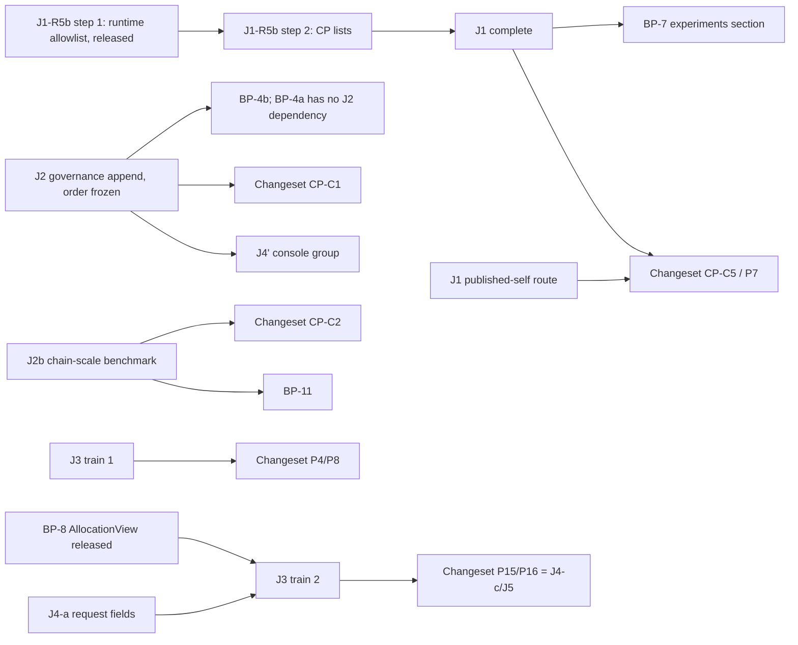

# Shared substrate: Branchpoint × Changeset (joint plan)

**Status:** APPROVED by owner (2026-10-31); consolidated 2026-11-01 (Branchpoint D10). Cross-repo issues filed (see `../PROGRESS.md`).

**Owners:**
- Branchpoint: `seam-experiments` session. It writes this file.
- Changeset: `seam-changesets` session. It reviews this file.

**Master plans:**
- Branchpoint: [`../branchpoint.md`](../branchpoint.md)
- Changeset: [`seam-changesets/plans/changeset.md`](https://github.com/zer07labs/seam-changesets/blob/main/plans/changeset.md)

**Companion:** [`holdout-via-changeset.md`](holdout-via-changeset.md), the interface plan for holdout.

## Why this file exists

Branchpoint and Changeset are separate products with separate master plans, but they write to the same
**append-only or ordered** surfaces. This file holds **only** those shared surfaces, so neither plan renumbers the
other or breaks its goldens.

Everything else stays in its own master plan:
- **Changeset only:** store, adapters, staging and apply worker (P0–P16 except the joint phases).
- **Branchpoint only:** estimators, allocation core, lifecycle (BP-1, BP-3, BP-5, BP-9..BP-12, BP-15).

## Review findings this plan resolves

| # | Finding | Found by | Resolution |
|---|---|---|---|
| C1 | Branchpoint's bucket salt rode in the signed tenant document, which Changeset's worker verifies inside the customer's cluster. | Changeset | J1-R1: no secret in the tenant document. The salt is derived inside the runtime (D6). |
| C4 | Both plans append to `GOV_KINDS`, add an `ApprovalMachine` instance, amend `governance-events.md`, pin kinds in the console, add hub golden groups, and need SDK and `seam-mcp-common` releases. | Both | J2 and J3 serialise them. |
| C5 | The runtime refuses a whole tenant document for a structurally malformed `experiments` section; Changeset's verifier must not stall on it. | Changeset | J1-R4 tolerant readers, backed by a vector. |
| B4 | `remove_sections` is allowlisted in five code sites across two repos; the runtime refuses the whole snapshot on an unknown name. | Fable | J1-R5b names every site and orders runtime → CP → publish. |
| B5 | J2 never enumerated Branchpoint's kinds. | Fable | J2 enumerates all 18 in frozen order. |

## J1 — Tenant-snapshot section convention + verification vectors

- **Status:** TODO
- **Repos:** seam-runtime (removable-sections allowlist first, spec text), seam-control-plane (builder, validation,
  `published-self`), seam (`docs/design` pointer).
- **Consumed by:** Branchpoint BP-7 (`experiments`); Changeset CP-C5 (`changeset`) and P7 (Python verifier);
  learning `cp_governing.py` (reuses the vectors).
- **Depends on:** nothing for R1–R4, R6–R8 and the vectors. **R5b is internally ordered** (below), and BP-7 / CP-C5
  wait for the whole of J1.
- **Delivers:** a written convention every product-owned tenant-document section follows, plus one shared set of
  signed-snapshot and fleet-root verification vectors.
- **Rules:**
  - **R1 — No secret field, ever, in the tenant document.** Every consumer verifies it, including customer-cluster
    workers, so anything in it is effectively public to the tenant. (Retires Branchpoint's CP-minted salt; see D6.)
  - **R2 — Section key = owning product.** `learning`, `experiments`, `changeset`.
  - **R3 — Versioning.** Every section carries an integer `v`. An unknown `v` is refused by that section's own
    consumer and ignored by everyone else.
  - **R4 — Declared consumers.** `experiments`: runtime and learning. `changeset`: the Changeset worker only.
    `learning`: learning only (the runtime ignores it). Every consumer is a **tolerant reader** of every section it
    doesn't own: it verifies the signature over the whole document but never parses foreign sections.
  - **R5 — Absent semantics.**
    - `learning`: absent means **no unit auto-promotes**; it does not retain (`types.ts:115-120`).
    - `experiments`: absent means no experiments; it does not retain; it is **not removable** (nothing to revoke).
    - `changeset`: absent retains the last value (CP-18b ratchet). Never published ⇒ `default_route = review`.
  - **R5b — Revocation path for ratcheting sections, runtime first.** `changeset` becomes removable. The value
    `remove_sections` may carry is checked at **seven** sites (the one list: `../branchpoint.md` D10, `remove_sections`
    row), and the runtime refuses the **whole** snapshot on an unknown name (`seamd/src/registry.rs:366-400`). They change in this order, each step released before the
    next starts:
    1. **seam-runtime (release in prd, partner, aws-stg):**
       - `crates/seamd/src/registry.rs:350` `REMOVABLE_SECTIONS` → `["retention_schedule", "handling_policies", "changeset"]`;
       - `crates/seamd/src/governing/doc.rs:130-139`, the tenant-document rule that today admits only
         `Some(["handling_policies"])`, admits `["handling_policies"]`, `["changeset"]` and
         `["handling_policies", "changeset"]` (canonical order). The runtime does not consume `changeset`, so its
         removal is a no-op there; the change only stops the runtime refusing the document;
       - `docs/specs/multi-tenant-config.md` §1 table (`:23-24`) and §6 table (`:268`): tenant sections allowed add
         `learning`, `experiments`, `changeset` (fixing the existing drift: `learning` is emitted by the CP but
         missing from the table), and `remove_sections` allows `handling_policies` and/or `changeset`.
    2. **seam-control-plane (after step 1 is deployed):**
       - `src/types.ts:74` `RemovableSection` type and `:77` `REMOVABLE_SECTIONS` (append `"changeset"`; the output
         order is this list's order, `snapshot.ts:760`);
       - `src/snapshot.ts:206` `TENANT_REMOVABLE_SECTIONS` → `["handling_policies", "changeset"]` (enforced at
         `:225-230`);
       - `src/snapshot.ts:737` `REMOVABLE_SOURCE` gains `changeset: (s) => s.changeset !== undefined`
         (`removeSectionsSection`, `:766-804`, reads both);
       - `src/snapshot.ts:779-782`, the validator's removable names, gains `changeset`;
       - the `removeSection` route (`src/http/routes/publish.ts:817, :865-875`) stops hard-coding
         `handling_policies`; a `changeset` removal also clears the CP-held staged `changeset` state (`:894, :910`);
       - `src/snapshot.ts:185-195` `TENANT_DOCUMENT_KEYS` → `[…, "policy_rules", "learning", "experiments",
         "changeset", "remove_sections"]`; the stray-key refusal at `:171` then admits them. Resolve first that
         `retention_schedule` is emitted by `buildSnapshot` (`:150`) but absent from the list (it is root-only, so
         confirm `buildSnapshot` never emits it for a tenant).
    3. **Publish:** only after step 2 is deployed may any publish carry `remove_sections: ["changeset"]`.
    ```mermaid
    flowchart LR
      R1[runtime registry.rs:350 + doc.rs:131-139 + spec] -->|released 3 envs| C1[CP types.ts:74,77 + snapshot.ts:185-195,206,737]
      C1 -->|deployed| P1[first publish with remove_sections: changeset]
      C1 --> J1done[J1 complete]
      J1done --> BP7[BP-7]
      J1done --> CPC5[Changeset CP-C5 / P7]
    ```
    Revoking a single agent is a republish of the section without it (no dependency on R5b).
  - **R6 — Emission order.** Conditional spreads in `snapshot.ts` follow `learning` → `experiments` → `changeset`;
    no existing golden moves (#287 precedent).
  - **R7 — Consumer-first.** A section the runtime parses (`experiments`) ships its runtime parser one release before
    the CP builder can emit it.
  - **R8 — Hydration path.** A section held in its own state file (`experiments.json`, `changeset.json`) reaches the
    tenant document through a **workspace accessor threaded through every publish site**, following
    `ws.autoPromote`: `publish.ts:670, 897, 913, 1174, 1189`; `workspace.ts:379`. The store's
    `state.json`-only hydration helper (`storage.ts:1214`) is not used.
- **Tenant-safe document fetch.**
  - **Problem:** `/snapshots/published/{tenant}` (`src/http/server.ts:332`) is gated by one static
    `SEAM_CONFIG_FETCH_TOKEN` (`src/published-fetch-gate.ts:5,23`) that reads every tenant's document; it must never
    enter a customer cluster.
  - **Fix:** `GET /api/control-plane/snapshots/published-self` returns the caller tenant's own signed bytes, plus a
    tenant-safe fleet-root read. Authenticated by a tenant-scoped CP machine credential carrying the new capability
    **`snapshots:read-self`**: tenant-confined (`TENANT_CONFINED_*`, `src/tenant-authority-guard.ts`), tenant
    resolved from the credential binding (never a path parameter), grants no other read, excluded from
    `BREAK_GLASS_CEILING` (`src/identity.ts`), listed in `contract/route-inventory.json` and `src/openapi.ts`, with
    its `requiredCapability` row (`src/identity.ts:1080`).
  - **Order:** before CP-C5 and Changeset P7.
- **Files (seam-control-plane):** `src/types.ts`; `src/snapshot.ts`; `src/http/routes/publish.ts`
  (`refuseCpHeldConfigFields` `:97`, called at `:658, 788, 992`, plus the six publish sites: `publish.ts:670, :897,
  :913, :1174, :1189` and `src/http/workspace.ts:379`); root-refused writes in
  `src/http/routes/roster.ts` (pattern `:70`, `:300`); `src/http/workspace.ts`; `src/http/server.ts` and
  `src/published-fetch-gate.ts` (`published-self`); `fixtures/registry_snapshot_*_golden.json` unchanged, new goldens
  in one hub round; `fixtures/vectors/tenant-snapshot-*.json` (new); `contract/tenant-section-fields.json` (new).
- **Acceptance criteria:**
  1. A tenant with neither section produces byte-identical `state.json` and tenant document before and after.
  2. Both sections emitted together appear in R6 order; existing goldens don't move; new goldens land in one hub batch.
  3. Every field in every section schema is on `contract/tenant-section-fields.json`, each marked non-secret; a new
     field fails the lint until it is added in a reviewed change.
  4. The shared vectors verify in the runtime's verifier, learning's `cp_governing.py` and Changeset's Python verifier.
  5. The malformed-`experiments` vector is refused by the runtime and verifies cleanly in Changeset's verifier.
  6. A publish through each of the six publish sites carries the section (R8).
  7. `published-self` returns only the caller tenant's document; a tenant-A credential gets 403/404 for B; the static
     fetch token is refused on it.
  8. **R5b order:** a runtime build from step 1 installs a vector with `remove_sections: ["changeset"]` (no refusal);
     the pre-step-1 runtime refuses the same vector (proving the gate is real); the CP refuses to publish
     `remove_sections: ["changeset"]` before step 2.
  9. Removing the `changeset` section via `remove_sections` reverts the worker to `default_route = review` (vector).
- **Tests:** CP golden and byte-identity tests, the field allow-list lint, vector round-trips in three languages.
- **Docs:** a "Product sections" subsection in `seam-runtime/docs/specs/multi-tenant-config.md`; flag the contract
  change to `seam`.

## J2 — Governance append sequencing

- **Status:** DONE (verified from origin/main 2026-11-08, Branchpoint W0): seam-control-plane#585 + seam-runtime#1590.
- **Repos:** seam-control-plane, seam-console-ui, seam-runtime (docs), seam (golden hub).
- **Depends on:** nothing technical. It merges before either product emits a new kind (declare first, emit later),
  and **the order below is frozen before CP-C1 opens**: the console pins `GOV_KINDS` order-exact
  (`seam-console-ui/packages/contract/src/cp-drift.test.ts:491-492`) and `governance-reads.ts:108` echoes it.
- **Delivers:** one CP PR (seam-control-plane#581) that appends both families and declares the four new
  `ApprovalMachine` instances; one console PR that pins them.
- **Frozen append order** (after `"TENANT_MOVE_ABORTED"`, the last entry today, `src/governance.ts:179`; membership
  validated at `:681`). Naming follows `LEARNING_PROMOTION_SUBMITTED/APPROVED/REJECTED` (`:78-80`).
  1. `DECISION_POINT_REGISTERED`
  2. `DECISION_POINT_UPDATED`
  3. `DECISION_POINT_TIER_CHANGE_SUBMITTED`
  4. `DECISION_POINT_TIER_CHANGE_APPROVED`
  5. `DECISION_POINT_TIER_CHANGE_REJECTED`
  6. `DECISION_POINT_RETIRED`
  7. `EXPERIMENT_DRAFTED`
  8. `EXPERIMENT_SHADOW_STARTED`
  9. `EXPERIMENT_LIVE_SUBMITTED` (Shadow→Live and Paused→Live; `detail.from`)
  10. `EXPERIMENT_LIVE_APPROVED`
  11. `EXPERIMENT_LIVE_REJECTED`
  12. `EXPERIMENT_PAUSED` (`detail.reason ∈ {manual, guardrail_breach, evidence_stale}`)
  13. `EXPERIMENT_CONCLUDED` (`detail.reason ∈ {sample_target, max_duration, boundary, insufficient_units}`)
  14. `EXPERIMENT_VERDICT_SUBMITTED` (`detail.verdict ∈ {promote, stop, extend}`)
  15. `EXPERIMENT_VERDICT_APPROVED`
  16. `EXPERIMENT_VERDICT_REJECTED`
  17. `EXPERIMENT_CLOSED`
  18. `EXPERIMENT_EVIDENCE_REFUSED`
  19. `CHANGESET_SUBMITTED`
  20. `CHANGESET_APPROVED`
  21. `CHANGESET_REJECTED`
  22. `CHANGESET_SIGNER_ENROLLED`
  23. `CHANGESET_SIGNER_ROTATED`
  24. `CHANGESET_SIGNER_REVOKED`
  25. `CHANGESET_POLICY_SUBMITTED`
  26. `CHANGESET_POLICY_APPROVED`
  27. `CHANGESET_POLICY_REJECTED`

  Kinds 1–8 are first emitted by BP-4b, 9–17 by BP-11, 18 by BP-5, 19–24 by CP-C1, 25–27 by CP-C5 (the two-person
  `changeset`-section publish; seam-control-plane#581, seam-changesets#7).
  `ApprovalMachine` instances after the existing three (Policy `approvals.ts:544,564`, Learning
  `learning-approvals.ts:39`, Roster `roster-governance.ts:38`): `DecisionPointTierApprovals` (#4, BP-4b),
  `ChangesetApprovals` (#5, CP-C1), `ChangesetPolicyApprovals` (#6, CP-C5, over the `CHANGESET_POLICY_*` kinds: an
  `ApprovalMachine` is built over one kinds set, `approvals.ts:564`), `ExperimentLifecycleApprovals` (#7, BP-11). Instance order is prose only; no code
  enumerates them.
- **Capabilities.** `experiments:write|approve`, `decision-points:read|write|approve` (`decision-points:read|write`
  land earlier, in BP-4a, ahead of J2, with their own console pin update; J2 adds only `approve`), `snapshots:read-self` (J1);
  `changesets:decide|submit|read|signers` (Changeset). Every new write capability goes into
  `TENANT_CONFINED_WRITE_CAPABILITIES` (`tenant-authority-guard.ts:77`); none into `BREAK_GLASS_CEILING`. One
  identity-matrix update and one `route-inventory.json` update.
- **Separation of duties (Changeset allow-list additions).** When an agent AID is added to `changeset.agents`, the
  staging event records the **adder** and the publish records the **publisher**; CP-C1 refuses approval of that
  agent's change sets by either. SoD binds **only to CP-resolved principals**: the submitter credential, the adder,
  the publisher, and the approver as a user. The staging-asserted `initiated_by` is display-only, never an SoD input.
- **Two-person publish for the Changeset trust surface.** Any publish that changes the `changeset` section, or any
  registry entry for an AID listed in `changeset.agents`, requires CP two-person approval through
  `ChangesetPolicyApprovals` (kinds 25–27); the stager or publisher can't also approve it. Enforced at the publish site (J1-R8).
- **`governance-events.md` amendment.** One PR to `seam-runtime/docs/specs/governance-events.md` lists all 27.
- **Console.** One update to `packages/contract/src/governance.ts` and the `cp-drift` test.
- **Golden hub (seam).** One batch adds Branchpoint's groups and the `changeset_*` groups.
- **Acceptance criteria:**
  1. `GOV_KINDS` ends with exactly the 27 kinds above in that order (array-equality test), and none is emitted yet
     (grep test for each).
  2. The console drift test is green against the CP commit, and fails if any two of the 27 are swapped.
  3. The identity matrix covers every new capability per role.
  4. A single-actor publish that changes `changeset` is refused; the same publish with a distinct approver succeeds.
  5. `golden_gate.py` passes in every vendoring repo after the single hub batch.

## J2b — Governance-chain scale guard

- **Status:** TODO. **Must land before** CP-C2 (Changeset) and BP-11 (Branchpoint lifecycle).
- **Problem:** every append re-validates and `structuredClone`s the whole chain (`storage.ts:590-601`), rewrites
  `governance.json` in full (`file-store.ts:902-907`), runs `chain.verify()` over every event (`governance.ts:478`),
  and rewrites the anchor history (`workspace.ts:216-220`). Total I/O is quadratic.
- **Rule for both products:** only decision events go on the chain, each carrying a digest. Attestations (CP-C3),
  evidence (BP-5) and receipt summaries (CP-C6) live in their own append files from day one.
- **Benchmark:** 50k events per tenant, ceiling recorded, before CP-C2 and BP-11. If it binds, chain segmentation
  becomes a CP phase ahead of both.
- **Acceptance criteria:** (1) the benchmark result (events/s and p99 append latency at 10k, 25k, 50k) is committed to
  `seam-control-plane/docs/`. (2) a test proves evidence and attestation appends do not touch `governance.json`.

## J3 — SDK + seam-mcp-common release trains (two trains)

- **Status:** PARTIAL (verified from origin/main 2026-11-08, Branchpoint W0): train 1 seam-sdk#331 DONE; train 2 TODO.
- **Repos:** seam-runtime (protos), seam-sdk, seam-mcp, seam-adapters (`seam-agent-core` lock-step).
- **Two trains.** Changeset P4/P8 must not wait for Branchpoint protos.
  - **Train 1** — `run_decision(contexts=, context_refs=)` (no proto change; `seam.proto:367-405`), plus
    `report_outcome(reward=, metrics=, observed_at=)` and a `ServerInfo.wire_features` accessor (runtime OI-R6)
    **if** BP-2c and OI-R6 have shipped by train 1's date (otherwise all of them move to train 2 together).
    Train 1 is the target: seam-connectors plan 47 P12 (outcome ingestion go-live) blocks on these, and train 2 also
    waits on BP-8 and J4-a.
    Followed by `seam-mcp-common` bump 1 (0.62.0 → train-1 SDK). Needed by Changeset P4/P8.
  - **Train 2** — `run_decision(decision_point=, allocation_unit=)` (`RunDecisionRequest` 9/10, J4-a);
    `DecisionRecordView.allocation` (13, `AllocationView`, `Allocation`, `AllocationAvailability`, BP-8) and
    `DecisionRecordView.decision_point` (14, J4-a); and the BP-2 fields (`reward`, `metrics`, `observed_at`,
    `wire_features`) if not in train 1. Followed by
    `seam-mcp-common` bump 2. Needed by Changeset P15/P16 (J4-c/J5) and Branchpoint consumers.
- **Depends on:** train 1 — nothing (BP-2c optional); train 2 — BP-8 released and J4-a merged.
- **Acceptance criteria:**
  1. Each train updates `contract/field-manifest.txt` (and `rpc-manifest.txt` if needed) once, listing exactly its
     fields.
  2. Requests from callers that omit every new argument are byte-identical to the previous release (golden).
  3. Python/TS parity tests pass.
  4. The `seam-mcp-common` secret-scan harness passes after each bump.
  5. Each train has its own `COMPATIBILITY.md` row naming the runtime release it is locked to.

## J4' — Console Operations › Governance group

- **Status:** TODO
- **Repo:** seam-console-ui
- **Depends on:** J2
- **Delivers:** `apps/operations/lib/nav.ts` Governance entries for **Experiments** (BP-6) and **Change sets**
  (Changeset P10/P12), both using `packages/ui/src/governance/policy-decision.tsx`.
- **Glossary rule:** observe ≠ shadow. "Observe" is a Changeset route that applies and records `would_route`;
  "shadow" is Branchpoint's offline replay. Console copy never uses "shadow" for observe; the BP-6 vocabulary lint
  checks it.
- **Acceptance criteria:** (1) `nav.test.ts` pins both entries in one change. (2) the vocabulary lint fails on
  "shadow" in any changeset copy key.

## Ordering



J1 steps 1–2, J2 and J2b can start now. J3 train 2 waits for its protos.

## Review

- 2026-10-31: owner approval; Fable on D6 and the J4-a request fields (REVISE, applied).
- 2026-11-01: CP, learning and connectors repo reviews (applied); Changeset Fable review (H6, SoD; applied).
- 2026-11-01: Fable deep review → Branchpoint consolidation (B4 five-site order, B5 kinds, M8 two trains).
