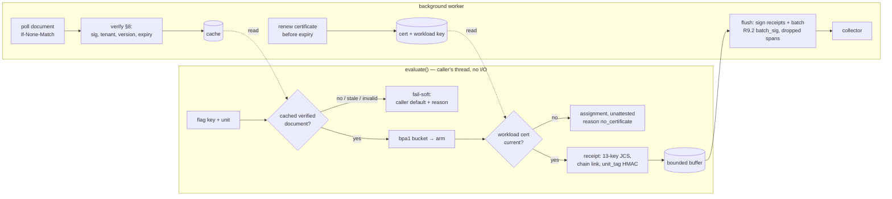

# Branchpoint SDKs — architecture

How the Python (`sdk/python`) and TypeScript (`sdk/ts`) SDKs are built. The wire shapes are normative in
[`docs/spec/branchpoint-v1.md`](../spec/branchpoint-v1.md) (§8 SDK document, §9 upload batch, §10 SDK-key token);
this page explains the moving parts and their failure semantics, and does not restate the shapes. Each SDK's README
has the API, the configuration, and the full `stats()` key list (identical in both).

## Two paths

`evaluate()` is synchronous and makes **zero network calls** (asserted by `sdk/python/tests/test_no_network.py` and
`sdk/ts/test/no_network.test.ts`). All I/O
runs on a background worker: a thread in Python, guarded promise chains with unref'd timers in Node.

- **Signing happens at flush, not at evaluate.** Evaluate builds the receipt and links the chain (HMACs plus a SHA-256
  chain hash); each receipt's Ed25519 signature and the batch signature are made at flush, so the hot path stays at p99 < 50 µs (perf tests in both suites).
- **The CP routes** (document, certificate) carry a fresh `seam-mc+jwt` SDK-key token. The collector route never
  sees it, and no transport follows a redirect (R10.4–R10.5).
- **One workload key per client**, reused across certificate renewals. A receipt chain is per
  (cert_digest, experiment_id), so a renewal starts new chains, and the old ones end cleanly.

## Failure semantics

Nothing on the evaluate path throws. Every failure picks a row in the spec's fail-soft order, returns the caller's
default where there is no verified assignment, and is counted in `stats()`.

| Situation | evaluate returns | counted as |
|---|---|---|
| no document yet, refused document, stale past `max_staleness` | caller default | `evaluations.config_unavailable`, `document_failures`; `document_refusal` holds the last refusal reason |
| experiment invalid in an otherwise good document | caller default for that flag only | `evaluations.config_invalid` |
| no current certificate | the assignment, without a receipt | `evaluations.no_certificate` |
| receipt buffer full | the assignment; receipt dropped and declared as a gap | `evaluations.receipt_dropped`, `receipts_dropped_overflow` |
| a batch fails to build or sign | n/a (worker) | declared gap, `receipts_dropped_error` |
| collector 4xx (except 401/403/408/429) / malformed 200 or 3xx (never followed) / 5xx, 401, 403, 408, 429 | n/a (worker) | rejected / whole batch retried / backed off and retried |

A receipt is never silently lost: it is uploaded, rejected by the collector, or declared in a `dropped` span that the
collector's verifier sees as the matching gap. `close()` flushes within a deadline and counts what is still buffered as dropped (a send already in flight at the
deadline settles on its own and is not counted twice).

## Privacy

The unit id never leaves the process. Receipts carry `unit_tag` (HMAC under the experiment salt), and outcomes refer to
receipts by id. The OpenFeature providers put only receipt evidence in `flag_metadata`. The OTel hook never emits the
targeting key, and drops any attribute equal to it. Sentinel tests in both suites assert this.

## OpenFeature and OTel

`seam_branchpoint.openfeature` and `@zer07labs/seam-branchpoint/openfeature` wrap one client each (a provider owns its
client). Reasons map to OpenFeature `SPLIT` / `DISABLED` / `DEFAULT` / `ERROR`, with the table in each README. Provider
events (READY, STALE, CONFIGURATION_CHANGED) follow the actual cache state. Both OpenFeature and OTel are optional
dependencies: the core imports neither.

## Conformance

`tests/conformance/conformance.py` runs both SDKs on the same inputs, asserts identical evaluations and receipt bytes,
and feeds each SDK's uploaded batches to the unchanged reference verifier (`reference/python/branchpoint_ref.py`).
